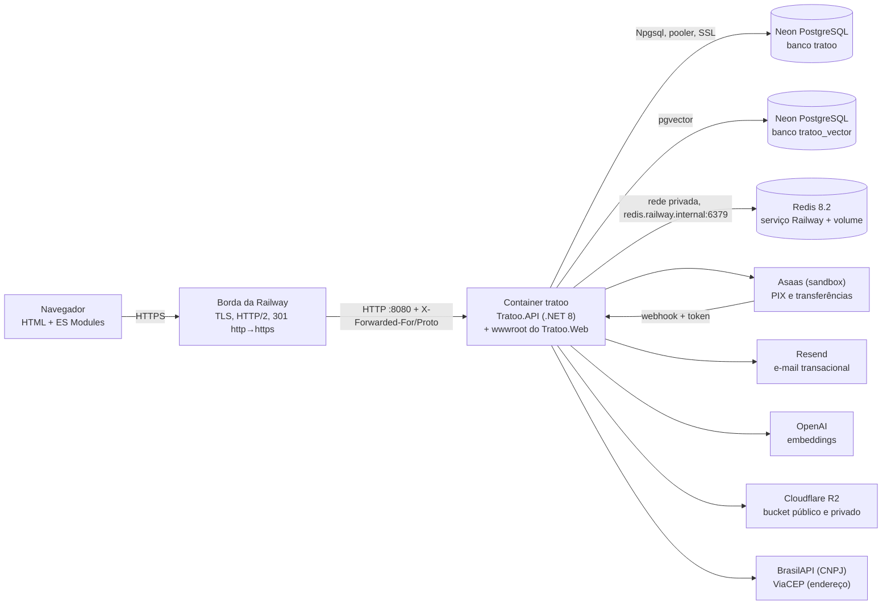
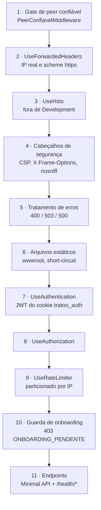
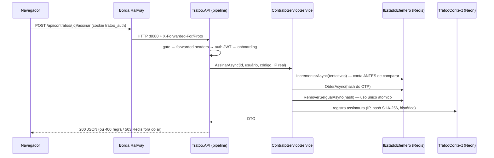
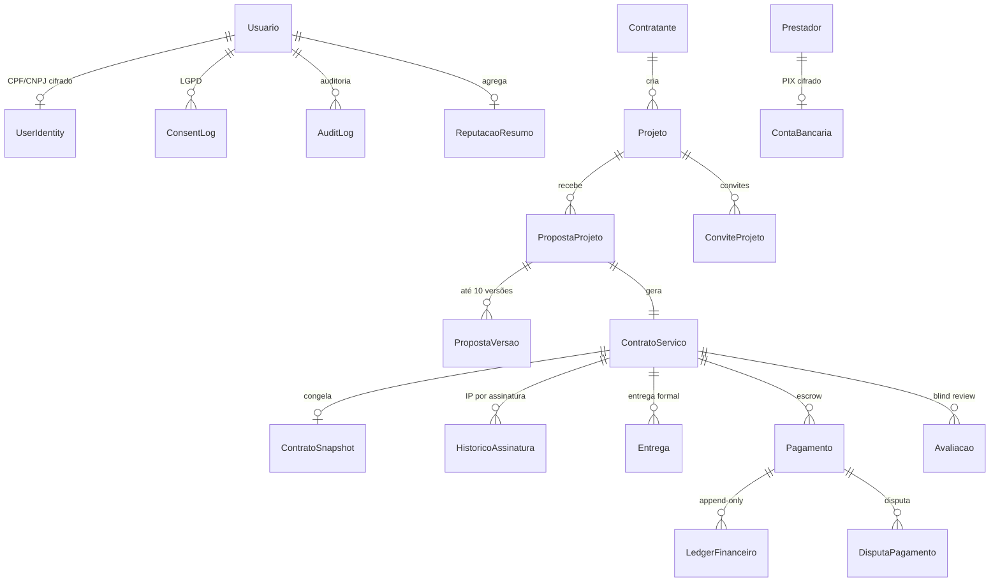
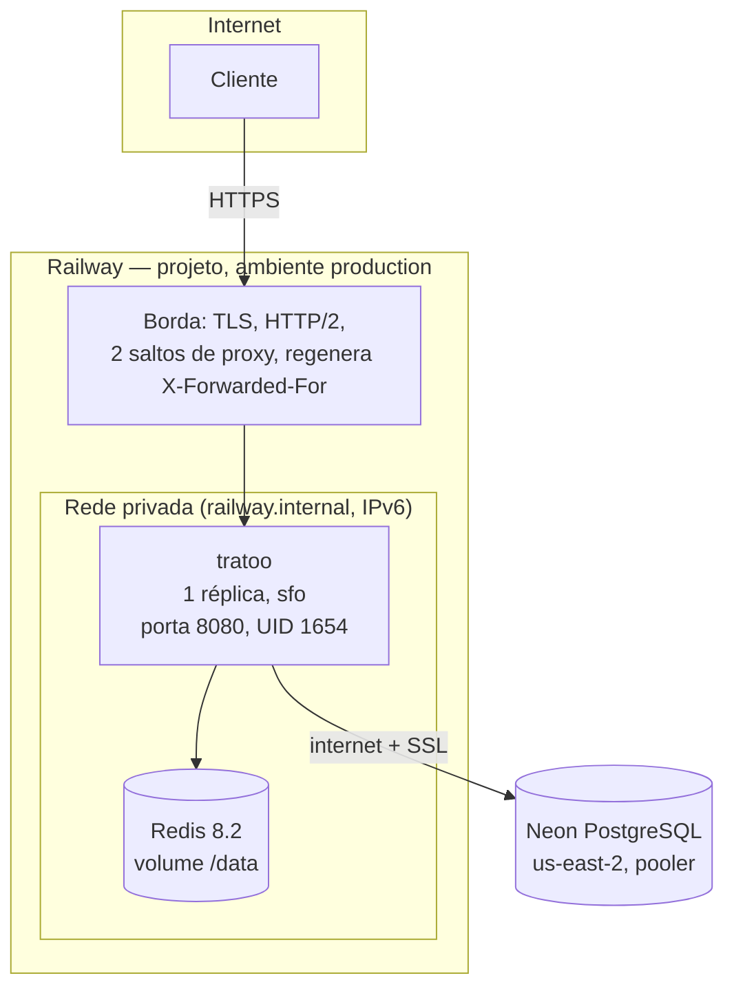
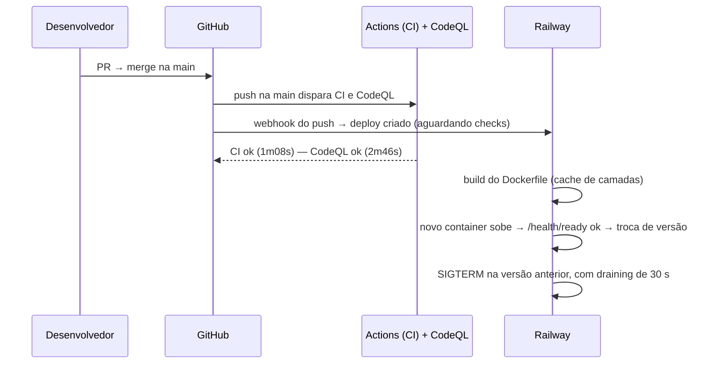
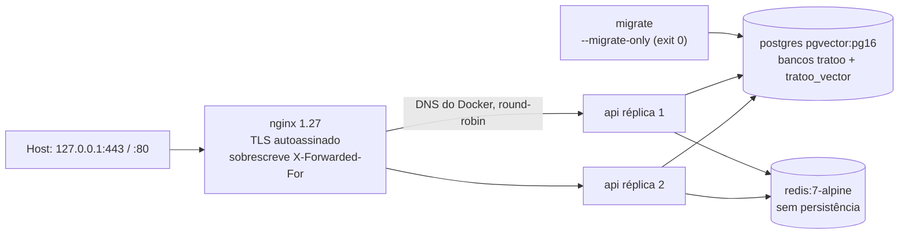
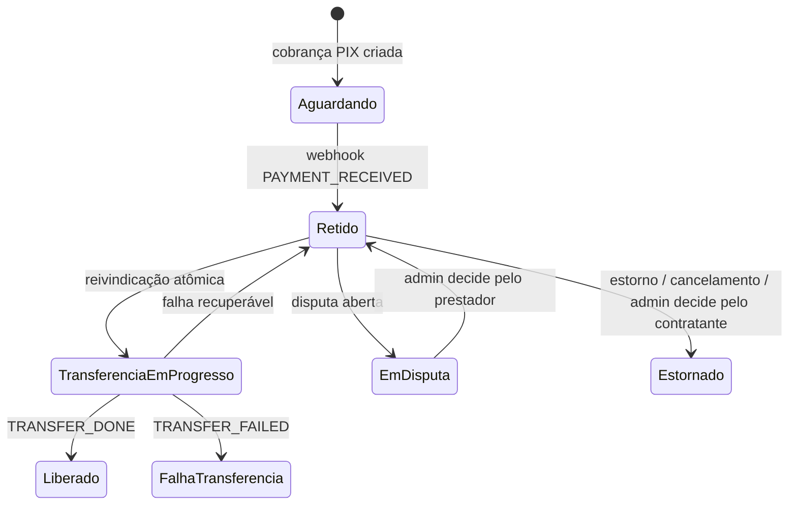

# Tratoo — Arquitetura Técnica

> Fonte técnica principal do projeto. Descreve o Tratoo **como ele é hoje**, e não como
> deveria ser. O documento foi reconstruído a partir de uma auditoria do código, do
> histórico Git (agosto a outubro de 2026), da suíte de testes e da configuração de produção
> na Railway.
>
> **Estado de referência:** branch `main` no commit `3389b87` (merge do PR #15). É o commit em
> produção: primeiro no deploy `d0e04f31` (30/10/2026, 02:22 UTC, que é 29/10, 23:22 no horário de
> Brasília) e, depois da correção do health check de deploy ([§4.3](#43-railwaytoml--configuração-efetiva)),
> no deploy `b40f6558` (30/10, 04:38 UTC).
> **Auditoria:** 29 e 30/10/2026. O método e os limites estão no [§1.5](#15-como-ler-este-documento).

---

## Sumário

1. [Visão geral](#1-visão-geral)
2. [Arquitetura da aplicação](#2-arquitetura-da-aplicação)
3. [Banco de dados e persistência](#3-banco-de-dados-e-persistência)
4. [Infraestrutura e deploy](#4-infraestrutura-e-deploy)
5. [Segurança](#5-segurança)
6. [Concorrência e escalabilidade](#6-concorrência-e-escalabilidade)
7. [CI/CD e qualidade](#7-cicd-e-qualidade)
8. [Integrações externas](#8-integrações-externas)
9. [Evolução e decisões arquiteturais](#9-evolução-e-decisões-arquiteturais)
10. [Limitações e próximos passos](#10-limitações-e-próximos-passos)
- [Apêndice A — Matriz de rastreabilidade](#apêndice-a--matriz-de-rastreabilidade)
- [Apêndice B — Documentos complementares](#apêndice-b--documentos-complementares)

---

## 1. Visão geral

### 1.1 Objetivo e problema

O Tratoo é um marketplace de serviços. De um lado estão os **contratantes**, que publicam
projetos; do outro, os **prestadores** (freelancers), que enviam propostas. O problema central
é a falta de confiança numa negociação entre desconhecidos: quem entrega teme não receber, e
quem paga teme não receber o serviço.

A plataforma ataca esse problema com quatro mecanismos:

- **Pagamento em garantia (escrow):** o valor pago via PIX fica retido até a entrega ser aprovada
  ou o prazo de liberação automática vencer.
- **Contrato digital:** cada parte assina com um código enviado por e-mail, e o conteúdo é selado
  com hash SHA-256.
- **Reputação:** avaliação às cegas (*blind review*) e verificação de identidade (CPF/CNPJ).
- **Disputas:** mediação feita por um administrador quando há desacordo.

A busca semântica com embeddings (vetores numéricos que representam o significado de um texto)
aproxima projetos e prestadores mesmo quando eles descrevem a mesma coisa com palavras
diferentes.

É um projeto de estudo e portfólio que está publicado em produção. **Os pagamentos rodam no
ambiente de sandbox do Asaas:** a URL configurada na Railway é a de sandbox, então nenhuma
transação real acontece.

### 1.2 Funcionalidades principais

Os rótulos de status seguem a legenda do [§1.5](#15-como-ler-este-documento).

| Área | O que existe | Status |
|---|---|---|
| Cadastro e identidade | Cadastro em duas etapas, com o código de e-mail guardado em estado efêmero. Onboarding obrigatório. CPF/CNPJ cifrado e validado (o CNPJ via BrasilAPI). Consentimento e auditoria (`ConsentLog`, `AuditLog`). | No código |
| Login | JWT (token assinado que carrega a identidade do usuário) em cookie `HttpOnly`, MFA opcional por e-mail, tempo de resposta equalizado contra enumeração de contas. | No código; o OTP de MFA tem testes |
| Projetos e propostas | Rascunho e publicação de projetos, busca com filtros, convites, proposta com até 10 versões de negociação, chat por polling (3 s com a aba ativa, 30 s em segundo plano). | No código |
| Contratos | Gerados a partir da proposta aceita. Assinatura com OTP (10 min, 5 tentativas), hash SHA-256, snapshot imutável e PDF (QuestPDF) num bucket privado, com URL pré-assinada de 15 min. | No código; o OTP de assinatura tem testes |
| Pagamento e escrow | Cobrança PIX no Asaas, webhook idempotente, ledger imutável, liberação manual ou automática (prazo de entrega + 7 dias), disputa, estorno e limite diário de R$ 5.000 por contratante. | No código; a liberação concorrente tem testes |
| Entrega | Entrega formal com anexos no R2 privado (URL de 30 min), aprovação ou pedido de ajustes. | No código |
| Avaliações | Blind review com janela de 7 dias e reputação agregada (`ReputacaoResumo`). | No código; a finalização concorrente tem testes |
| Busca semântica | Embeddings OpenAI de 1536 dimensões no pgvector, com top-100 por cosseno, score composto calculado em C# e fallback por palavras-chave. | No código |
| Administração | Resolução de disputas e diagnóstico de rede (`/api/diagnostico/rede`), restritos ao papel Admin em produção. | No código |

As regras de negócio **não têm testes automatizados de ponta a ponta**. A suíte cobre a
infraestrutura e os pontos de concorrência indicados acima ([§7.2](#72-testes)). Esta auditoria
também não executou os fluxos de negócio em produção.

### 1.3 Tecnologias e versões

| Camada | Tecnologia | Versão verificada |
|---|---|---|
| Runtime | .NET 8 (SDK fixado no `global.json`) | SDK `8.0.408`; runtime de produção `8.0.33` (inspeção do container) |
| API | ASP.NET Core Minimal API | 8.0 |
| ORM | EF Core + Npgsql | EF Core `9.0.10`; `Npgsql.EntityFrameworkCore.PostgreSQL` `9.0.4` |
| Banco | PostgreSQL gerenciado (Neon) com pgvector | `Pgvector.EntityFrameworkCore` `0.3.0`; a versão do servidor Neon não foi verificada (o compose usa `pgvector/pgvector:pg16`) |
| Cache e estado compartilhado | Redis + StackExchange.Redis | Servidor `8.2.11` em produção; cliente `2.13.17`; `redis:7-alpine` no compose e no CI |
| Autenticação | JWT Bearer, BCrypt | `Microsoft.AspNetCore.Authentication.JwtBearer` `8.0.0`; `BCrypt.Net-Next` `4.0.3` |
| E-mail | SDK do Resend (HTTPS) | `Resend` `0.8.0` |
| Storage | AWS SDK S3 apontado para o Cloudflare R2 | `AWSSDK.S3` `3.7.100.0` |
| PDF | QuestPDF (licença Community) | `2025.1.0` |
| Logs | Serilog (console + arquivo) | `Serilog.AspNetCore` `8.0.1` |
| Documentação da API | Swashbuckle (só em Development) | `6.5.0` |
| Frontend | HTML/CSS/JS sem framework, Web Components, ES Modules, Bootstrap 5.3 vendorizado | — |
| Testes | xUnit + TestServer + Docker CLI | xUnit `2.9.2`; `Microsoft.AspNetCore.TestHost` `8.0.11` |
| Imagem | `mcr.microsoft.com/dotnet/sdk:8.0` → `aspnet:8.0` (Debian 12) | — |

### 1.4 Visão geral da arquitetura



Um único processo .NET serve **a API e o frontend estático**. Quatro dependências entram no
caminho do usuário: o PostgreSQL (dois bancos no mesmo servidor Neon), o Redis (estado
efêmero compartilhado e rate limiting), o Asaas (pagamentos) e o Resend (e-mails). A OpenAI e o
R2 só são usados em fluxos específicos: busca/indexação e upload/download, respectivamente.

### 1.5 Como ler este documento

**Legenda de status**

| Rótulo | Significado |
|---|---|
| **Confirmado** | O código existe e o funcionamento foi comprovado por teste automatizado, execução observada ou verificação em produção. |
| **No código** | O código existe, mas não há comprovação de funcionamento em produção. |
| **Configurado** | Há configuração na Railway (variável, serviço ou gatilho). Isso não prova uso. |
| **Planejado** | Aparece em roadmap, documento ou comentário, mas não foi implementado. |
| **Removido** | Existiu e não faz parte da arquitetura atual. |
| **Divergência** | Documentação, comentário ou arquivo de configuração afirma uma coisa, e o estado real é outro. |

**Fontes de evidência**, da mais forte para a mais fraca:

1. Comportamento observado: health checks públicos, logs de deploy, `railway ssh` e `redis-cli`
   apenas para leitura, e a suíte de testes (238/238 aprovados localmente com Docker, também verdes
   no CI).
2. Configuração da Railway lida pela CLI 5.58 e pela API GraphQL, só com *queries*: serviços,
   manifestos de deploy, gatilhos e **nomes** de variáveis (nunca os valores).
3. Código da `main` em `3389b87`.
4. Histórico Git e PRs (`git log`, `git show`, API do GitHub).
5. Documentos anteriores, usados apenas como pista.

**O que não foi verificado:** o console do Neon (plano, versão do Postgres, backups e PITR); o
conteúdo de `__EFMigrationsHistory` em produção; os painéis do Asaas, do Resend, do R2 e da
OpenAI; e a execução de ponta a ponta dos fluxos de negócio em produção.

---

## 2. Arquitetura da aplicação

### 2.1 Projetos da solution

| Projeto | Tipo | Responsabilidade real |
|---|---|---|
| [`Tratoo.API`](../Tratoo.API) | ASP.NET Core (Minimal API) | Host HTTP. Contém `Program.cs` (composição e pipeline), 18 grupos de endpoints em `EndPoints/*Extensions.cs` (cerca de 100 rotas), `Infrastructure/` (proxy, rate limiting, Redis, health checks, porta, encerramento, modos de linha de comando), 5 `BackgroundServices` e os DTOs de entrada em `Requests/`. |
| [`Tratoo.Domain`](../Tratoo.Domain) | Class library | Regras de negócio organizadas por feature (`Features/<Feature>/{DTOs,Repositories,Services,Validators}`), entidades EF (`Domain/Models`), enums, `TratooContext`/`VectorContext` e a migration. **Também contém as implementações das integrações** (Asaas, R2, OpenAI, Resend, BrasilAPI) e a criptografia (`Features/Shared/DataProtector.cs`). |
| [`Tratoo.Web`](../Tratoo.Web) | Projeto Web sem código de servidor | Só o `wwwroot` (35 HTML, 31 JS, 24 CSS). Na imagem Docker, ele é copiado para `/Tratoo.Web/wwwroot` e servido pela API. |
| [`Tratoo.Tests`](../Tratoo.Tests) | xUnit | 238 testes: 206 de unidade e de host em memória (TestServer) e 32 de integração com Postgres e Redis reais via Docker. |

Observações sobre a organização real:

- **Não existe projeto `Tratoo.Shared`**, nem no histórico. O código compartilhado fica em
  `Tratoo.Domain/Features/Shared/`: `DataProtector`, `PasswordHasher`, `SecureHasher`,
  validadores de CPF e CNPJ, `PaginadoDTO` e `UsuarioFactory`.
- **`Tratoo.Domain` não é um domínio "puro".** Ele depende de EF Core, Npgsql, AWS SDK, SDK do
  Resend e QuestPDF. A troca de provedor é possível por interfaces (`IAsaasGatewayService`,
  `IArquivoStorageService`, `IR2PrivateStorageService`, `IEmailService`, `IEmbeddingService`),
  mas as implementações ficam no mesmo assembly. É uma escolha de simplicidade: menos projetos
  e menos indireção, com mais acoplamento.
- O `Tratoo.Domain.csproj` ainda referencia `Azure.Storage.Blobs`, que **nenhum código usa**.
  É resíduo do antigo deploy no Azure (ver [§9.1](#91-linha-do-tempo)).

### 2.2 Modos de execução do binário

O mesmo `Tratoo.API.dll` tem quatro modos. Os três modos especiais são verificados **antes** de
criar o host web. Sem DI, Kestrel ou BackgroundServices, um desses processos nunca expira um
contrato nem libera um pagamento por engano.

| Comando | Quem usa | O que faz | Status |
|---|---|---|---|
| `dotnet Tratoo.API.dll` | Produção e compose | Sobe a API | **Confirmado** (produção) |
| `--healthcheck` | `HEALTHCHECK` do Dockerfile | Faz `GET /health/live` no próprio processo e sai com 0 ou 1 ([`SondaHealthCheck`](../Tratoo.API/Infrastructure/SondaHealthCheck.cs)) | **Confirmado** (testes) |
| `--migrate-only` | Serviço `migrate` do compose; `preDeployCommand` (preparado, inativo) | Aplica as migrations do `TratooContext` e o schema vetorial, depois sai ([`ModoMigracao`](../Tratoo.API/Infrastructure/ModoMigracao.cs)) | **Confirmado** (testes rodam o processo real); na Railway, **Planejado** |
| `--recifrar-dados [--aplicar]` | Rotação da chave de dados | Gera o relatório e regrava os valores cifrados com a chave nova ([`ModoRecifragem`](../Tratoo.API/Infrastructure/ModoRecifragem.cs)) | **Confirmado** (testes de integração; usado em produção em 24/10) |

### 2.3 Pipeline de middlewares

A ordem abaixo é a real em [`Program.cs`](../Tratoo.API/Program.cs). Ela importa porque cada
etapa depende do que as anteriores já resolveram.



- **1 e 2 vêm antes de tudo.** O HSTS só é emitido quando `Request.IsHttps` é verdadeiro. O rate
  limiter particiona por IP, e a auditoria grava o IP. Tudo isso precisa do IP e do scheme já
  corrigidos ([§5.2](#52-ip-real-do-cliente-e-trust-boundary)).
- **5 vem antes dos endpoints.** Em geral, os endpoints não precisam de `try/catch`: lançam
  `NegocioException` (vira 400) ou `ServicoIndisponivelException` (vira 503 + `Retry-After: 5`). Qualquer outra
  exceção vira 500 genérico, com log ([`TratamentoErrosSetup`](../Tratoo.API/Infrastructure/TratamentoErrosSetup.cs)).
- **6 vem antes da autenticação.** Arquivos estáticos não passam por autenticação, rate limiting
  nem guarda de onboarding.
- **10 precisa de lista de isenções.** O cookie vai em toda requisição same-origin, inclusive em
  login e cadastro. Por isso as rotas públicas e as sondas `/health/*` estão listadas em
  [`RotasIsentasOnboarding`](../Tratoo.API/Infrastructure/RotasIsentasOnboarding.cs).

### 2.4 Fluxo de uma requisição

Exemplo: validação de um OTP de assinatura de contrato, que passa pelo maior número de camadas.



### 2.5 Injeção de dependências

Todo o registro de dependências fica em `Program.cs`, sem frameworks de DI ou de mapeamento
externos.

- **Scoped:** os dois `DbContext`, os 16 repositórios e os serviços de domínio. Os
  BackgroundServices criam um escopo por rodada (`IServiceScopeFactory`), ou seja, um `DbContext`
  por execução.
- **Singleton:** `IConnectionMultiplexer` (Redis), `IEstadoEfemero`, `ProtecaoEstadoEfemero`,
  `RedeConfiavel`/`ForwardedHeadersSettings` e `EstadoChaveDados`.
- **HttpClient tipado** via `IHttpClientFactory`: Asaas, OpenAI (com `OpenAiLoggingHandler` e
  timeout de 30 s), BrasilAPI (`IdentidadeService`), ViaCEP (cliente nomeado) e Resend
  (`AddResend`, timeout configurável).
- **Estado estático:** o `DataProtector` é uma classe estática configurada uma vez na subida, com
  as chaves valendo para o processo inteiro. Os serviços de domínio a chamam diretamente.
- **Escolha por configuração:** `AddTratooEstadoEfemero` registra a implementação em memória ou
  a do Redis conforme `Redis:ConnectionString` ([§6.2](#62-estado-efêmero-memória--redis)).

### 2.6 Autenticação e autorização

- **Token:** JWT HMAC-SHA256 gerado pelo `JwtService`, com validade em `Jwt:ExpirationHours`
  (padrão 8 h). A validação confere emissor, audiência, assinatura e validade, com
  `ClockSkew = TimeSpan.Zero` (nenhuma tolerância de expiração).
- **Transporte:** cookie `tratoo_auth` com `HttpOnly` (JavaScript não lê o token), `Secure` fora
  de Development, `SameSite=Strict` e expiração de 8 h. O `JwtBearerEvents.OnMessageReceived` lê o
  token do cookie, não do header `Authorization`. O `SameSite=Strict` é a defesa contra CSRF, já
  que não há antiforgery.
- **Papéis:** as políticas `Prestador`, `Contratante` e `Admin` usam `RequireRole`, e o papel é
  emitido como `ClaimTypes.Role`.
- **Onboarding:** usuário autenticado com `perfilCompleto != "true"` recebe 403 fora das rotas
  isentas.
- **Senhas:** BCrypt. O login sempre executa o BCrypt (contra `PasswordHasher.DummyHash` quando o
  e-mail não existe) e completa até no mínimo 300 ms. Assim o tempo de resposta não revela se a
  conta existe ([`LoginService`](../Tratoo.Domain/Features/Auth/Services/LoginService.cs)).

### 2.7 Frontend

- HTML, CSS e JS **sem framework e sem bundler**, servidos pela API. A navegação é multipágina:
  cada `.html` é uma rota.
- **Web Components** em Light DOM (`<tratoo-header>`, `<tratoo-footer>`), registrados por
  `core/app.js`. Os scripts de página são **ES Modules** e inicializam via `onReady()`.
- `services/api.js` centraliza o `fetch` com `credentials: 'same-origin'`. O frontend nunca
  manipula o token.
- `utils/auth-guard.js` é um script **clássico e bloqueante** de propósito: esconde o `<body>`,
  consulta `/api/me` e redireciona para login ou onboarding antes de qualquer conteúdo protegido
  aparecer.
- **Bootstrap 5.3 vendorizado** em `assets/vendor/bootstrap/`, porque o CSP só permite scripts
  de `'self'`. A ponte de tema fica em `base/tratoo-theme.css`.
- `utils/dom.js` (`el()`/`svg()`, com `createElement` e `textContent`) é a forma segura de montar
  DOM com dados ([§5.8](#58-xss-codeql-e-csp)). Até agora é usada em 3 páginas.
- **Migração visual em andamento.** Ainda há cerca de 200 usos de `innerHTML` em 30 arquivos JS.
  O commit `32872b2` (PR #15) removeu o suporte a tema escuro nas páginas de perfil.
- As convenções estão em [`Tratoo.Web/wwwroot/CONTRIBUTING.md`](../Tratoo.Web/wwwroot/CONTRIBUTING.md).

---

## 3. Banco de dados e persistência

### 3.1 Topologia real

Hoje o motor é **somente PostgreSQL**. O SQL Server foi removido em 06/08/2026
([§9.2, D1](#d1--um-único-motor-postgresql-no-neon)).

| Banco | DbContext | Conteúdo | Schema |
|---|---|---|---|
| `tratoo` | `TratooContext` | Todo o negócio: 31 `DbSet` (usuários com herança TPT, projetos, propostas, contratos, pagamentos, ledger, disputas, avaliações, auditoria) | EF Core migrations |
| `tratoo_vector` | `VectorContext` | `prestador_embeddings` e `projeto_embeddings` (`VECTOR(1536)`) | SQL cru e idempotente no `VectorDbInitializer`, sem migrations EF |

Em produção, os dois bancos ficam **no mesmo servidor Neon**, na região `us-east-2`, e o acesso
passa pelo **endpoint pooler** (PgBouncer em modo *transaction*) com SSL. Isso foi verificado
pelas propriedades das connection strings, sem exibir valores.

A aplicação roda em `sfo` (us-west2). Essa distância cross-region pesa na latência: na chamada
ao `/health/ready` observada na auditoria, os checks de banco levaram 690 ms e 417 ms, contra
2 ms do Redis local. Um diagnóstico anterior mediu de 59 a 84 ms por handshake TCP entre o
container e o Neon ([`TRILHA2-DECISOES.md` §7.3](TRILHA2-DECISOES.md)).

**Por que dois bancos e não um?** A separação existe desde a época em que o vetorial era o único
Postgres. Ela foi mantida porque o compose reproduz exatamente a mesma topologia e expõe erros
que um banco único esconderia, como uma consulta no contexto errado ou uma extensão criada no
banco errado.

### 3.2 Migrations

| Item | Estado | Status |
|---|---|---|
| Migrations do `TratooContext` | Existe **uma** migration, `20260806232531_InitPostgres`, que substituiu as migrations do SQL Server | **Confirmado** (código) |
| Aplicação em produção | Manual, por `dotnet ef database update` a partir de uma máquina de desenvolvimento: o `TratooContextFactory` (design-time) lê o `appsettings.json` local. Isso foi inferido; o conteúdo de `__EFMigrationsHistory` não foi verificado | Não verificado |
| Modo `--migrate-only` | Validado no compose: banco vazio aplica a migration e o schema vetorial; segunda execução não faz nada; duas instâncias simultâneas se serializam pela trava do EF | **Confirmado** (compose + testes) |
| `preDeployCommand` na Railway | Comentado no `railway.toml`. Quando for ativado, terá de ir para as configurações do serviço, porque a Railway não lê o arquivo ([§4.3](#43-railwaytoml--configuração-efetiva)) | **Planejado** |
| `ConnectionStrings__MigrationConnection` | Não existe em produção. É pré-requisito do pre-deploy, porque o Neon recomenda conexão direta (sem pooler) para mudar schema | **Planejado** |

Detalhe técnico: no EF Core 9 com Npgsql 9.0.4, o `MigrateAsync` usa
`LOCK TABLE "__EFMigrationsHistory" IN ACCESS EXCLUSIVE MODE` dentro de uma transação. Como é
uma trava de transação, e não um *advisory lock* de sessão, ela funciona até pelo pooler.

### 3.3 pgvector, embeddings e busca semântica

- **Geração:** o `EmbeddingService` chama a OpenAI diretamente (`text-embedding-3-small`, 1536
  dimensões) por `HttpClient` tipado. Não existe serviço Python intermediário no repositório.
- **Quando indexa:** depois de salvar perfil, competências, experiências, certificações e
  portfólio, e ao publicar um projeto. O `ReindexacaoBackgroundService` reindexa tudo toda
  segunda-feira às 02:00 UTC, sob trava exclusiva ([§6.3](#63-backgroundservices)).
- **Índices:** HNSW (*Hierarchical Navigable Small World*, índice aproximado de vizinhos mais
  próximos) com `vector_cosine_ops`, criados por `CREATE INDEX IF NOT EXISTS` na subida, com os
  parâmetros padrão do pgvector.
- **Consulta em duas camadas** ([`BuscaSemanticaService`](../Tratoo.Domain/Features/IA/Services/BuscaSemanticaService.cs)):
  1. o pgvector devolve os 100 vetores mais próximos por distância de cosseno (`CosineDistance`
     em LINQ, traduzido para `<=>`);
  2. o C# aplica os filtros de negócio e calcula o score composto.
- **Score composto real, com soma 1,00:**

  | Fator | Peso |
  |---|---|
  | Similaridade semântica | 0,42 |
  | Habilidades (match de stack) | 0,22 |
  | Comprovação (competência ligada a portfólio ou certificação) | 0,12 |
  | Completude do perfil | 0,09 |
  | Avaliação média | 0,08 |
  | Contratos concluídos (teto de 20) | 0,04 |
  | Verificação de identidade (1,0 se nível ≥ 2; senão 0,3) | 0,03 |

  > **Divergência.** O comentário XML da própria classe e os documentos anteriores ainda falam
  > em "35/15/15/10/10/10/5", com um fator de "Disponibilidade". Os pesos acima estão no código
  > desde `b2aa430` (08/06/2026). Quem manda é o código.

- **Fallback:** se a OpenAI falhar, a busca cai para palavras-chave, mantendo os filtros. Sem
  `OpenAI__ApiKey`, a API sobe normalmente e a busca usa só palavras-chave.

### 3.4 Integridade e decisões de mapeamento

- **Dinheiro:** `decimal` com `HasPrecision(18, 2)`.
- **Enums como string** na maioria dos casos (`HasConversion<string>()`), para ficarem legíveis no
  banco. Também saem como string no JSON (`JsonStringEnumConverter`).
- **Datas padrão no banco:** `timezone('utc', now())`, sintaxe PostgreSQL que substituiu o
  `GETUTCDATE()` do SQL Server.
- **Idempotência garantida pelo banco:** índices únicos em `Pagamentos.IdempotencyKey` e
  `WebhookLogs.ChaveIdempotencia`.
- **Ledger append-only:** `LedgerFinanceiro` só recebe inserções.
- **Unicidade de negócio:** um contrato por proposta; uma avaliação por parte por contrato;
  `(PropostaId, Versao)` único.
- **Soft delete:** `EntregaAnexo` tem filtro global (`HasQueryFilter(a => a.ExcluidoEm == null)`).
  Usuários excluídos são anonimizados e marcados com `ExcluidoEm`, e os contratos, pagamentos e
  avaliações deles são preservados.
- **`DeleteBehavior.Restrict`** predominante entre agregados. `Cascade` só onde o filho não existe
  sem o pai.
- **Herança de usuário em TPT:** `Prestadores` e `Contratantes` em tabelas próprias. Há um
  comentário legado dizendo "TPH", mas a configuração (`ToTable` por tipo) é TPT.



---

## 4. Infraestrutura e deploy

### 4.1 Produção na Railway

O que foi verificado em 29 e 30/10/2026:

| Item | Valor verificado | Fonte |
|---|---|---|
| Ambientes | Um único: `production`. Não há staging | GraphQL `project.environments` |
| Serviço `tratoo` | Origem GitHub `Gustavo-C-almeida/tratoo`, build `DOCKERFILE` (`/Dockerfile`), região `sfo`, **1 réplica**, restart `ON_FAILURE` (até 10 tentativas), sem *sleep* | Manifesto do deploy `d0e04f31` |
| Gatilho de deploy | Push na `main`, com `checkSuites: true`: a Railway espera os checks do GitHub passarem | `deploymentTriggers` |
| Deploy ativo | `b40f6558` (30/10, 04:38 UTC), SUCCESS, commit `3389b87` (PR #15), com health check `/health/ready` e `drainingSeconds = 30` ([§4.3](#43-railwaytoml--configuração-efetiva)) | `deployment.meta` |
| Domínios | `www.tratoo.app.br` (custom, desde 22/09) e `tratoo-production.up.railway.app`, ambos na porta 8080 | `railway domain list` |
| Serviço `Redis` | Imagem `redis:8.2` (versão 8.2.11), 1 réplica, volume `redis-volume` em `/data` (5 GB), snapshot RDB `save 60 1`, AOF desligado, senha obrigatória, **só rede privada** (sem TCP proxy público) | GraphQL + `redis-cli INFO`/`CONFIG GET` |
| Banco | Neon, fora da Railway: `us-east-2`, endpoint pooler, bancos `tratoo` e `tratoo_vector` | Propriedades das connection strings (sem valores) |
| Container | PID 1 = `dotnet Tratoo.API.dll` com UID 1654 (não-root); um único socket em LISTEN, na 8080; `/app` do root com permissão 755; `/app/logs` do usuário `app`; nenhum `appsettings.json` na imagem | `railway ssh` só leitura |
| Ambiente .NET | `Hosting environment: Production`. Não há `ASPNETCORE_ENVIRONMENT` definido, então vale o padrão | Log de subida + nomes de variáveis |



### 4.2 Dockerfile

O [`Dockerfile`](../Dockerfile) tem duas etapas:

- **Build:** `sdk:8.0`. Restaura os pacotes a partir dos `.csproj` (camada cacheável) e publica
  `Tratoo.API` em Release.
- **Runtime:** `aspnet:8.0` com o publish da API e `Tratoo.Web/wwwroot` em `/Tratoo.Web/wwwroot`.
  O `Program.cs` procura o frontend em `../Tratoo.Web/wwwroot` a partir de `/app`.

As decisões do runtime:

| Decisão | Motivo | Status |
|---|---|---|
| `USER $APP_UID` (1654, numérico) | A imagem base roda como root por padrão. Com UID numérico, um orquestrador com `runAsNonRoot` verifica sem consultar `/etc/passwd`. Binários e wwwroot continuam do root, então o processo não consegue alterar o próprio código | **Confirmado** (produção: PID 1 com UID 1654) |
| Só `/app/logs` pertence a `app` | É o único lugar onde a aplicação grava dentro de `/app` (sink de arquivo do Serilog) | **Confirmado** (produção) |
| Sem `ASPNETCORE_URLS`; `ASPNETCORE_HTTP_PORTS=8080` | O `ASPNETCORE_URLS` tinha precedência e fazia a app ignorar o `PORT` da Railway. Agora o `PORT` vira `http_ports` em `PortaHttpSetup`, com 8080 como reserva | **Confirmado** (produção escuta em `[::]:8080`) |
| `HEALTHCHECK` com `dotnet Tratoo.API.dll --healthcheck` contra `/health/live` | A imagem não tem curl nem wget, e instalá-los aumentaria a superfície de ataque. A sonda usa a mesma resolução de porta do Kestrel. Só checa *liveness*: reiniciar o container não conserta um banco fora do ar | **No código** (a Railway não usa o HEALTHCHECK do Docker; o compose usa) |
| `ENTRYPOINT` em forma exec | O `dotnet` é o PID 1 e recebe o SIGTERM diretamente, sem um shell no meio que engoliria o sinal | **Confirmado** (log de SIGTERM, [§4.6](#46-inicialização-e-encerramento)) |

O `.dockerignore` exclui `bin/`, `obj/`, `logs/`, `appsettings.json`,
`appsettings.Development.json`, `.git` e `*.md`. Em produção, **toda a configuração vem de
variáveis de ambiente**. O `appsettings.example.json` entra na imagem, mas o host não o carrega.

### 4.3 `railway.toml` × configuração efetiva

> **Divergência encontrada na auditoria e corrigida em 30/10/2026.** O `railway.toml` nunca foi
> aplicado em produção. Desde 30/10, o health check de deploy e o *draining* valem por meio das
> configurações do serviço na Railway.

**O que a auditoria encontrou.** O arquivo existe desde 28/09 (PR #5) e declara
`healthcheckPath = "/health/ready"` e `drainingSeconds = 30`; o `preDeployCommand` está comentado.
Nos 12 deploys de 28/09 a 30/10 consultados pela API da Railway:

- o manifesto efetivo de cada deploy trazia `healthcheckPath: null` e `drainingSeconds: null`;
- o `resolvedFileConfig` do serviço informava que nenhum arquivo de configuração tinha sido
  resolvido (`fileManifest` vazio), embora o `propertyFileMapping` do deploy listasse exatamente
  `deploy.healthcheckPath` e `deploy.drainingSeconds`;
- o log de build do deploy `d0e04f31` terminava em `image push`, sem a etapa de health check;
- nesse deploy, a versão nova começou a escutar às 02:26:02 UTC e a anterior recebeu SIGTERM às
  02:26:05. A conexão com o Redis só foi aberta às 02:26:17. Qualquer chamada ao `/health/ready`
  teria aberto essa conexão antes, porque o check `redis` depende dela. Ou seja, nenhum
  `/health/ready` rodou antes da troca de versão.

Na prática, durante esse período a promoção não esperava a readiness, o check `dados-cifrados` não
barrava uma chave errada e o tempo entre SIGTERM e SIGKILL era o padrão da plataforma.

**Causa.** Segundo o diagnóstico de 30/10, o Config as Code foi depreciado pela Railway e só
continua valendo para serviços que já usavam o arquivo. O `tratoo` passou a ter um `railway.toml`
só em 28/09. A plataforma ainda faz o parse (por isso o `propertyFileMapping`), mas descarta os
valores. A CLI informa que os arquivos existentes deixam de funcionar de vez em 01/12/2026.

**Correção (30/10, com autorização).** `healthcheckPath = /health/ready` e `drainingSeconds = 30`
foram definidos nas configurações do serviço, seguidos de um redeploy. Evidência do deploy
`b40f6558` (04:38 UTC, mesmo commit `3389b87`): o manifesto efetivo traz os dois valores, e o log
de build mostra `Starting Healthcheck`, `Path: /health/ready`, `Retry window: 5m0s` e
`Healthcheck succeeded!`.

**Consequências atuais:**

- A promoção espera o `/health/ready` por até 5 min. Uma versão sem banco, sem Redis ou com a
  chave de dados errada não recebe tráfego, e a anterior continua no ar.
- A configuração de deploy **vive fora do repositório**, nas configurações do serviço. O
  `railway.toml` ficou como referência e precisa ser mantido em sincronia à mão: o `ShutdownTests`
  lê o `drainingSeconds` dele para conferir a coerência com o `ShutdownTimeout`. Um futuro
  `preDeployCommand` também terá de ir para as configurações do serviço, não para o arquivo.
- Voltar a ter a configuração versionada exige migrar para Infrastructure as Code
  (`.railway/railway.ts`), que ficou como opção no roadmap ([§10.3](#103-roadmap)).

### 4.4 Fluxo de deploy (CD) e rollback



O deploy `d0e04f31` (30/10, anterior à correção do health check) mostra cada etapa:

- **02:22:45 UTC:** push na `main`. O deploy, o CI e o CodeQL são criados no mesmo segundo.
- **02:23:53:** o CI termina.
- **02:25:31:** o CodeQL termina.
- **02:25:48:** a imagem é gerada (anotação OCI `created`).
- **02:26:02:** a versão nova começa a escutar.
- **02:26:05:** a anterior recebe SIGTERM.

O build começa só depois de **todos** os checks do commit passarem, o que é coerente com
`checkSuites: true`.

- **CI ≠ CD.** O CI do GitHub compila e testa. O CD é a Railway, que faz build e deploy da `main`
  depois dos checks. Não há staging, migração automática, smoke test pós-deploy nem rollback
  automático.
- **Rollback:** manual, pelo histórico de deploys da Railway, que guarda as imagens anteriores
  (`canRollback: true` no deploy consultado). Desde 30/10, uma versão que não passa no
  `/health/ready` simplesmente não é promovida ([§4.3](#43-railwaytoml--configuração-efetiva)).
  O rollback manual fica para defeitos que o health check não detecta.

### 4.5 Health checks

| Rota | Checks | Para quê | Estado em produção (30/10) |
|---|---|---|---|
| `/health/live` | `self`, sem dependências | Liveness: o processo está atendendo? Usado pelo `HEALTHCHECK` do Docker | Healthy |
| `/health/ready` | `postgres` (`CanConnectAsync`), `pgvector` (extensão instalada), `dados-cifrados` (a chave decifra amostras reais) e `redis` (`PING`, registrado só quando há Redis) | Readiness: dá para receber tráfego? A Railway usa como gate de deploy desde 30/10 | Healthy nos 4 checks |

Decisões em [`HealthCheckSetup`](../Tratoo.API/Infrastructure/HealthCheckSetup.cs) e
[`HealthChecks`](../Tratoo.API/Infrastructure/HealthChecks.cs):

- Cada check tem **timeout de 5 s**, para que um banco que aceita TCP mas não responde não deixe
  a sonda pendurada.
- O corpo da resposta detalha cada check (nome, status, descrição e duração), **sem mensagens de
  exceção**. Assim a rota anônima não vaza host nem credencial.
- As duas rotas usam `AllowAnonymous()` explícito e são isentas da guarda de onboarding.
- Os checks de banco são feitos à mão (`CanConnectAsync`/`SqlQueryRaw`), sem o pacote
  `HealthChecks.EntityFrameworkCore`. O motivo é evitar mais um pacote da família EF, que já teve
  conflito de versões (MSB3277).
- O `dados-cifrados` lembra a confirmação no processo (`EstadoChaveDados`). Depois do primeiro
  OK, não consulta mais o banco.

### 4.6 Inicialização e encerramento

**Subida**, na ordem do `Program.cs`:

1. Modos especiais (`--healthcheck`, `--migrate-only`, `--recifrar-dados`), antes de qualquer host.
2. Chave de dados (`DataProtector:Chave`). Se faltar, ou se for o placeholder do exemplo, o
   processo sai com uma linha `[startup] ...` e **exit 1**.
3. Porta (`PORT` → `http_ports`). Um valor inválido derruba a subida, porque escutar na porta
   errada deixaria o serviço fora do ar em silêncio.
4. Registro de serviços. Com Redis configurado, `Redis:ChaveProtecao` é validada **na subida**.
5. `VectorDbInitializer`, que cria a extensão, as tabelas e os índices de forma idempotente,
   **antes** de o Kestrel escutar. Ele continua no boot até o `preDeployCommand` ser ativado e
   provado.
6. Pipeline e `app.Run()`. Logs observados em produção: `Trust boundary de X-Forwarded-*: …`,
   `Now listening on: http://[::]:8080` e `Hosting environment: Production`.

**Encerramento** ([`ShutdownSetup`](../Tratoo.API/Infrastructure/ShutdownSetup.cs)):

- `HostOptions.ShutdownTimeout = 25 s`, para caber dentro dos 30 s de `drainingSeconds`. Esse
  prazo está ativo na Railway desde 30/10 ([§4.3](#43-railwaytoml--configuração-efetiva)).
- O `UseLogDeEncerramento` registra o ciclo completo. Na troca de versão de 30/10, a versão
  anterior registrou: `SIGTERM recebido — iniciando encerramento gracioso (limite 25s)` →
  `Application is shutting down...` → `Encerramento concluído em 8 ms`. Se a última linha faltar,
  o processo foi morto com SIGKILL antes de terminar.
- O compose usa `stop_grace_period: 30s`. O padrão do Docker, de 10 s, cortaria o prazo do host.

**Status:** **Confirmado** (log de produção + `ShutdownTests`).

### 4.7 Portas, rede e DNS interno

- **Kestrel:** HTTP puro na 8080, dual-stack (`[::]`). O TLS termina na borda da Railway, que
  também responde com 301 de http para https. Uma requisição `http://` nunca chega à aplicação.
- **Redis:** `redis.railway.internal:6379`, resolvido pelo DNS interno da rede privada (IPv6). Não
  há porta pública. A connection string usa `abortConnect=false` e timeouts de 2 s.
- **Neon:** sai pela internet, com SSL obrigatório na connection string.
- **Compose:** uma rede bridge `interna` com subnet fixa (`172.28.0.0/24`). Só o Nginx publica
  portas, e apenas em `127.0.0.1`. O Postgres e o Redis não têm `ports`.

### 4.8 Variáveis de ambiente

As variáveis de produção do serviço `tratoo` estão listadas abaixo **só pelo nome**, conferidas em
30/10. A convenção `Secao__Chave` do .NET vira `Secao:Chave` na configuração.

| Grupo | Variáveis | Observação |
|---|---|---|
| Banco | `ConnectionStrings__DefaultConnection`, `ConnectionStrings__VectorConnection` | Neon pooler, `us-east-2` |
| Chave de dados | `DataProtector__Chave` | Não há `DataProtector__ChaveAnterior`, ou seja, nenhuma rotação em curso |
| Redis | `Redis__ConnectionString`, `Redis__ChaveProtecao` | A connection string referencia as variáveis do serviço `Redis` (host privado). A chave de proteção tem 32 bytes |
| JWT | `Jwt__SecretKey`, `Jwt__Issuer`, `Jwt__Audience`, `Jwt__ExpirationHours` | — |
| Asaas | `Asaas__ApiKey`, `Asaas__BaseUrl`, `Asaas__WebhookToken`, `Asaas__ConfirmarTransferenciaImediatamente`, `Asaas__TaxaOperacionalEstimadaPercentual` | `BaseUrl` = **sandbox**; `ConfirmarTransferenciaImediatamente=false` |
| E-mail | `Resend__ApiKey`, `Resend__BaseUrl`, `Resend__FromEmail`, `Resend__FromName`, `Resend__TimeoutSegundos` | O código também aceita `RESEND_API_KEY`/`RESEND_FROM_*`, que têm precedência. Em produção, a configuração usa a seção `Resend__*` |
| OpenAI | `OpenAI__ApiKey`, `OpenAI__BaseUrl` | — |
| R2 | `CloudflareR2__{AccountId,AccessKey,BucketName,PublicUrl}`, `CloudflareR2Private__{AccountId,AccessKey,BucketName,ServiceURL}` | Dois buckets |
| Host | `AllowedHosts`, `Logging__LogLevel__Default`, `Logging__LogLevel__Microsoft.AspNetCore` | Ver a nota abaixo |
| Seed | `Seed__SenhaUsuario` | Configurada, **sem uso em produção**: as rotas de seed só existem em Development |
| Plataforma | `RAILWAY_*` (11, injetadas pela Railway) | — |

Não estão definidas em produção, e por isso valem os padrões do código: `ASPNETCORE_ENVIRONMENT`
(vale Production), `ForwardedHeaders__*` (`ForwardLimit = 2` e as faixas padrão),
`LogArquivo__Habilitado` (sink de arquivo ligado) e `ConnectionStrings__MigrationConnection`. O
`PORT` também não aparece entre as variáveis do serviço: a Railway o injeta em tempo de execução
(uma inspeção de 29/09 registrou 8080), e a aplicação escuta na 8080.

> Nota: o Serilog é configurado no código (`MinimumLevel.Information()`, console + arquivo) e não
> lê a seção `Logging`. Por isso as variáveis `Logging__LogLevel__*` provavelmente não alteram o
> nível de log. Isso foi inferido pela configuração e não foi testado.

**Ambiente local:** o compose lê um `.env`, nunca versionado, criado a partir do
[`.env.example`](../.env.example). As variáveis obrigatórias usam `${VAR:?mensagem}`, então o
`docker compose up` para com uma explicação se alguma faltar.

### 4.9 Ambiente local com Docker Compose

O [`compose.yaml`](../compose.yaml) reproduz a topologia de produção e acrescenta o que a
produção ainda não tem: mais de uma réplica.



A ordem de subida é garantida por `depends_on` com condições: `postgres` e `redis` saudáveis →
`migrate` termina com exit 0 → `api` saudável (pelo `HEALTHCHECK` da imagem) → `nginx`.

| Aspecto | Produção (Railway) | Local (compose) |
|---|---|---|
| Proxy | Borda Railway, 2 saltos, regenera `X-Forwarded-For` | Nginx, 1 salto, sobrescreve `X-Forwarded-For` com `$remote_addr` |
| `ForwardLimit` / peers confiáveis | 2 / padrão (`100.64.0.0/10`, `fc00::/7`, loopback) | 1 / subnet do compose + loopback |
| Réplicas da API | 1 | 2 (`API_REPLICAS`) |
| Redis | Railway, `redis:8.2`, **com** snapshot RDB em volume | `redis:7-alpine`, **sem** persistência (`--save ''`, sem AOF) |
| Banco | Neon (`us-east-2`), via pooler | Postgres local, dois bancos, superusuário |
| Migrations | Manuais | Serviço `migrate` automático |
| Asaas | URL de sandbox via variável | URL de sandbox **fixa** no compose |
| Log em arquivo | Ligado (`/app/logs`, efêmero) | Desligado (`LogArquivo__Habilitado=false`); só stdout |
| `ASPNETCORE_ENVIRONMENT` | Production (padrão) | Production por padrão; Development só se definido no `.env` |

> **Divergência a registrar.** O Redis de produção nasceu do template da Railway, **com** RDB
> (`save 60 1`) gravando em volume. A decisão tomada para o compose foi não persistir, porque o
> cadastro pendente carrega o hash BCrypt da senha. Em produção, o que vai para o disco é o que
> está no Redis: valores cifrados com AES-256-GCM, nomes de chave em HMAC e contadores em claro
> ([§5.7](#57-proteção-do-estado-no-redis)). O risco é baixo, mas a diferença existe e não foi
> uma decisão explícita.

---

## 5. Segurança

### 5.1 Ameaças e mecanismos

| Ameaça | Mecanismo | Status |
|---|---|---|
| IP forjado ou IP do proxy em auditoria e rate limiting | Gate de peer confiável + `ForwardedHeaders` com `ForwardLimit = 2` | **Confirmado** (produção em 22/09; testes) |
| Força bruta em login, cadastro, reset, OTP e dados bancários | Rate limiting por IP (distribuído no Redis) + limite de tentativas por código | **Confirmado** (testes; comandos de rate limit observados no Redis de produção) |
| Reuso ou corrida de OTP | Contagem antes da comparação + remoção atômica (comparar e apagar) | **Confirmado** (testes de concorrência, inclusive com Redis real) |
| Vazamento de dados sensíveis em repouso | AES-256 (`DataProtector`) com chave fora do código + check `dados-cifrados` | **Confirmado** (produção: chave configurada, check Healthy) |
| Leitura do Redis por terceiros | AES-256-GCM nos valores + HMAC nos nomes de chave + rede privada + senha | **Confirmado** (código, testes, rede privada verificada) |
| XSS | Construção de DOM com `textContent` (`utils/dom.js`), CSP e CodeQL | **Parcial**: 6 alertas corrigidos em 07/10; ainda há `innerHTML` e alertas abertos ([§5.8](#58-xss-codeql-e-csp)) |
| SQL injection | EF Core com LINQ parametrizado; SQL cru só constante ou interpolado com parâmetro | **Confirmado** (revisão de código) |
| CSRF | Cookie `SameSite=Strict` + `HttpOnly` | **No código** |
| Enumeração de contas | Tempo mínimo de 300 ms no login; reset de senha com resposta idêntica | **No código** |
| Webhook de pagamento forjado | Token compartilhado comparado em tempo constante | **Configurado** (token presente em produção) |
| Dados pessoais em logs | Remoção de destinatário, assunto e fragmentos de chave dos logs | **Confirmado** (código; CodeQL) |
| Container comprometido alterando o próprio código | Processo não-root; binários do root | **Confirmado** (produção) |
| Segredo no repositório público | Configuração por variáveis; chave AES removida do histórico e rotacionada | **Confirmado** ([§5.6](#56-criptografia-de-dados-sensíveis)) |

### 5.2 IP real do cliente e trust boundary

**Problema.** Atrás de um *reverse proxy* (um servidor que recebe a conexão do cliente e a repassa à
aplicação), o `HttpContext.Connection.RemoteIpAddress` é o IP do proxy. Até 20/09 o Tratoo não
processava `X-Forwarded-For`, e três coisas quebravam juntas:

- toda a auditoria gravava o mesmo IP interno: assinatura de contrato, `ConsentLog`, `AuditLog`,
  dados bancários e disputas;
- `Request.IsHttps` era sempre falso, e o `UseHsts()` nunca emitia o header;
- o rate limiting era global ([§5.3](#53-rate-limiting)).

**Solução** ([`ForwardedHeadersSetup`](../Tratoo.API/Infrastructure/ForwardedHeadersSetup.cs),
[`PeerConfiavelMiddleware`](../Tratoo.API/Infrastructure/PeerConfiavelMiddleware.cs),
[`ClientRequestInfo`](../Tratoo.API/Infrastructure/ClientRequestInfo.cs)):

1. **Gate de peer confiável.** É o primeiro middleware. Se a conexão TCP não vier de
   `100.64.0.0/10` (CGNAT, de onde a Railway entrega o tráfego), `fc00::/7` (ULA IPv6) ou
   loopback, ele remove `X-Forwarded-For`, `-Proto`, `-Host`, `-Port` e `X-Real-IP` antes de
   qualquer processamento, e registra um aviso no log.
2. **`UseForwardedHeaders`** com `ForwardLimit = 2`, processando só `XForwardedFor` e
   `XForwardedProto`. O `X-Forwarded-Host` fica de fora, para evitar *host header injection*.
3. **Fonte única do IP:** `ClientRequestInfo.ObterIp(http)`. O IP é normalizado: IPv4 mapeado em
   IPv6 vira IPv4, o *scope id* é removido e o valor é limitado a 45 caracteres. Nenhum endpoint
   lê o header diretamente.

**Por que um gate próprio, e não `KnownProxies`/`KnownNetworks`?** O middleware do ASP.NET Core
valida **cada salto** da cadeia. Preencher essas listas só com a faixa do peer faz o middleware
parar no primeiro salto e adotar o IP do *pool* de borda da Railway como se fosse o cliente. Um
teste prova isso: `PinarSoAFaixaDoPeer_QuebraAIdentificacaoDoCliente`. A faixa desse pool não é
publicada. Por isso a decisão foi separar as responsabilidades: o gate decide **quem** pode
apresentar os headers, e o middleware oficial decide **quantos** saltos percorrer.

**Por que `ForwardLimit = 2`?** Isso foi medido em produção em 22/09. O header chega com
`<cliente>, <nó de borda>`, e o primeiro valor bate com o `srcIp` que a própria Railway registra
em `railway logs --http`. Com o limite em 1, a aplicação gravaria o IP do nó de borda, e dois
usuários no mesmo nó dividiriam a mesma cota de rate limit. No mesmo teste ficou demonstrado que a
Railway **regenera** o `X-Forwarded-For`: um valor forjado pelo cliente não chega à aplicação.

**Armadilha de configuração.** O binder do .NET **anexa** itens a arrays que já têm valor padrão.
Por isso `PeersConfiaveis` é `null` por padrão e o default vem de `PeersConfiaveisPadrao`.
Configurar a lista **substitui** o padrão, em vez de só ampliá-lo (teste em
`BindingConfiguracaoTests`).

**Evidência atual:**

- O log de subida mostra o trust boundary com as quatro faixas padrão.
- Não há nenhuma ocorrência de `X-Forwarded-* descartados` no deploy atual.
- A resposta de produção traz `Strict-Transport-Security: max-age=2592000`.
- Testes: `ForwardedHeadersTests` (25), `CapturaIpAuditoriaTests` (10), `ClientRequestInfoTests`
  (8) e `BindingConfiguracaoTests` (8).

Diagnóstico completo e metodologia em [`REVERSE-PROXY-IP-CLIENTE.md`](REVERSE-PROXY-IP-CLIENTE.md).

### 5.3 Rate limiting

| Política | Limite (janela fixa de 1 min, por IP) | Onde |
|---|---|---|
| `cadastro` | 5 | Cadastro e confirmação |
| `login` | 10 | Login e MFA |
| `senha` | 3 | Reset de senha |
| `dados-bancarios` | 5 | Token, confirmação e gravação de dados bancários |
| `otp-assinatura` | 3 | Pedido de OTP de contrato (evita spam de e-mail) |

- **Defeito corrigido em 20/09.** O `AddFixedWindowLimiter` **não particiona nada**: ele usa uma
  chave constante, ou seja, um balde para o planeta inteiro. Na prática, 10 logins por minuto
  valiam para a plataforma toda, e qualquer visitante conseguia bloquear o login de todos. Agora
  cada política usa `AddPolicy` + `RateLimitPartition`, com a chave `"{política}|{ip}"`
  ([`RateLimiterSetup`](../Tratoo.API/Infrastructure/RateLimiterSetup.cs)).
- **Resposta:** 429 com JSON e `Retry-After: 60`. O header vem antes do corpo, porque depois da
  escrita os headers ficam imutáveis.
- **Distribuído:** com Redis configurado, cada partição usa o
  [`LimitadorJanelaFixaRedis`](../Tratoo.API/Infrastructure/LimitadorJanelaFixaRedis.cs), um
  script Lua com `TIME` + `INCRBY` e janela alinhada ao relógio do **Redis**. Assim, réplicas com
  relógios diferentes contam no mesmo balde. A chave no Redis é um HMAC, já que o IP é dado
  pessoal.
- **Falha do Redis degrada para memória**, por réplica, com um aviso no log a cada 30 s no
  máximo. Bloquear todo login porque o Redis caiu seria uma negação de serviço autoinfligida.
- **Em produção:** o `INFO commandstats` do Redis registra `TIME`, `INCRBY` e `PEXPIRE`, que é a
  assinatura do script de rate limit. Testes: `RateLimitingPorIpTests` (19), além de
  `RedisReplicasTests`.

### 5.4 OTP, MFA e estado efêmero

| Código | Validade | Tentativas | Onde |
|---|---|---|---|
| MFA, reset de senha e confirmação de cadastro | 5 min | 5 | [`VerificacaoMFAService`](../Tratoo.Domain/Features/Auth/Services/VerificacaoMFAService.cs) |
| Assinatura de contrato | 10 min | 5 | `ContratoServicoService` |
| Token de dados bancários (e janela de edição) | 10 min | 5 | `DadosBancariosService` |
| Cadastro pendente | 24 h (com reenvio limitado a 1 por minuto) | — | `CadastroService` |

- Os códigos têm 6 dígitos (`RandomNumberGenerator`) e ficam guardados **só como hash**
  (`SecureHasher`: SHA-256 + `FixedTimeEquals`). O BCrypt fica para senhas, porque um código de
  TTL curto não precisa de um hash lento.
- **Uso único sob concorrência**, corrigido em 29/10 (PR #12), em três passos:
  1. a tentativa é **contada antes** da comparação (`IncrementarAsync`, atômico);
  2. o código só vale se **esta** requisição conseguir apagá-lo (`RemoverSeIgualAsync`, que no
     Redis é um script Lua que compara o valor cifrado lido e só então dá `DEL`);
  3. a janela de edição bancária é consumida atomicamente.
- **Fail-closed:** se o Redis estiver fora, `EstadoEfemeroRedis` lança
  `ServicoIndisponivelException`, que vira 503 + `Retry-After: 5`. Ele nunca cai para a memória
  local em silêncio, o que reintroduziria o bug das réplicas. A exceção deliberada é o **pedido de
  reset de senha**, que engole a falha e responde igual. Um 503 só para contas existentes
  revelaria quais e-mails estão cadastrados.
- **Testes:** `OtpConcorrenciaTests` (15, com cenários de MFA, contrato e dados bancários em
  `CenariosOtp`), `EstadoEfemeroTests` (20) e `RedisReplicasTests` (16, com Redis real).

### 5.5 Autenticação

Os detalhes estão em [§2.6](#26-autenticação-e-autorização). Um ponto de segurança a destacar: o
token não é acessível ao JavaScript (`HttpOnly`), então um XSS não consegue exfiltrá-lo
diretamente. Ele ainda poderia, porém, fazer requisições em nome do usuário. É por isso que o XSS
continua sendo prioridade ([§5.8](#58-xss-codeql-e-csp)).

### 5.6 Criptografia de dados sensíveis

[`DataProtector`](../Tratoo.Domain/Features/Shared/DataProtector.cs) cifra **conta bancária, chave
PIX, CPF/CNPJ e CPF do representante legal**:

- **Algoritmo:** AES-256 em modo CBC com PKCS7 e IV aleatório. O formato é
  `base64(IV)|base64(cifrado)`.
- **Chave:** vem de `DataProtector:Chave` (variável `DataProtector__Chave`). A derivação são os
  bytes UTF-8 do texto, truncados ou completados até 32 bytes. Ela foi mantida exatamente igual
  para continuar lendo os dados já gravados.
- **Sem chave, a API não sobe:** exit 1 com uma linha `[startup]`. Subir sem ela só adiaria o
  erro para a primeira leitura de dado bancário.
- **Chave errada é detectada:** o check `dados-cifrados` decifra até 3 amostras reais de cada
  coluna. O resultado é Unhealthy se nenhuma decifra, Degraded se só parte decifra ou se há uma
  rotação em curso, e Healthy se todas decifram. Valores de seed, que não têm a forma de dado
  cifrado, não contam. A heurística `PareceTexto` separa uma decifragem real de um padding que
  casou por acaso (cerca de 1 em 256 com a chave errada).
- **Rotação sem indisponibilidade** ([`ROTACAO-CHAVE-DADOS.md`](ROTACAO-CHAVE-DADOS.md)):
  `DataProtector:Chave` recebe a chave nova e `DataProtector:ChaveAnterior` a antiga. A leitura
  tenta as duas e a escrita usa só a nova. Depois, `--recifrar-dados --aplicar` regrava tudo numa
  transação, conferindo cada valor e abortando se algum mudou durante o processo.

**Estudo de caso: a chave no repositório público.** Até outubro, a chave AES era um literal no
código-fonte de um repositório **público**. Remover o literal do HEAD não basta, porque a chave
continua no histórico e em clones antigos. E trocar a chave sem coordenação tornaria os dados de
produção ilegíveis. A sequência executada foi:

1. A chave passou a vir da configuração, com o mesmo valor (PR #9, 18/10).
2. O check `dados-cifrados` passou a validar a chave contra os dados reais.
3. Os artefatos de Azure foram removidos (PR #10) e o histórico da `main` foi reescrito (19/10).
4. A rotação foi suportada (PR #11, 21/10) e executada em produção (24/10).

Estado verificado em 30/10: só `DataProtector__Chave` configurada, sem chave anterior, e o check
`dados-cifrados` Healthy. Lição: **um segredo que vazou continua vazado para sempre**. O que
resolve é fazer os dados deixarem de depender dele.

**Limitação:** o CBC não autentica o conteúdo (não há MAC), e a derivação de chave não usa KDF. O
formato autenticado e versionado (por exemplo, AES-GCM com prefixo de versão) está no roadmap
([§10.3](#103-roadmap)). Testes: `DataProtectorTests` (16), `RotacaoChaveDadosTests` (16),
`ChaveDeDadosNaSubidaTests` (8), `RecifragemTests` (4) e `DadosCifradosHealthCheckTests` (5).

### 5.7 Proteção do estado no Redis

Na memória do processo, um OTP guardado como SHA-256 simples bastava. Num serviço de rede, não:

- 6 dígitos são 900 mil valores, e quem lê o Redis reverte o hash em milissegundos;
- o cadastro pendente leva nome, e-mail, IP e hash BCrypt por até 24 h;
- os próprios **nomes** de chave carregariam e-mail e IP.

Por isso o [`ProtecaoEstadoEfemero`](../Tratoo.API/Infrastructure/ProtecaoEstadoEfemero.cs) faz o
seguinte:

- **Valores** são cifrados com **AES-256-GCM**, que garante confidencialidade e integridade. O
  nome da chave entra como dado associado, então um valor copiado para outra chave não decifra.
  O formato é `[versão][nonce 12][tag 16][cifrado]`.
- **Nomes** de chave viram `tratoo:<categoria>:<HMAC-SHA256>`. Só a categoria fica legível, para
  diagnóstico.
- As duas chaves são derivadas por **HKDF** de um único segredo, `Redis:ChaveProtecao` (32 bytes
  ou mais, igual em todas as réplicas). Trocar esse segredo invalida os códigos pendentes, que
  passam a ser tratados como ausentes, e nada além disso.

**Em produção:** `Redis__ChaveProtecao` está configurada com 32 bytes, o Redis só é acessível pela
rede privada e exige senha.

### 5.8 XSS, CodeQL e CSP

- **CodeQL** em *default setup*, sem arquivo de workflow no repositório. Ele analisa Actions, C#
  e JavaScript/TypeScript a cada push e PR na `main`.
- **Alertas em 30/10:** 14 corrigidos e **10 abertos, todos de severidade média**. São 4 de
  *log forging* no backend e 6 de sanitização no frontend (`incomplete-html-attribute-sanitization`
  e `xss-through-exception`).
- **Correção de 07/10 (PR #8):** 6 alertas de XSS em `chat/detalhe.js`, `auth/onboarding.js` e
  `projetos/detalhe.js` foram fechados com `utils/dom.js`. A convenção a partir daí: dado vindo
  de usuário, URL ou API nunca entra em `innerHTML`. Usa-se `el()`, `textContent` ou `.value`, e
  IDs de URL são validados. O `esc()` artesanal anterior não escapava aspas e era inseguro dentro
  de atributo.
- **Correção de 29/10 (PR #12):** os logs deixaram de incluir destinatário e assunto de e-mail (o
  assunto carrega o título do projeto, digitado pelo usuário) e fragmentos de nomes de chave
  derivados de e-mail ou IP. Isso fechou alertas de *log injection* e de exposição de informação
  privada.
- **CSP em produção:**

  ```
  default-src 'self'; script-src 'self' 'unsafe-inline';
  style-src 'self' 'unsafe-inline' https://cdnjs.cloudflare.com;
  font-src 'self' https://cdnjs.cloudflare.com; img-src 'self' data: https:;
  connect-src 'self'; object-src 'none'; base-uri 'self'; form-action 'self'; frame-ancestors 'none'
  ```

  O `'unsafe-inline'` existe porque o frontend usa handlers e estilos inline. O cdnjs serve o
  Font Awesome.
- **Outros headers** (observados na resposta de produção): `X-Content-Type-Options: nosniff`,
  `X-Frame-Options: DENY`, `Referrer-Policy: strict-origin-when-cross-origin`,
  `Permissions-Policy: geolocation=(), camera=(), microphone=()` e HSTS.

### 5.9 SQL injection

Todo o acesso a dados passa por EF Core com LINQ, que gera SQL parametrizado. A busca vetorial
usa `CosineDistance` em LINQ. Os únicos pontos de SQL cru são:

- DDL constante no `VectorDbInitializer`;
- a consulta constante do check `pgvector`;
- `SqlQuery<bool>($"SELECT pg_try_advisory_xact_lock({chave})")`, em que a interpolação vira
  `DbParameter` (e `chave` é uma constante).

Nenhum desses pontos monta SQL com entrada de usuário.

### 5.10 Segredos e configuração

- Nenhum segredo é versionado. O `.gitignore` exclui `appsettings.json` e `appsettings.Development.json`,
  o `.dockerignore` repete a exclusão, e o repositório traz só `appsettings.example.json` e
  `.env.example`, com placeholders.
- Em produção, todos os segredos são variáveis da Railway ([§4.8](#48-variáveis-de-ambiente)).
- O CI não usa segredos: os testes têm uma chave de dados própria (`ConfiguracaoDosTestes`) e
  sobem bancos efêmeros.
- **Cuidado local:** os `appsettings*.json` de desenvolvimento, que não são versionados, podem
  apontar para o banco de produção. Os testes se protegem disso: o `ProcessoApi` roda a API num
  diretório de trabalho vazio e remove as variáveis `ConnectionStrings__*` e `DataProtector__*`
  herdadas. Para desenvolvimento, o caminho seguro é o compose.

### 5.11 Integrações e pagamentos

- **Webhook do Asaas** (`POST /api/webhooks/asaas`): é público e protegido pelo header
  `asaas-access-token`, comparado com `CryptographicOperations.FixedTimeEquals`. A idempotência é
  garantida por `WebhookLog.ChaveIdempotencia`, com índice único. Se `Asaas__WebhookToken`
  estiver vazio, a validação é **pulada**. Em produção o token existe; transformar a ausência em
  erro de subida está no roadmap.
- **Liberação de pagamento:** o pagamento só sai de `Retido` por uma reivindicação atômica no banco
  ([§6.4](#64-idempotência-financeira)). A chave PIX é validada (`ChavePixValidator`), o
  prestador precisa estar ativo, e cada liberação gera um `AuditLog` (`pagamento_liberado`, com o
  IP) e uma entrada no ledger.
- **Limite diário:** R$ 5.000 por contratante (`PagamentoService.LimiteDiarioContratante`).
- **Arquivos privados** (PDF de contrato, anexos de entrega) só saem por URL pré-assinada de curta
  duração: 15 min para o contrato e 30 min para anexos. O `Content-Type` dos anexos de entrega é
  derivado da extensão (`ContentTypePorExtensao`), nunca do valor enviado pelo cliente.

---

## 6. Concorrência e escalabilidade

### 6.1 O que é estado de processo

O inventário de 29/09 ([`TRILHA2-DECISOES.md` §1.1](TRILHA2-DECISOES.md)) separou dois grupos:

- **Precisa ser compartilhado entre réplicas:** OTPs, contadores de tentativa, cadastro pendente,
  token e janela de edição de dados bancários, OTP de assinatura e contadores do rate limiting.
  Hoje tudo isso está atrás de `IEstadoEfemero` ou do limitador Redis.
- **Pode continuar local:** os caches de perfil público (TTL de 2 min, `IMemoryCache`). Levá-los
  para o Redis trocaria uma ida à rede por outra e ainda exigiria invalidação distribuída.

**Regra:** nada que seja fonte da verdade vai para o Redis. Dinheiro, contrato, ledger, auditoria
e idempotência ficam no Postgres.

### 6.2 Estado efêmero: memória × Redis

| | Sem `Redis:ConnectionString` | Com `Redis:ConnectionString` |
|---|---|---|
| Implementação | `EstadoEfemeroEmMemoria` (`IMemoryCache`) | `EstadoEfemeroRedis` + `ProtecaoEstadoEfemero` |
| Rate limiting | `RateLimitPartition.GetFixedWindowLimiter` em memória | `LimitadorJanelaFixaRedis`, que cai para memória em falha |
| Falha do armazenamento | — | OTP e estado: 503 (fail-closed). Rate limit: degrada para memória |
| Health check | — | `redis` em `/health/ready` |
| Onde vale hoje | Testes e qualquer execução sem Redis | **Produção desde 29/10** e compose |

O cliente StackExchange.Redis está **fixado na 2.13.17**, porque a linha 3.x puxa dependências da
geração .NET 10. As opções são `AbortOnConnectFail=false` (o processo sobe com o Redis fora e
reconecta sozinho) e `BacklogPolicy.FailFast` (falha na hora, sem fila, para o 503 e a degradação
não esperarem o timeout inteiro). Uma armadilha encontrada na validação: com `FailFast`, uma
oscilação da conexão gera `TaskCanceledException`, e não `RedisException`. As duas
implementações tratam esse caso.

> **Divergência menor:** comentários em `EstadoEfemeroSetup`, `IEstadoEfemero` e
> `RateLimiterSetup` ainda dizem que a produção roda "sem Redis, 1 réplica". O Redis foi ativado
> em produção em 29/10 só por configuração: o serviço Redis foi criado e as variáveis
> `Redis__ConnectionString` e `Redis__ChaveProtecao` foram adicionadas.

**Evidência em produção:**

- `/health/ready` com o check `redis` Healthy.
- Log de conexão do StackExchange.Redis em `redis.railway.internal:6379`, com papel `primary`.
- `INFO commandstats` registrando `SETEX`, `GET`, `EVAL`/`EVALSHA`, `INCR`, `INCRBY` e `TIME`, os
  comandos de estado efêmero e de rate limit.
- No momento da inspeção, `DBSIZE` era 0 (todo o estado expira).

### 6.3 BackgroundServices

| Serviço | Intervalo (atraso inicial) | Proteção com N réplicas | Teste |
|---|---|---|---|
| `PropostaExpiracaoService` | 1 h (15 s) | `UPDATE … WHERE` condicional único | Concorrência com Postgres real |
| `ContratoExpiracaoService` | 1 h (30 s) | Cancelamento condicional + proposta e projeto na mesma transação | Idem, inclusive "contrato assinado depois da leitura não é cancelado" |
| `PagamentoLiberacaoService` | 4 h (2 min) | `ExecucaoExclusiva` (trava da rodada) + reivindicação atômica por pagamento | "Duas réplicas liberando o mesmo pagamento geram uma única transferência" |
| `AvaliacaoExpiracaoService` | 24 h (3 min) | Finaliza só se ainda pendente e no estado lido. Lembrete D+3 com marca atômica (`DefinirSeAusente`) | "Avaliação pendente é finalizada uma única vez" |
| `ReindexacaoBackgroundService` | Segunda, 02:00 UTC (2 min) | `ExecucaoExclusiva`, para não pagar a OpenAI em dobro | Trava de um job não bloqueia outro |

O [`ExecucaoExclusiva`](../Tratoo.API/Infrastructure/ExecucaoExclusiva.cs) usa
`pg_try_advisory_xact_lock`, uma trava **de transação** no próprio Postgres, mantida aberta numa
conexão dedicada enquanto a rodada roda em outro escopo:

- **Por que de transação, e não de sessão?** O PgBouncer do Neon em modo *transaction* não
  suporta advisory lock de sessão.
- **Por que não no Redis?** Isso tornaria o Redis obrigatório para a correção dos jobs, e o
  Postgres já é a fonte da verdade.
- **E se o processo morrer?** A transação é desfeita e a trava cai sozinha.

**Status:** **Confirmado** por testes (`JobsConcorrenciaTests`, 7, com Postgres real). Em produção
roda com 1 réplica, então a trava nunca é disputada.

### 6.4 Idempotência financeira

- **Cobrança:** `Pagamento.IdempotencyKey` único. O cliente Asaas é reutilizado por
  `externalReference`.
- **Webhook:** `WebhookLog.ChaveIdempotencia` único. O mesmo evento não é processado duas vezes.
- **Liberação:** `UPDATE Pagamentos SET Status='TransferenciaEmProgresso' WHERE Id=@id AND Status='Retido'`
  (`ExecuteUpdate`). Só um processo vence; o outro registra "liberação concorrente" e sai. Se a
  transferência falhar, o status volta para `Retido` de forma condicional. Isso fica em
  `ExecutarLiberacaoAsync` e cobre **todas** as vias de liberação: manual, automática, disputa e
  reprocessamento.



Este diagrama mostra o caminho principal. A enum `StatusPagamento` tem também `Criado`,
`Processando`, `Cancelado` e `Falhou`. O webhook trata 12 eventos do Asaas (`PAYMENT_*` e
`TRANSFER_*`).

### 6.5 Escala horizontal: o que está pronto e o que está validado

| Pré-requisito para mais de uma réplica | Estado |
|---|---|
| Estado efêmero e rate limit compartilhados | Pronto; Redis em produção desde 29/10 |
| Jobs seguros com N réplicas | Pronto; testado com Postgres real |
| Migrations fora do boot | `--migrate-only` pronto; pre-deploy **inativo** |
| Data Protection do ASP.NET | Não compartilhado, **de propósito**: nada o consome (o JWT é assinado com `Jwt:SecretKey`, não há antiforgery, sessão nem cookie auth). Se algum desses entrar, as chaves precisarão ir para um armazenamento comum |
| Cache de perfil | Local por réplica; aceita até 2 min de inconsistência |
| Validação com 2 réplicas | **Só no compose**: balanceamento, failover do Nginx em cerca de 1 s e testes `RedisReplicasTests` |
| Produção | **1 réplica.** A escala horizontal **não foi validada em produção** |

---

## 7. CI/CD e qualidade

### 7.1 CI: GitHub Actions

O [`.github/workflows/ci.yml`](../.github/workflows/ci.yml) foi criado em 29/10 (PR #13). As
actions foram atualizadas para Node 24 no PR #14.

- **Disparo:** todo PR e todo push na `main`. A `concurrency` cancela a execução anterior do
  mesmo ref. As permissões são `contents: read`, e há timeout de 20 min.
- **Etapas:** `checkout@v7`, `setup-dotnet@v6` (8.0.x), cache do NuGet, `docker pull` das imagens
  de teste (`pgvector/pgvector:pg16`, `redis:7-alpine`), `restore`, `build` em Release, `test` com
  logger TRX e upload dos resultados.
- **Sem segredos.** Nada no CI alcança o banco de produção.
- **`TRATOO_EXIGIR_DOCKER=1`:** sem Docker, os testes de integração **falham** em vez de serem
  ignorados. Assim o pipeline nunca fica verde sem tê-los rodado.
- **Proteção da `main`:** exige o check `Build e testes`, com `enforcement_level: non_admins`. Ou
  seja, administradores podem ignorar a regra.

### 7.2 Testes

238 testes, **todos aprovados** na execução local da auditoria (Release, Docker ativo,
`TRATOO_EXIGIR_DOCKER=1`, 5 min 09 s) e nas execuções de CI da `main`.

| Grupo | Classes (nº de testes) |
|---|---|
| Proxy, IP e rate limit | `ForwardedHeadersTests` (25), `RateLimitingPorIpTests` (19), `CapturaIpAuditoriaTests` (10), `ClientRequestInfoTests` (8), `BindingConfiguracaoTests` (8) |
| Health checks e runtime | `HealthCheckTests` (28), `PortaHttpTests` (17), `ShutdownTests` (3), `LogArquivoSetupTests` (4), `ModoMigracaoTests` (9) |
| Estado efêmero e OTP | `EstadoEfemeroTests` (20), `OtpConcorrenciaTests` (15) |
| Criptografia | `DataProtectorTests` (16), `RotacaoChaveDadosTests` (16), `ChaveDeDadosNaSubidaTests` (8) |
| **Integração (Docker)** | `RedisReplicasTests` (16), `JobsConcorrenciaTests` (7), `DadosCifradosHealthCheckTests` (5), `RecifragemTests` (4) |

- **Como a integração roda:** sem Testcontainers. Os testes chamam a **CLI do Docker** diretamente
  (`Integracao/Docker.cs`) e marcam os containers com o rótulo `tratoo-testes=1`. O atributo
  `[FactComDocker]` vira "ignorado" sem Docker, exceto no CI.
- **Testes de processo:** `ProcessoApi` executa o binário real para provar recusas de subida e os
  modos de linha de comando.
- **Lacuna:** não há testes das regras de negócio de ponta a ponta (proposta → contrato →
  pagamento → avaliação) nem testes de frontend. A suíte nasceu em 20/09, junto com a correção de
  proxy, e cresceu acompanhando a infraestrutura.

### 7.3 Outras verificações do GitHub

| Recurso | Estado em 30/10 |
|---|---|
| CodeQL | *Default setup* configurado (Actions, C#, JS/TS) |
| Dependabot alerts | **Desativado** no repositório. Atualizações de dependência são manuais |
| Secret scanning | Sem alertas |

### 7.4 Onde a automação termina

```
PR → CI (build + 238 testes) + CodeQL ──► merge na main ──► Railway espera os checks ──► build ──► /health/ready ──► deploy
                                                                 (automático)
Manual: migrations no banco · rollback · variáveis e configurações da Railway
```

---

## 8. Integrações externas

| Integração | Responsabilidade | Como a aplicação fala com ela | Estado em produção |
|---|---|---|---|
| **Neon** (PostgreSQL) | Banco de negócio e vetorial | Npgsql pelo endpoint pooler, SSL, `us-east-2` | **Confirmado** (`postgres`/`pgvector` Healthy) |
| **Redis** (Railway) | Estado efêmero e rate limiting | StackExchange.Redis pela rede privada | **Confirmado** ([§6.2](#62-estado-efêmero-memória--redis)) |
| **Asaas** | Cobrança PIX, transferência ao prestador, estorno e webhooks | `AsaasGatewayService` via `IAsaasGatewayService`, HttpClient tipado. O webhook chega em `/api/webhooks/asaas` | **Configurado em sandbox**; os fluxos não foram exercitados nesta auditoria |
| **Resend** | E-mail transacional: OTPs, notificações e lembretes | SDK oficial (`AddResend`), HTTPS/443. SMTP foi descartado porque o plano da Railway bloqueava as portas 25, 465 e 587 | **Configurado**; o envio não foi verificado nesta auditoria |
| **OpenAI** | Embeddings `text-embedding-3-small` | `EmbeddingService`, HttpClient com Bearer e `OpenAiLoggingHandler` | **Configurado** |
| **Cloudflare R2** | Bucket público (fotos e portfólio) e privado (PDFs e anexos) | AWS SDK S3 no endpoint S3 do R2. URLs pré-assinadas no privado | **Configurado** |
| **BrasilAPI** | Validação de CNPJ (`GET /api/cnpj/v1/{cnpj}`) | `IdentidadeService`, HttpClient tipado. O CPF é validado localmente | **No código** |
| **ViaCEP** | Endereço a partir do CEP | Proxy em `/api/cep/{cep}`, cliente nomeado `viacep` | **No código** |
| **cdnjs** | Font Awesome (CSS e fontes) | Liberado no CSP | **Confirmado** (CSP de produção) |
| **GitHub** | Código, PRs, CI, CodeQL e gatilho de deploy | Actions + webhook da Railway com `checkSuites` | **Confirmado** |
| **Railway** | Hospedagem, borda, rede privada e logs | Dockerfile; CLI e GraphQL para operação | **Confirmado** |

---

## 9. Evolução e decisões arquiteturais

### 9.1 Linha do tempo

| Data | Commit / PR | Mudança | Status hoje |
|---|---|---|---|
| 21/07 | `0239830` | Primeiro Dockerfile para a Railway | Evoluído (ver 28–29/09) |
| 06/08 | `bf6761d` | `TratooContext` migrado de SQL Server para PostgreSQL (Neon). Migrations antigas removidas; nasce `InitPostgres` | **Confirmado** |
| 06/08 | `045bb4b` | `ContratoExpiracaoService` resolvia um tipo concreto em vez da interface | **Confirmado** |
| 07–10/08 | `394b2ac`, `2bc073c` | Bootstrap 5.3 vendorizado; login e cadastro migrados | **Confirmado** (migração parcial) |
| 10/08 | `fa43e83` | E-mail: SMTP/Gmail → API HTTPS do Resend | **Confirmado** (configurado) |
| 20/09 | `49a075b` | `ResendEmailService` passa a depender só do SDK | **Confirmado** |
| 20/09 | `5aed9aa` | IP real atrás do proxy + rate limiting particionado. Criação do `Tratoo.Tests` | **Confirmado** |
| 21/09 | `3be901d`/`ccf7d9e` | Diagnóstico temporário do proxy (já removido). Os mesmos commits versionaram `package.json` e `node_modules/` do SDK npm `railway` | Diagnóstico **removido**; `node_modules` permanece como **resíduo** |
| 22/09 | `92340eb`, PR #3 | Gate de peer confiável; `ForwardLimit = 2` validado em produção | **Confirmado** |
| 27–28/09 | `470dc64`, PR #4 | `Retry-After` nas respostas 429 | **Confirmado** |
| 28/09 | `fe22680`, PR #5 | Health checks live/ready, sonda `--healthcheck` e `railway.toml` | Código **confirmado**. O `railway.toml` nunca foi aplicado ([§4.3](#43-railwaytoml--configuração-efetiva)) |
| 29/09 | `11d0206`, PR #6 | Container não-root, `PORT`, encerramento gracioso | **Confirmado** |
| 01/10 | `fcef8f9`, PR #7 | Compose completo (Nginx, 2 réplicas, Redis, Postgres, `migrate`), `IEstadoEfemero`, `ExecucaoExclusiva`, `--migrate-only` | **Confirmado** (local e testes) |
| 07/10 | `3796758`, PR #8 | 6 alertas de XSS do CodeQL corrigidos com `utils/dom.js` | **Confirmado** |
| 18/10 | `ae0877c`, PR #9 | Chave AES fora do código; check `dados-cifrados` | **Confirmado** |
| 18/10 | `4dee3a7`, PR #10 | Perfis de publicação do Azure removidos | **Removido** (sobra o pacote `Azure.Storage.Blobs`) |
| 19/10 | — | Histórico da `main` reescrito para retirar a chave | **Confirmado**: os commits dos deploys anteriores a essa data (por exemplo, `a853ee5`) não existem no histórico atual |
| 21/10 | `08e90c3`, PR #11 | Rotação de chave (`ChaveAnterior` + `--recifrar-dados`) | **Confirmado**; executada em 24/10 |
| 29/10 | — (configuração) | Redis ativado em produção | **Confirmado** |
| 29/10 | `471be1c`, `6903729`, PR #12 | OTP de uso único atômico; logs sem dados do usuário | **Confirmado** (testes; em produção desde o deploy de 29/10) |
| 29/10 | `80d1d85`, PR #13 | CI com build e testes e Docker obrigatório | **Confirmado** |
| 29/10 | `0dfdad4`, PR #14 | Teste instável de OTP corrigido; actions em Node 24 | **Confirmado** |
| 29/10 | `32872b2`, PR #15 | Fundo branco nos perfis; suporte a tema escuro removido | **Confirmado** (em produção) |
| 30/10 | — (configurações da Railway) | Health check `/health/ready` e `drainingSeconds = 30` passam a valer pelas configurações do serviço; deploy `b40f6558` | **Confirmado** |

Antes de agosto, o histórico tem a base funcional do produto (cadastro com LGPD, perfis, projetos,
propostas, contratos, escrow, avaliações, cancelamentos e busca semântica). Ela começa com um
commit inicial em 01/06/2026 e passa por uma refatoração grande em 08/06.

### 9.2 Decisões

Cada decisão segue o formato contexto → decisão → alternativas → consequências → evidência.

#### D1 — Um único motor: PostgreSQL no Neon

- **Contexto:** o negócio rodava em SQL Server (`TratooContext`), e os vetores em PostgreSQL com
  pgvector (`VectorContext`). Eram dois motores, dois custos e dois jeitos de operar. O SQL Server
  exige mais memória e não tem um plano gratuito competitivo.
- **Decisão (06/08):** levar o `TratooContext` para o PostgreSQL no Neon, no mesmo servidor do
  banco vetorial, mantendo dois bancos. Todas as migrations do SQL Server foram substituídas por
  uma única `InitPostgres`, e os defaults de data foram reescritos (`GETUTCDATE()` →
  `timezone('utc', now())`).
- **Alternativas:** manter os dois motores; ou unificar num banco só, o que esconderia defeitos de
  contexto e de extensão ([§3.1](#31-topologia-real)).
- **Consequências:** um só motor para operar, testar (o compose usa uma imagem só) e documentar.
  Em troca, o histórico de migrations recomeçou do zero, e o banco ficou em `us-east-2`, longe da
  aplicação em `sfo`.
- **Evidência:** `bf6761d`; health checks `postgres`/`pgvector` Healthy em produção.

#### D2 — E-mail por API HTTPS (Resend) em vez de SMTP

- **Contexto:** o envio por SMTP (Gmail) não funciona na Railway, que bloqueia as portas de saída
  25, 465 e 587 no plano usado.
- **Decisão (10/08; ajustada em 20/09):** usar o SDK oficial do Resend sobre HTTPS/443, mantendo o
  contrato `IEmailService`.
- **Consequências:** passa a haver dependência de um provedor externo, com chave em variável. Desde
  29/10, os logs registram só o Id da mensagem, sem destinatário nem assunto.
- **Evidência:** `fa43e83`, `49a075b`, `6903729`.

#### D3 — IP real atrás do proxy e trust boundary próprio

- **Contexto e diagnóstico:** [§5.2](#52-ip-real-do-cliente-e-trust-boundary). O ponto crítico é
  que a correção "óbvia" (`KnownNetworks` com a faixa do peer) teria reintroduzido o bug de forma
  silenciosa.
- **Decisão:** separar quem pode apresentar headers (o gate) de quantos saltos percorrer
  (`ForwardLimit`), e medir a topologia em produção em vez de supor.
- **Resultado:** auditoria e rate limiting com o IP do cliente, HSTS emitido de fato e nenhum vetor
  de spoofing por `X-Forwarded-For`.
- **Evidência:** `5aed9aa`, `92340eb`; 51 testes de proxy e IP; trust boundary no log de subida.

#### D4 — Rate limiting particionado e distribuído

- **Contexto:** o `AddFixedWindowLimiter` criava um balde global. Com várias réplicas, cada uma
  teria o seu.
- **Decisão:** partição por `{política}|{ip}`; com Redis, um contador global com o relógio do
  Redis; em falha, degradação para memória. Para o OTP, o comportamento em falha é o oposto
  (fail-closed), porque um OTP sem armazenamento aceitaria qualquer código.
- **Evidência:** `5aed9aa`, `470dc64`, `fcef8f9`; `RateLimitingPorIpTests`; comandos de rate limit
  no Redis de produção.

#### D5 — Health checks com intenções separadas

- **Decisão:** `/health/live` sem dependências (reiniciar não conserta banco) e `/health/ready` com
  as dependências reais. A sonda do Docker usa o próprio binário, sem curl na imagem. O corpo da
  resposta não carrega mensagem de exceção.
- **Consequência:** a Railway não promove uma versão sem banco ou com a chave errada.
- **Estado real:** o gate ficou inativo de 28/09 a 30/10, porque a Railway não aplicava o
  `railway.toml`. A auditoria detectou o problema e ele foi corrigido nas configurações do serviço
  ([§4.3](#43-railwaytoml--configuração-efetiva)). É um caso típico de configuração declarada que
  nunca entrou em vigor e só aparece quando se confere o estado efetivo da plataforma.
- **Evidência:** `fe22680`; `HealthCheckTests` (28); respostas de produção.

#### D6 — Container de produção: não-root, `PORT` e encerramento gracioso

- **Contexto (antes de 29/09):** o processo rodava como root; o `ASPNETCORE_URLS` fixo fazia a app
  ignorar o `PORT`; e a Railway mandava SIGKILL sem dar tempo de encerrar.
- **Decisão:** `USER $APP_UID`; `PORT` → `http_ports`; `ENTRYPOINT` em forma exec;
  `ShutdownTimeout` de 25 s acoplado a `drainingSeconds = 30`; log explícito do ciclo de
  encerramento.
- **Resultado:** UID 1654 em produção e encerramento limpo em 8 ms. O `drainingSeconds = 30` só
  passou a valer em 30/10, pelas configurações do serviço ([§4.3](#43-railwaytoml--configuração-efetiva)).
- **Evidência:** `11d0206`; `railway ssh`; log de SIGTERM; `PortaHttpTests`/`ShutdownTests`.

#### D7 — Estado efêmero atrás de uma abstração; Redis opcional e depois ativado

- **Contexto:** subir uma segunda réplica quebraria OTP, cadastro pendente e contadores (validar
  na réplica B um código gerado na A) e multiplicaria os limites por N.
- **Decisão (01/10):** criar `IEstadoEfemero`, com memória como padrão e Redis por configuração;
  proteger o conteúdo do Redis com AES-GCM e HMAC; fail-closed para OTP. A recomendação inicial
  era ligar o Redis em produção só quando houvesse mais de uma réplica. Em 29/10 ele foi ativado
  mesmo com 1 réplica, sem mudar código.
- **Consequências:** o código está pronto para escalar. Em contrapartida, ganhou uma dependência
  no caminho do login e da assinatura (com o Redis fora, esses fluxos respondem 503). Agora o
  estado sobrevive a redeploys.
- **Evidência:** `fcef8f9`; `RedisReplicasTests`; `/health/ready` com `redis`; `commandstats`.

#### D8 — Trava de jobs no Postgres e escritas condicionais

- **Decisão:** a primeira linha de defesa é tornar cada escrita condicional (`UPDATE … WHERE` com o
  estado esperado), o que corrige até corridas que já existiam com 1 réplica. A segunda é
  `pg_try_advisory_xact_lock` nos jobs em que rodar em dobro tem custo (liberação de pagamento e
  reindexação). A trava não fica no Redis.
- **Por que funciona com o Neon:** uma trava de transação sobrevive ao PgBouncer em modo
  *transaction*.
- **Evidência:** `fcef8f9`; `JobsConcorrenciaTests` com Postgres real.

#### D9 — Migrations fora do boot

- **Decisão:** um modo `--migrate-only` sem host, que roda uma vez por deploy (não por réplica) e
  aborta o deploy em caso de falha. Ele está pronto no compose e preparado como `preDeployCommand`,
  mas comentado até dois pré-requisitos: confirmar o histórico de migrations em produção e criar a
  conexão direta do Neon.
- **Alternativas:** `MigrateAsync()` no startup (roda em cada réplica e, se falhar, derruba a app
  em vez de bloquear o deploy) ou manter o processo manual (o estado atual).
- **Evidência:** `fcef8f9`; `ModoMigracaoTests`; validação no compose com duas instâncias
  simultâneas.

#### D10 — Chave de dados fora do código, rotação e histórico

Os detalhes estão em [§5.6](#56-criptografia-de-dados-sensíveis). A decisão central foi a
**ordem**:

1. tirar a chave do código **sem trocá-la**;
2. ter um check que prove que a chave decifra os dados;
3. reescrever o histórico;
4. só então rotacionar, com suporte a duas chaves e recifragem transacional.

Inverter a ordem teria deixado os dados de produção ilegíveis. A reescrita do histórico não
"desvaza" a chave: ela continua comprometida para sempre, e o que resolve é a rotação.

#### D11 — OTP de uso único sob concorrência

- **Problema:** o código era comparado e só depois removido, e a tentativa só era contada depois
  do erro. N requisições simultâneas com o mesmo código podiam todas ser aceitas, e um atacante
  conseguia comparar mais vezes do que o limite.
- **Decisão (29/10):** contar antes de comparar (incremento atômico) e aceitar só a requisição que
  efetivamente apagou o código (comparar e apagar atômico, inclusive no Redis, via Lua).
- **Evidência:** `471be1c`; `OtpConcorrenciaTests` (15), também contra o Redis real em
  `RedisReplicasTests`. O teste instável corrigido em `0dfdad4` documenta um caso-limite: quando os
  palpites excedentes invalidam o código antes de qualquer comparação legítima, **zero
  comparações** é um resultado seguro.

#### D12 — XSS: construção de DOM segura em vez de escape artesanal

- **Decisão:** um utilitário de 1 arquivo (`utils/dom.js`, com `createElement`, `setAttribute`
  recusando `on*` e `append`) em vez de um *sanitizer* externo. O frontend não tem bundler nem npm,
  e o CSP só permite scripts próprios.
- **Consequência:** as páginas migradas ficam seguras por construção. As outras continuam
  dependendo de revisão, e os alertas abertos estão listados em [§5.8](#58-xss-codeql-e-csp).

#### D13 — CI que não aceita testes de integração "ignorados"

- **Decisão:** os testes de integração usam containers reais (`docker run`) e, no CI, Docker
  ausente é **falha**, não *skip*.
- **Consequência:** um pipeline verde garante que os 32 testes de integração rodaram. Localmente,
  continua possível rodar só os testes de unidade.
- **Evidência:** `80d1d85`; execução de CI de 30/10 (1 min 08 s).

---

## 10. Limitações e próximos passos

### 10.1 Divergências encontradas nesta auditoria

| # | Onde | O que dizia | O que é | Ação |
|---|---|---|---|---|
| 1 | `railway.toml` × Railway | Health check `/health/ready` e `drainingSeconds = 30` | Não aplicados de 28/09 a 30/10 | **Corrigido em 30/10** nas configurações do serviço ([§4.3](#43-railwaytoml--configuração-efetiva)) |
| 2 | Docs antigas e comentário do `BuscaSemanticaService` | Pesos 35/15/15/10/10/10/5 com "Disponibilidade" | 42/22/12/9/8/4/3 com "Comprovação" | Documentado aqui; o comentário do código continua desatualizado |
| 3 | Docs antigas | "Taxa da plataforma de 10%" | Não há taxa da plataforma. A `TaxaGateway` do Asaas é só informativa | Corrigido aqui e no README |
| 4 | Docs antigas e comentário em `ContratoServicoService` | Cancelamento de contrato ativo sem entrega cobra 5% de taxa | O estorno é **integral** (`EstornarCancelamentoContratoAsync`); o comentário "5% taxa + 95%" está desatualizado | Documentado aqui |
| 5 | README e docs antigas | Banco transacional em SQL Server | Só PostgreSQL desde 06/08 | Corrigido |
| 6 | Comentários de `EstadoEfemeroSetup`, `IEstadoEfemero` e `RateLimiterSetup` | "Produção sem Redis, 1 réplica" | Redis ativo em produção desde 29/10 (1 réplica) | Documentado aqui |
| 7 | `TRILHA2-DECISOES.md` §7.1 | "Rotação pendente" | Rotação concluída em 24/10 | Atualizar o documento auxiliar |
| 8 | Comportamento declarado do `dados-cifrados` | "Barra o deploy com a chave errada" | Não barrava enquanto o health check de deploy estava inativo (ver #1) | **Resolvido com #1** |

### 10.2 Limitações atuais

- **Uma réplica e nenhum staging.** A escala horizontal foi validada só no compose.
- **Rollback manual**, e configuração de deploy fora do repositório: o health check e o draining
  estão nas configurações do serviço, e o `railway.toml` não é lido ([§4.3](#43-railwaytoml--configuração-efetiva)).
- **Migrations manuais.** Não há verificação automática de que o schema de produção bate com o
  código.
- **Latência entre regiões.** A aplicação está em `sfo` e o banco em `us-east-2`. Toda requisição
  com várias consultas paga cada ida e volta.
- **Pagamentos em sandbox**, sem reconciliação automática com o gateway. Existe só
  `SincronizarStatusAsync` manual e reprocessamento de transferência pelo admin. Também não há
  relatório "entrou/saiu/retido".
- **Criptografia de dados em AES-CBC sem autenticação** e com derivação de chave simples.
- **Frontend:** CSP com `'unsafe-inline'`, cerca de 200 usos de `innerHTML` ainda não migrados e
  10 alertas de CodeQL de severidade média em aberto.
- **Testes:** sem cobertura de ponta a ponta das regras de negócio e sem testes de frontend.
- **Dependências:** Dependabot desativado. `Azure.Storage.Blobs` referenciado sem uso. `node_modules/`
  e `package.json` do SDK npm `railway` versionados por engano (471 arquivos).
- **Logs em arquivo dentro do container** se perdem a cada deploy. Os logs que valem são os do
  stdout, coletados pela Railway.
- **Webhook do Asaas:** a validação depende de o token estar configurado (fail-open se ausente).
- **Configuração da Railway:** o Config as Code foi depreciado, e o `railway.toml` precisa ser
  mantido em sincronia à mão com as configurações reais.

### 10.3 Roadmap

Nada abaixo está implementado.

| Prioridade | Item | Por quê |
|---|---|---|
| Média | Ativar o `preDeployCommand` (`--migrate-only`) **nas configurações do serviço**, depois de confirmar o `__EFMigrationsHistory` e criar `ConnectionStrings__MigrationConnection` | Migrations automáticas, uma vez por deploy, com falha bloqueando a promoção |
| Baixa | Levar a configuração de deploy de volta para o repositório via Infrastructure as Code (`.railway/railway.ts`), ou remover o `railway.toml` e documentar as configurações | Hoje a configuração efetiva fica fora do Git, e o arquivo só serve de referência |
| Média | Reconciliação periódica de pagamentos e retentativa automática de transferência | Itens de compliance deferidos (reconciliação, retentativa, relatório) |
| Média | Formato de cifra autenticado e versionado (AES-GCM) para o `DataProtector`, migrando com o mesmo mecanismo de rotação | Integridade dos dados sensíveis |
| Média | Fechar os alertas abertos do CodeQL e migrar os `innerHTML` restantes para `utils/dom.js`; depois remover `'unsafe-inline'` (nonces) | Reduz a superfície de XSS |
| Média | Tornar `Asaas__WebhookToken` obrigatório na subida | Elimina o caminho fail-open |
| Baixa | Ativar o Dependabot; remover `Azure.Storage.Blobs`, `node_modules/` e `package.json` | Higiene de dependências e do repositório |
| Baixa | Alinhar as regiões da aplicação e do banco | Maior ganho de latência disponível |
| Baixa | Decidir explicitamente sobre a persistência do Redis de produção (RDB ligado hoje) | Hoje é padrão do template, não uma decisão |
| Baixa | Testes de ponta a ponta dos fluxos de negócio | Cobrir o que a suíte de infraestrutura não cobre |
| Baixa | Continuar a migração visual das páginas restantes | Consistência e manutenção do frontend |

---

## Apêndice A — Matriz de rastreabilidade

| Recurso | Status | Evidência principal |
|---|---|---|
| API + frontend no mesmo processo (Railway, Dockerfile) | Confirmado | Manifesto `d0e04f31` (builder `DOCKERFILE`); `Content root /app`; `/app/../Tratoo.Web/wwwroot` no log |
| PostgreSQL (Neon) com dois bancos | Confirmado | Variáveis (nomes e propriedades); `/health/ready` |
| pgvector + HNSW | Confirmado | Check `pgvector`; `VectorDbInitializer` |
| Busca semântica de duas camadas | No código | `BuscaSemanticaService` |
| SQL Server | Removido | `bf6761d` (06/08) |
| Serviço Python de IA | Removido / substituído | Ausente do repositório; `EmbeddingService` chama a OpenAI direto |
| Azure App Service | Removido | `4dee3a7`; resta o pacote `Azure.Storage.Blobs` sem uso |
| Diagnóstico temporário `[DIAG-PROXY]` | Removido | Ausente do código atual |
| Gate de peer confiável + `ForwardLimit = 2` | Confirmado | Log de subida; validação de 22/09; 51 testes |
| Rate limiting por IP | Confirmado | `RateLimitingPorIpTests`; `commandstats` |
| Rate limiting distribuído (Redis) | Confirmado | `TIME`/`INCRBY` no Redis de produção |
| `Retry-After` nos 429 | Confirmado | Testes |
| Health checks live/ready | Confirmado | Respostas de produção; `HealthCheckTests` |
| Health check como gate de deploy | Confirmado (desde 30/10, pelas configurações do serviço) | Manifesto de `b40f6558` com `healthcheckPath: /health/ready`; log de build "Healthcheck succeeded!". Entre 28/09 e 30/10 era **divergência** |
| `drainingSeconds = 30` | Confirmado (desde 30/10, pelas configurações do serviço) | Manifesto de `b40f6558`. Antes, `null` |
| `railway.toml` como fonte da configuração de deploy | Inativo (a Railway não lê) | `resolvedFileConfig` vazio; a configuração efetiva vem das configurações do serviço |
| `preDeployCommand` com migrations | Planejado | Comentado no `railway.toml` (que não é lido); `MigrationConnection` ausente |
| `--migrate-only` | Confirmado (local/testes) | `ModoMigracaoTests`; compose |
| Container não-root | Confirmado | PID 1 com UID 1654 |
| `PORT` → 8080 | Confirmado | `Now listening on: http://[::]:8080`; LISTEN 8080 |
| Encerramento gracioso | Confirmado | Logs SIGTERM → "Encerramento concluído em 8 ms" |
| `HEALTHCHECK` do Docker (`--healthcheck`) | No código (usado no compose) | Dockerfile; a Railway não usa |
| Redis em produção | Confirmado | Check `redis`; log de conexão; `commandstats` |
| Proteção AES-GCM/HMAC do estado no Redis | Confirmado (código/testes); configurado | `ProtecaoEstadoEfemero`; `Redis__ChaveProtecao` (32 bytes) |
| Persistência RDB do Redis de produção | Configurado | `save 60 1` em volume `/data` |
| OTP de uso único atômico | Confirmado (testes) | `OtpConcorrenciaTests`, `RedisReplicasTests`; deploy de 29/10 |
| Limite de 5 tentativas no MFA | Confirmado (testes) | `VerificacaoMFAService.MaxTentativas` |
| `ExecucaoExclusiva` + escritas condicionais nos jobs | Confirmado (testes) | `JobsConcorrenciaTests` |
| Reivindicação atômica na liberação de pagamento | Confirmado (testes) | `PagamentoRepository` (`ExecuteUpdate … WHERE Status = Retido`); teste de duas réplicas |
| `DataProtector` com chave por configuração | Confirmado | Exit 1 sem chave (testes); variável em produção |
| Check `dados-cifrados` | Confirmado | Healthy em produção |
| Rotação de chave (`--recifrar-dados`) | Confirmado | Testes; estado final em produção sem `ChaveAnterior` |
| Logs sem dados do usuário (e-mail/estado) | Confirmado (código) | `6903729` |
| CodeQL (default setup) | Confirmado | API do GitHub; execuções na `main` |
| Correção dos 6 alertas de XSS | Confirmado | `3796758`; 14 alertas no estado *fixed* |
| Alertas abertos do CodeQL (10, média) | Confirmado (existência) | API do GitHub |
| CI de build e testes com Docker obrigatório | Confirmado | `ci.yml`; execuções verdes |
| Proteção da `main` (check obrigatório) | Configurado | API do GitHub (não se aplica a admins) |
| Deploy automático da `main` após os checks | Confirmado | `deploymentTriggers.checkSuites`; timeline de 30/10 |
| Dependabot | Desativado | API do GitHub |
| Ambiente de staging | Inexistente | Um único ambiente na Railway |
| Mais de uma réplica em produção | Planejado | `numReplicas: 1`; validado só no compose |
| Compose com Nginx, 2 réplicas, Redis e migrate | Confirmado (local) | `compose.yaml`; validação registrada em `TRILHA2-DECISOES.md` §8 |
| Pagamentos Asaas | Configurado (sandbox) | `Asaas__BaseUrl` de sandbox |
| E-mail Resend | Configurado | Variáveis `Resend__*` |
| OpenAI e R2 | Configurado | Variáveis `OpenAI__*`, `CloudflareR2*__*` |
| Rotas de seed (`/api/dev/*`) | No código (só em Development) | `DevSeedExtensions`; `Seed__SenhaUsuario` sem uso em produção |
| Diagnóstico de rede (`/api/diagnostico/rede`) | No código (Admin em produção) | `DiagnosticoRedeExtensions` |
| Data Protection do ASP.NET compartilhado | Não aplicável (sem consumidor) | Comentário no `Program.cs`; aviso no log de subida |
| Reconciliação automática de pagamentos | Planejado | Itens deferidos do hardening de pagamentos |
| CSP com nonces | Planejado | Comentário no `Program.cs` |
| Cifra autenticada no `DataProtector` | Planejado | `TRILHA2-DECISOES.md` §7.1 |

## Apêndice B — Documentos complementares

| Documento | Conteúdo |
|---|---|
| [`REVERSE-PROXY-IP-CLIENTE.md`](REVERSE-PROXY-IP-CLIENTE.md) | Diagnóstico completo do IP do cliente, trust boundary, metodologia da validação em produção e checklist pós-deploy |
| [`TRILHA2-DECISOES.md`](TRILHA2-DECISOES.md) | Inventário de estado em processo, jobs com N réplicas, decisão sobre o Redis, proxy local, migrations e o registro das etapas 06–08 (compose, migrations, Redis + réplicas) |
| [`ROTACAO-CHAVE-DADOS.md`](ROTACAO-CHAVE-DADOS.md) | Roteiro operacional de rotação da chave de dados, com reversão |
| [`../Tratoo.Web/wwwroot/CONTRIBUTING.md`](../Tratoo.Web/wwwroot/CONTRIBUTING.md) | Convenções do frontend (Web Components, ES Modules, tema Bootstrap) |
| [`../README.md`](../README.md) | Apresentação do projeto e como executar |

---

*Ao alterar autenticação, pagamentos, contratos, infraestrutura de deploy ou estado
compartilhado, atualize a seção correspondente e a matriz do Apêndice A.*
