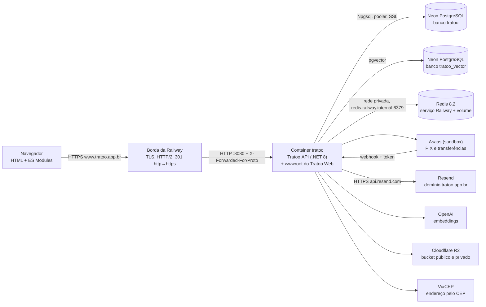
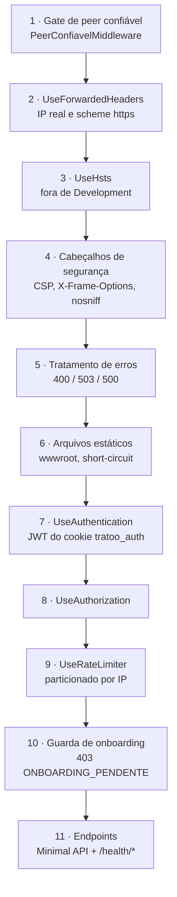
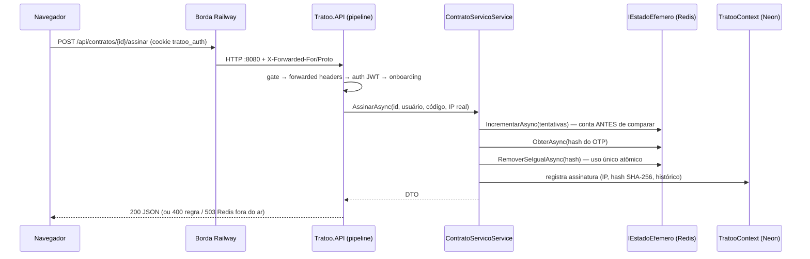
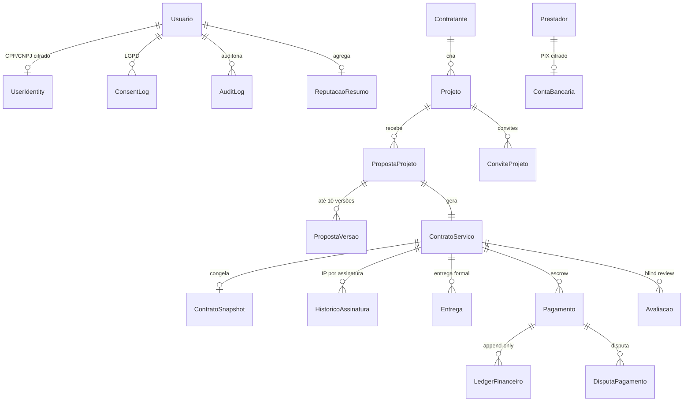
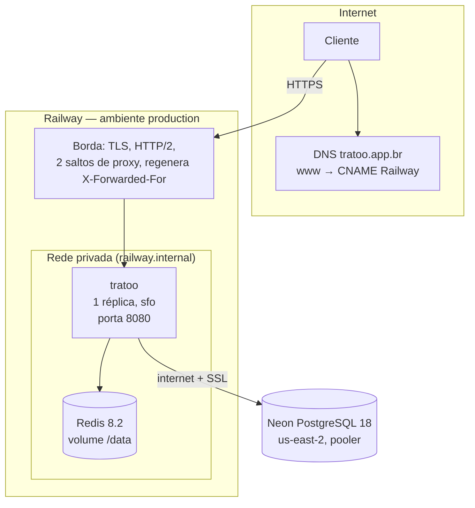
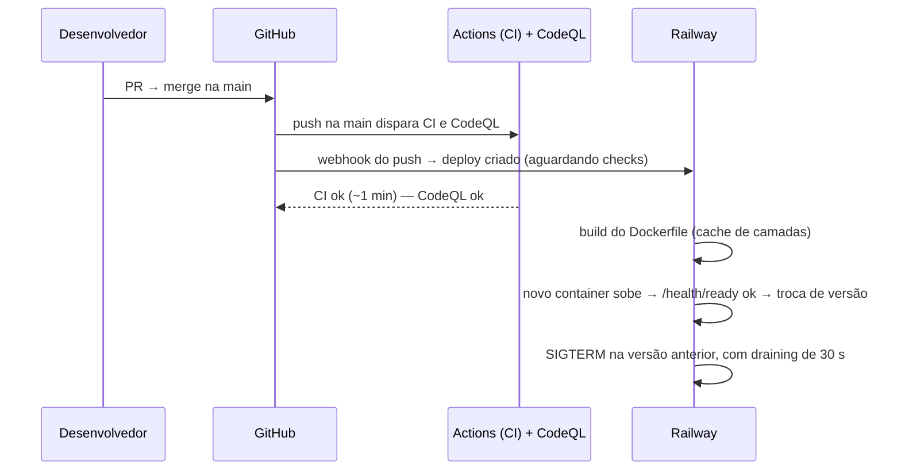
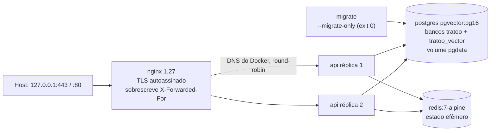
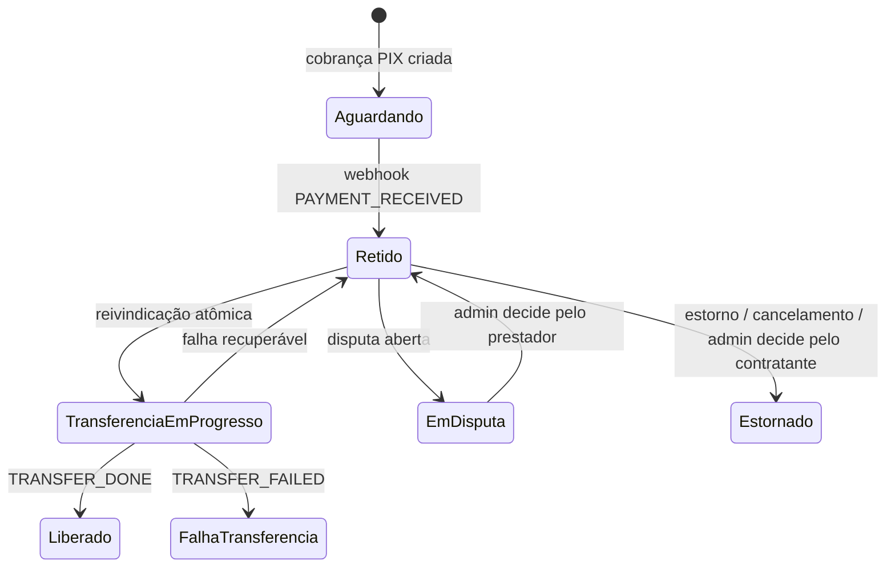

# Tratoo — Arquitetura Técnica

> Fonte técnica principal do projeto. Descreve o Tratoo como ele é hoje, com a evidência de cada
> afirmação. A evolução até aqui está em [`HISTORICO.md`](HISTORICO.md).
>
> **Estado de referência:** branch `main` no commit `b134922` (merge do PR #21), em produção no
> deploy `ebf57cde` da Railway. **Verificação:** 31/10/2026, só com leituras (código, Git, GitHub,
> CLI e API da Railway, DNS, endpoints públicos, API do Resend e consultas SQL somente leitura no
> Neon). A legenda e as fontes estão no [§1.5](#15-como-ler-este-documento).

---

## Sumário

1. [Visão geral](#1-visão-geral)
2. [Arquitetura da aplicação](#2-arquitetura-da-aplicação)
3. [Banco de dados e persistência](#3-banco-de-dados-e-persistência)
4. [Infraestrutura e deploy](#4-infraestrutura-e-deploy)
5. [Segurança](#5-segurança)
6. [Concorrência e escalabilidade](#6-concorrência-e-escalabilidade)
7. [CI/CD e qualidade](#7-cicd-e-qualidade)
8. [Integrações externas](#8-integrações-externas)
9. [Decisões arquiteturais](#9-decisões-arquiteturais)
- [Apêndice A — Matriz de rastreabilidade](#apêndice-a--matriz-de-rastreabilidade)
- [Apêndice B — Documentos complementares](#apêndice-b--documentos-complementares)

---

## 1. Visão geral

### 1.1 Objetivo e problema

O Tratoo é um marketplace de serviços. De um lado estão os **contratantes**, que publicam
projetos; do outro, os **prestadores** (freelancers), que enviam propostas. O problema central
é a falta de confiança numa negociação entre desconhecidos: quem entrega teme não receber, e
quem paga teme não receber o serviço.

A plataforma ataca esse problema com quatro mecanismos:

- **Pagamento em garantia (escrow):** o valor pago via PIX fica retido até a entrega ser aprovada
  ou o prazo de liberação automática vencer.
- **Contrato digital:** cada parte assina com um código enviado por e-mail, e o conteúdo é selado
  com hash SHA-256.
- **Reputação:** avaliação às cegas (*blind review*) e verificação de identidade (CPF/CNPJ).
- **Disputas:** mediação feita por um administrador quando há desacordo.

A busca semântica com embeddings (vetores numéricos que representam o significado de um texto)
aproxima projetos e prestadores mesmo quando eles descrevem a mesma coisa com palavras
diferentes.

É um projeto de estudo e portfólio publicado em produção em `https://www.tratoo.app.br`. **Os
pagamentos rodam no ambiente de sandbox do Asaas:** a URL configurada na Railway aponta para
`sandbox.asaas.com`, então nenhuma transação real acontece.

### 1.2 Funcionalidades principais

Os rótulos de status seguem a legenda do [§1.5](#15-como-ler-este-documento).

| Área | O que existe | Status |
|---|---|---|
| Cadastro e identidade | Cadastro em duas etapas, com o código de e-mail guardado em estado efêmero. Onboarding obrigatório. CPF/CNPJ cifrado e validado localmente pelos dígitos verificadores (`ValidadorCNPJ.Validar` para CNPJ). Consentimento e auditoria (`ConsentLog`, `AuditLog`). | No código |
| Login | JWT (token assinado que carrega a identidade do usuário) em cookie `HttpOnly`, MFA opcional por e-mail, tempo de resposta equalizado contra enumeração de contas. | No código; o OTP de MFA é Confirmado por testes |
| Projetos e propostas | Rascunho e publicação de projetos, busca com filtros, convites, proposta com até 10 versões de negociação, chat por polling (3 s com a aba ativa, 30 s em segundo plano). | No código |
| Contratos | Gerados a partir da proposta aceita. Assinatura com OTP (10 min, 5 tentativas), hash SHA-256, snapshot imutável e PDF (QuestPDF) num bucket privado, com URL pré-assinada de 15 min. | No código; o OTP de assinatura é Confirmado por testes |
| Pagamento e escrow | Cobrança PIX no Asaas, webhook idempotente, ledger imutável, liberação manual ou automática (prazo de entrega + 7 dias), disputa, estorno integral no cancelamento e limite diário de R$ 5.000 por contratante. | No código; a liberação concorrente é Confirmada por testes |
| Entrega | Entrega formal com anexos no R2 privado (URL de 30 min), aprovação ou pedido de ajustes. | No código |
| Avaliações | Blind review com janela de 7 dias e reputação agregada (`ReputacaoResumo`). | No código; a finalização concorrente é Confirmada por testes |
| Busca semântica | Embeddings OpenAI de 1536 dimensões no pgvector, com top-100 por cosseno, score composto calculado em C# e fallback por palavras-chave. | No código; índices HNSW Confirmados no banco de produção |
| Administração | Resolução de disputas e diagnóstico de rede (`/api/diagnostico/rede`), restritos ao papel Admin em produção. | No código |

A suíte automatizada cobre a infraestrutura e os pontos de concorrência indicados acima
([§7.2](#72-testes)).

### 1.3 Tecnologias e versões

| Camada | Tecnologia | Versão |
|---|---|---|
| Runtime | .NET 8 (SDK fixado no [`global.json`](../global.json)) | SDK `8.0.408` (`rollForward: latestFeature`) |
| API | ASP.NET Core Minimal API | 8.0 |
| ORM | EF Core + Npgsql | EF Core `9.0.10`; `Npgsql.EntityFrameworkCore.PostgreSQL` `9.0.4` |
| Banco | PostgreSQL gerenciado (Neon) com pgvector | Neon: PostgreSQL `18`, extensão `vector` `0.8.1`. Compose e CI: `pgvector/pgvector:pg16`. `Pgvector.EntityFrameworkCore` `0.3.0` |
| Cache e estado compartilhado | Redis + StackExchange.Redis | Produção: imagem `redis:8.2`, servidor `8.2.11` (log de conexão). Cliente `2.13.17`. Compose e CI: `redis:7-alpine` |
| Autenticação | JWT Bearer, BCrypt | `Microsoft.AspNetCore.Authentication.JwtBearer` `8.0.0`; `BCrypt.Net-Next` `4.0.3` |
| E-mail | SDK do Resend (HTTPS) | `Resend` `0.8.0` |
| Storage | AWS SDK S3 apontado para o Cloudflare R2 | `AWSSDK.S3` `3.7.100.0` |
| PDF | QuestPDF (licença Community) | `2025.1.0` |
| Logs | Serilog (console + arquivo) | `Serilog.AspNetCore` `8.0.1` |
| Documentação da API | Swashbuckle (só em Development) | `6.5.0` |
| Frontend | HTML/CSS/JS sem framework, Web Components, ES Modules, Bootstrap 5.3 vendorizado | — |
| Testes | xUnit + TestServer + Docker CLI | xUnit `2.9.2`; `Microsoft.AspNetCore.TestHost` `8.0.11` |
| Imagem | `mcr.microsoft.com/dotnet/sdk:8.0` → `aspnet:8.0` | — |

O `TratooContextFactory` (design-time) e o compose usam PostgreSQL 16; o servidor do Neon roda a
versão 18.

### 1.4 Visão geral da arquitetura



Um único processo .NET serve **a API e o frontend estático**. Quatro dependências entram no
caminho do usuário: o PostgreSQL (dois bancos no mesmo projeto Neon), o Redis (estado
efêmero compartilhado e rate limiting), o Asaas (pagamentos) e o Resend (e-mails). A OpenAI e o
R2 são usados em fluxos específicos: busca/indexação e upload/download, respectivamente.

### 1.5 Como ler este documento

**Legenda de status**

| Rótulo | Significado |
|---|---|
| **Confirmado** | Comprovado na verificação de 31/10/2026: observação em produção (endpoint, log, configuração efetiva, consulta ao banco, métricas do provedor), teste automatizado aprovado no CI ou registro DNS. |
| **Configurado** | A configuração existe no provedor (variável, serviço, domínio) e foi lida. |
| **No código** | Implementado no código da `main` em `b134922`. |

**Fontes de evidência**, da mais forte para a mais fraca:

1. Comportamento observado: `/health/live` e `/health/ready` públicos, headers de resposta, logs
   de build e de runtime do deploy `ebf57cde`, a execução de CI `41215952551` na `main`
   (238/238 testes aprovados), consultas SQL somente leitura no Neon e métricas de envio do
   Resend.
2. Configuração lida só com consultas: configurações dos serviços `tratoo` e `Redis` na Railway
   (CLI e API), **nomes** de variáveis (nunca os valores; das connection strings, só o host),
   status do domínio e do certificado, domínio no Resend, projeto no Neon e registros DNS
   (resolvidos contra `1.1.1.1`).
3. Código da `main` em `b134922`.

---

## 2. Arquitetura da aplicação

### 2.1 Projetos da solution

| Projeto | Tipo | Responsabilidade |
|---|---|---|
| [`Tratoo.API`](../Tratoo.API) | ASP.NET Core (Minimal API) | Host HTTP. Contém `Program.cs` (composição e pipeline), 18 grupos de endpoints em `EndPoints/*Extensions.cs`, `Infrastructure/` (proxy, rate limiting, Redis, health checks, porta, encerramento, modos de linha de comando), os `BackgroundServices` e os DTOs de entrada em `Requests/`. |
| [`Tratoo.Domain`](../Tratoo.Domain) | Class library | Regras de negócio organizadas por feature (`Features/<Feature>/{DTOs,Repositories,Services,Validators}`), entidades EF (`Domain/Models`), enums, `TratooContext`/`VectorContext` e a migration. Também contém as implementações das integrações (Asaas, R2, OpenAI, Resend) e a criptografia (`Features/Shared/DataProtector.cs`). |
| [`Tratoo.Web`](../Tratoo.Web) | Projeto Web sem código de servidor | Só o `wwwroot` (35 HTML, 32 JS e 24 CSS fora de `vendor/`). Na imagem Docker, ele é copiado para `/Tratoo.Web/wwwroot` e servido pela API. |
| [`Tratoo.Tests`](../Tratoo.Tests) | xUnit | 238 testes: unidade, host em memória (TestServer) e integração com Postgres e Redis reais via Docker. |

Organização:

- O código compartilhado fica em `Tratoo.Domain/Features/Shared/`: `DataProtector`,
  `PasswordHasher`, `SecureHasher`, validadores de CPF e CNPJ (dígitos verificadores por módulo 11, rejeitando sequências repetidas), `PaginadoDTO` e `UsuarioFactory`.
- **`Tratoo.Domain` concentra regras e integrações.** Ele depende de EF Core, Npgsql, AWS SDK, SDK
  do Resend e QuestPDF. A troca de provedor é feita por interfaces (`IAsaasGatewayService`,
  `IArquivoStorageService`, `IR2PrivateStorageService`, `IEmailService`, `IEmbeddingService`),
  com as implementações no mesmo assembly. É uma escolha de simplicidade: menos projetos e menos
  indireção, com mais acoplamento.

### 2.2 Modos de execução do binário

O mesmo `Tratoo.API.dll` tem quatro modos. Os três modos especiais são verificados **antes** de
criar o host web. Sem DI, Kestrel ou BackgroundServices, um desses processos nunca expira um
contrato nem libera um pagamento por engano.

| Comando | Quem usa | O que faz | Status |
|---|---|---|---|
| `dotnet Tratoo.API.dll` | Produção e compose | Sobe a API | **Confirmado** (produção) |
| `--healthcheck` | `HEALTHCHECK` do Dockerfile | Faz `GET /health/live` no próprio processo e sai com 0 ou 1 ([`SondaHealthCheck`](../Tratoo.API/Infrastructure/SondaHealthCheck.cs)) | **Confirmado** (testes) |
| `--migrate-only` | Serviço `migrate` do compose | Aplica as migrations do `TratooContext` e o schema vetorial, depois sai ([`ModoMigracao`](../Tratoo.API/Infrastructure/ModoMigracao.cs)) | **Confirmado** (testes rodam o processo real) |
| `--recifrar-dados [--aplicar]` | Rotação da chave de dados | Gera o relatório e regrava os valores cifrados com a chave nova ([`ModoRecifragem`](../Tratoo.API/Infrastructure/ModoRecifragem.cs)) | **Confirmado** (testes de integração) |

### 2.3 Pipeline de middlewares

A ordem abaixo é a de [`Program.cs`](../Tratoo.API/Program.cs). Ela importa porque cada
etapa depende do que as anteriores já resolveram.



- **1 e 2 vêm antes de tudo.** O HSTS só é emitido quando `Request.IsHttps` é verdadeiro. O rate
  limiter particiona por IP, e a auditoria grava o IP. Tudo isso precisa do IP e do scheme já
  resolvidos ([§5.2](#52-ip-real-do-cliente-e-trust-boundary)).
- **5 vem antes dos endpoints.** Em geral, os endpoints não precisam de `try/catch`: lançam
  `NegocioException` (vira 400) ou `ServicoIndisponivelException` (vira 503 + `Retry-After: 5`).
  Qualquer outra exceção vira 500 genérico, com log ([`TratamentoErrosSetup`](../Tratoo.API/Infrastructure/TratamentoErrosSetup.cs)).
- **6 vem antes da autenticação.** Arquivos estáticos não passam por autenticação, rate limiting
  nem guarda de onboarding.
- **10 tem lista de isenções.** O cookie vai em toda requisição same-origin, inclusive em
  login e cadastro. Por isso as rotas públicas e as sondas `/health/*` estão listadas em
  [`RotasIsentasOnboarding`](../Tratoo.API/Infrastructure/RotasIsentasOnboarding.cs).

### 2.4 Fluxo de uma requisição

Exemplo: validação de um OTP de assinatura de contrato, que passa pelo maior número de camadas.



### 2.5 Injeção de dependências

Todo o registro de dependências fica em `Program.cs`, sem frameworks de DI ou de mapeamento
externos.

- **Scoped:** os dois `DbContext`, os repositórios e os serviços de domínio. Os BackgroundServices
  criam um escopo por rodada (`IServiceScopeFactory`), ou seja, um `DbContext` por execução.
- **Singleton:** `IConnectionMultiplexer` (Redis), `IEstadoEfemero`, `ProtecaoEstadoEfemero`,
  `RedeConfiavel`/`ForwardedHeadersSettings` e `EstadoChaveDados`.
- **HttpClient tipado** via `IHttpClientFactory`: Asaas, OpenAI (com `OpenAiLoggingHandler` e
  timeout de 30 s), ViaCEP (cliente nomeado) e Resend
  (`AddResend`, timeout configurável).
- **Estado estático:** o `DataProtector` é uma classe estática configurada uma vez na subida, com
  as chaves valendo para o processo inteiro. Os serviços de domínio a chamam diretamente.
- **Escolha por configuração:** `AddTratooEstadoEfemero` registra a implementação em memória ou
  a do Redis conforme `Redis:ConnectionString` ([§6.2](#62-estado-efêmero-memória--redis)).

### 2.6 Autenticação e autorização

- **Token:** JWT HMAC-SHA256 gerado pelo `JwtService`, com validade em `Jwt:ExpirationHours`
  (padrão 8 h). A validação confere emissor, audiência, assinatura e validade, com
  `ClockSkew = TimeSpan.Zero` (nenhuma tolerância de expiração).
- **Transporte:** cookie `tratoo_auth` com `HttpOnly` (JavaScript não lê o token), `Secure` fora
  de Development, `SameSite=Strict` e expiração de 8 h. O `JwtBearerEvents.OnMessageReceived` lê o
  token do cookie, não do header `Authorization`. O `SameSite=Strict` é a defesa contra CSRF.
- **Papéis:** as políticas `Prestador`, `Contratante` e `Admin` usam `RequireRole`, e o papel é
  emitido como `ClaimTypes.Role`.
- **Onboarding:** usuário autenticado com `perfilCompleto != "true"` recebe 403 fora das rotas
  isentas.
- **Senhas:** BCrypt. O login sempre executa o BCrypt (contra `PasswordHasher.DummyHash` quando o
  e-mail não existe) e completa em no mínimo 300 ms. Assim o tempo de resposta não revela se a
  conta existe ([`LoginService`](../Tratoo.Domain/Features/Auth/Services/LoginService.cs)).

### 2.7 Frontend

- HTML, CSS e JS **sem framework e sem bundler**, servidos pela API. A navegação é multipágina:
  cada `.html` é uma rota.
- **Web Components** em Light DOM (`<tratoo-header>`, `<tratoo-footer>`), registrados por
  `core/app.js`. Os scripts de página são **ES Modules** e inicializam via `onReady()`.
- `services/api.js` centraliza o `fetch` com `credentials: 'same-origin'`. O frontend nunca
  manipula o token.
- `utils/auth-guard.js` é um script **clássico e bloqueante** de propósito: esconde o `<body>`,
  consulta `/api/me` e redireciona para login ou onboarding antes de qualquer conteúdo protegido
  aparecer.
- **Bootstrap 5.3 vendorizado** em `assets/vendor/bootstrap/`, porque o CSP só permite scripts
  de `'self'`. A ponte de tema fica em `base/tratoo-theme.css`.
- `utils/dom.js` (`el()`/`svg()`, com `createElement` e `textContent`) é a forma de montar DOM com
  dados ([§5.8](#58-xss-codeql-e-csp)).
- As convenções estão em [`Tratoo.Web/wwwroot/CONTRIBUTING.md`](../Tratoo.Web/wwwroot/CONTRIBUTING.md).

---

## 3. Banco de dados e persistência

### 3.1 Topologia

O motor é PostgreSQL, com dois bancos:

| Banco | DbContext | Conteúdo | Schema |
|---|---|---|---|
| `tratoo` | `TratooContext` | Todo o negócio: usuários com herança TPT, projetos, propostas, contratos, pagamentos, ledger, disputas, avaliações, auditoria | EF Core migrations |
| `tratoo_vector` | `VectorContext` | `prestador_embeddings` e `projeto_embeddings` (`VECTOR(1536)`) | SQL idempotente no `VectorDbInitializer` |

Em produção, os dois bancos ficam **no mesmo projeto Neon** (`tratoo`, região `aws-us-east-2`,
PostgreSQL 18). As duas connection strings apontam para o **endpoint pooler** (PgBouncer em modo
*transaction*) em `*.c-5.us-east-2.aws.neon.tech`, com `sslmode=Require`. Isso foi verificado
pelo host das connection strings e pela API do Neon, sem exibir valores.

A aplicação roda na região `sfo` da Railway, e o banco em `us-east-2`. Na chamada ao
`/health/ready` de 31/10, os checks `postgres` e `pgvector` levaram 1136 ms e 1196 ms, contra 1 ms
do Redis na rede privada.

**Por que dois bancos e não um?** O compose reproduz exatamente a mesma topologia e expõe erros
que um banco único esconderia, como uma consulta no contexto errado ou uma extensão criada no
banco errado.

### 3.2 Migrations

| Item | Estado | Status |
|---|---|---|
| Migrations do `TratooContext` | Uma migration, `20260806232531_InitPostgres` | **Confirmado**: é a única linha de `__EFMigrationsHistory` no banco `tratoo` de produção, registrada com `ProductVersion` `9.0.10` |
| Aplicação em produção | Manual, por `dotnet ef database update` a partir de uma máquina de desenvolvimento: o `TratooContextFactory` (design-time) lê o `appsettings.json` local | **No código** (procedimento) |
| Modo `--migrate-only` | Banco vazio aplica a migration e o schema vetorial; segunda execução não faz nada; duas instâncias simultâneas se serializam pela trava do EF | **Confirmado** (testes) |

Detalhe técnico: no EF Core 9 com Npgsql 9.0.4, o `MigrateAsync` usa
`LOCK TABLE "__EFMigrationsHistory" IN ACCESS EXCLUSIVE MODE` dentro de uma transação. Como é
uma trava de transação, e não um *advisory lock* de sessão, ela funciona pelo pooler.

### 3.3 pgvector, embeddings e busca semântica

- **Geração:** o `EmbeddingService` chama a OpenAI diretamente (`text-embedding-3-small`, 1536
  dimensões) por `HttpClient` tipado.
- **Quando indexa:** depois de salvar perfil, competências, experiências, certificações e
  portfólio, e ao publicar um projeto. O `ReindexacaoBackgroundService` reindexa tudo toda
  segunda-feira às 02:00 UTC, sob trava exclusiva ([§6.3](#63-backgroundservices)). O log de
  produção registra o agendamento da próxima rodada.
- **Índices:** HNSW (*Hierarchical Navigable Small World*, índice aproximado de vizinhos mais
  próximos) com `vector_cosine_ops`, criados por `CREATE INDEX IF NOT EXISTS` na subida, com os
  parâmetros padrão do pgvector. No banco `tratoo_vector` de produção existem
  `idx_prestador_embedding` e `idx_projeto_embedding` (`USING hnsw (embedding vector_cosine_ops)`),
  além das chaves primárias por `prestador_id` e `projeto_id`.
- **Consulta em duas camadas** ([`BuscaSemanticaService`](../Tratoo.Domain/Features/IA/Services/BuscaSemanticaService.cs)):
  1. o pgvector devolve os 100 vetores mais próximos por distância de cosseno (`CosineDistance`
     em LINQ, traduzido para `<=>`);
  2. o C# aplica os filtros de negócio e calcula o score composto.
- **Score composto, com soma 1,00:**

  | Fator | Peso |
  |---|---|
  | Similaridade semântica | 0,42 |
  | Habilidades (match de stack) | 0,22 |
  | Comprovação (competência ligada a portfólio ou certificação) | 0,12 |
  | Completude do perfil | 0,09 |
  | Avaliação média | 0,08 |
  | Contratos concluídos (teto de 20) | 0,04 |
  | Verificação de identidade (1,0 se nível ≥ 2; senão 0,3) | 0,03 |

- **Fallback:** se a OpenAI falhar, a busca cai para palavras-chave, mantendo os filtros. Sem
  `OpenAI__ApiKey`, a API sobe normalmente e a busca usa só palavras-chave.

### 3.4 Integridade e decisões de mapeamento

- **Dinheiro:** `decimal` com `HasPrecision(18, 2)`.
- **Enums como string** na maioria dos casos (`HasConversion<string>()`), para ficarem legíveis no
  banco. Também saem como string no JSON (`JsonStringEnumConverter`).
- **Datas padrão no banco:** `timezone('utc', now())`.
- **Idempotência garantida pelo banco:** índices únicos em `Pagamentos.IdempotencyKey` e
  `WebhookLogs.ChaveIdempotencia`.
- **Ledger append-only:** `LedgerFinanceiro` só recebe inserções.
- **Unicidade de negócio:** um contrato por proposta; uma avaliação por parte por contrato;
  `(PropostaId, Versao)` único.
- **Soft delete:** `EntregaAnexo` tem filtro global (`HasQueryFilter(a => a.ExcluidoEm == null)`).
  Usuários excluídos são anonimizados e marcados com `ExcluidoEm`, e os contratos, pagamentos e
  avaliações deles são preservados.
- **`DeleteBehavior.Restrict`** predominante entre agregados. `Cascade` só onde o filho não existe
  sem o pai.
- **Herança de usuário em TPT:** `Prestadores` e `Contratantes` em tabelas próprias (`ToTable` por
  tipo).



---

## 4. Infraestrutura e deploy

### 4.1 Produção na Railway

| Item | Valor | Fonte |
|---|---|---|
| Projeto e ambiente | Um ambiente, `production`, com os serviços `tratoo` e `Redis` | API da Railway (`list-services`) |
| Serviço `tratoo` | Origem GitHub `Gustavo-C-almeida/tratoo`, branch `main`, região `sfo`, **1 réplica**. O build usa o `Dockerfile` da raiz | Configurações do serviço; log de build (`load build definition from Dockerfile`) |
| Gatilho de deploy | Push na `main`, com `checkSuites: true`: a Railway espera os checks do GitHub passarem | Configurações do serviço |
| Deploy ativo | `ebf57cde` (31/10, 15:40 UTC), SUCCESS, commit `b134922` (PR #21) | `railway deployment list`; API da Railway |
| Configuração de deploy | `healthcheckPath = /health/ready` e `drainingSeconds = 30`, nas **configurações do serviço** | Configurações do serviço; log de build |
| Domínios | `www.tratoo.app.br` (custom) e `tratoo-production.up.railway.app`, ambos na porta 8080 | `railway domain list` |
| Serviço `Redis` | Imagem `redis:8.2`, 1 réplica em `sfo`, senha obrigatória (`--requirepass`), snapshot RDB `--save 60 1`, volume `redis-volume` de 5 GB em `/data`, endpoint só na rede privada (sem domínio nem TCP proxy) | Configurações do serviço `Redis` |
| Banco | Neon, fora da Railway: projeto `tratoo` em `aws-us-east-2`, endpoint pooler, bancos `tratoo` e `tratoo_vector` | Host das connection strings; API do Neon |
| Ambiente .NET | `ASPNETCORE_ENVIRONMENT` não está definido entre as variáveis, então vale Production | Nomes de variáveis |



### 4.2 Domínio e DNS

| Registro | Valor | Status |
|---|---|---|
| `www.tratoo.app.br` | CNAME `rmkhqshq.up.railway.app` (exigido pela Railway) | **Confirmado**: Railway informa domínio verificado, registro `PROPAGATED` e certificado `VALID` |
| `tratoo.app.br` | Delegado a `a.sec.dns.br` e `c.sec.dns.br` | **Confirmado** (DNS). O site é servido em `www` |
| `resend._domainkey.tratoo.app.br` | TXT DKIM (chave pública RSA) | **Confirmado**: igual ao exigido pelo Resend |
| `send.tratoo.app.br` | CNAME `send.forge.rmta.net`, que entrega o SPF (`v=spf1 …`) e o MX `feedback.forge.rmta.net` | **Confirmado** |
| `rsend.tratoo.app.br` | CNAME `rsend.forge.rmta.net` | **Confirmado** |

A borda da Railway responde `301` de `http://` para `https://` e envia
`Strict-Transport-Security: max-age=2592000` (emitido pela aplicação).

### 4.3 Dockerfile

O [`Dockerfile`](../Dockerfile) tem duas etapas:

- **Build:** `sdk:8.0`. Restaura os pacotes a partir dos `.csproj` (camada cacheável) e publica
  `Tratoo.API` em Release.
- **Runtime:** `aspnet:8.0` com o publish da API e `Tratoo.Web/wwwroot` em `/Tratoo.Web/wwwroot`.
  O `Program.cs` procura o frontend em `../Tratoo.Web/wwwroot` a partir de `/app`.

| Decisão | Motivo | Status |
|---|---|---|
| `USER $APP_UID` (numérico) | A imagem base roda como root por padrão. Com UID numérico, um orquestrador com `runAsNonRoot` verifica sem consultar `/etc/passwd`. Binários e wwwroot pertencem ao root, então o processo não consegue alterar o próprio código | **No código** (Dockerfile usado no build de produção) |
| Só `/app/logs` pertence a `app` | É o único lugar onde a aplicação grava dentro de `/app` (sink de arquivo do Serilog) | **No código** |
| `ASPNETCORE_HTTP_PORTS=8080`, sem `ASPNETCORE_URLS` | O `PORT` injetado pela plataforma vira `http_ports` em `PortaHttpSetup`, com 8080 como reserva | **Confirmado** (log `Now listening on: http://[::]:8080`; `PortaHttpTests`) |
| `HEALTHCHECK` com `dotnet Tratoo.API.dll --healthcheck` contra `/health/live` | A imagem não tem curl nem wget, o que mantém a superfície de ataque menor. A sonda usa a mesma resolução de porta do Kestrel e checa só *liveness*: reiniciar o container não conserta um banco fora do ar | **No código** (usado pelo compose; na Railway, o health check é o HTTP das configurações do serviço) |
| `ENTRYPOINT ["dotnet", "Tratoo.API.dll"]` em forma exec | O `dotnet` é o PID 1 e recebe o SIGTERM diretamente, sem um shell no meio que engoliria o sinal | **Confirmado** (log de SIGTERM, [§4.7](#47-inicialização-e-encerramento)) |

O `.dockerignore` exclui `bin/`, `obj/`, `logs/`, `appsettings.json`,
`appsettings.Development.json`, `.git` e `*.md`. Em produção, **toda a configuração vem de
variáveis de ambiente**. O `appsettings.example.json` entra na imagem, mas o host não o carrega.

### 4.4 Configuração de deploy

A configuração de deploy do serviço `tratoo` fica nas **configurações do serviço na Railway**
(Settings → Deploy):

| Configuração | Valor | Efeito |
|---|---|---|
| `healthcheckPath` | `/health/ready` | A nova versão só recebe tráfego depois de responder 2xx, com janela de até 5 min. Uma versão sem banco, sem Redis ou com a chave de dados errada não é promovida, e a anterior continua no ar |
| `drainingSeconds` | `30` | Tempo entre o SIGTERM e o SIGKILL da versão anterior. Cobre o `ShutdownTimeout` de 25 s do host |
| Réplicas | 1 (`sfo`) | — |

O [`railway.toml`](../railway.toml) do repositório registra os mesmos valores como referência
versionada, e o `ShutdownTests` lê o `drainingSeconds` dele para conferir a coerência com o
`ShutdownTimeout`. Uma mudança de valor é feita nos dois lugares. O valor efetivo de cada deploy
pode ser conferido na API da Railway, em `deployment.meta.serviceManifest.deploy`.

### 4.5 Fluxo de deploy (CD) e rollback



O deploy `ebf57cde` mostra a sequência: o push de `b134922` às 15:40 UTC criou o deploy e o CI no
mesmo segundo; o CI terminou às 15:41; o build carregou o Dockerfile às 15:42:18; o log de build
registra `Starting Healthcheck`, `Path: /health/ready` às 15:42:28 e `Healthcheck succeeded!` às
15:42:35; a versão anterior recebeu SIGTERM às 15:42:41.

- **CI e CD são etapas separadas.** O CI do GitHub compila e testa. O CD é a Railway, que faz
  build e deploy da `main` depois dos checks.
- **Migrations:** aplicadas manualmente ([§3.2](#32-migrations)).
- **Rollback:** pelo histórico de deploys da Railway, que guarda as imagens anteriores
  (`canRollback: true`). Uma versão que não passa no `/health/ready` não é promovida.

### 4.6 Health checks

| Rota | Checks | Para quê | Produção (31/10) |
|---|---|---|---|
| `/health/live` | `self`, sem dependências | Liveness: o processo está atendendo? Usado pelo `HEALTHCHECK` do Docker | 200, Healthy |
| `/health/ready` | `postgres` (`CanConnectAsync`), `pgvector` (extensão instalada), `dados-cifrados` (a chave decifra amostras reais) e `redis` (`PING`, registrado quando há Redis) | Readiness: dá para receber tráfego? É o health check de deploy da Railway | 200, Healthy nos 4 checks |

Decisões em [`HealthCheckSetup`](../Tratoo.API/Infrastructure/HealthCheckSetup.cs) e
[`HealthChecks`](../Tratoo.API/Infrastructure/HealthChecks.cs):

- Cada check tem **timeout de 5 s**, para que um banco que aceita TCP mas não responde não deixe
  a sonda pendurada.
- O corpo da resposta detalha cada check (nome, status, descrição e duração), **sem mensagens de
  exceção**. Assim a rota anônima não expõe host nem credencial.
- As duas rotas usam `AllowAnonymous()` explícito e são isentas da guarda de onboarding.
- Os checks de banco são feitos à mão (`CanConnectAsync`/`SqlQueryRaw`), sem o pacote
  `HealthChecks.EntityFrameworkCore`, para não acrescentar mais um pacote da família EF.
- O `dados-cifrados` guarda a confirmação no processo (`EstadoChaveDados`). Depois do primeiro
  OK, não consulta mais o banco ("Chave de dados já conferida contra dados existentes").

### 4.7 Inicialização e encerramento

**Subida**, na ordem do `Program.cs`:

1. Modos especiais (`--healthcheck`, `--migrate-only`, `--recifrar-dados`), antes de qualquer host.
2. Chave de dados (`DataProtector:Chave`). Se faltar, ou se for o placeholder do exemplo, o
   processo sai com uma linha `[startup] ...` e **exit 1**.
3. Porta (`PORT` → `http_ports`). Um valor inválido derruba a subida, porque escutar na porta
   errada deixaria o serviço fora do ar em silêncio.
4. Registro de serviços. Com Redis configurado, `Redis:ChaveProtecao` é validada **na subida**.
5. `VectorDbInitializer`, que cria a extensão, as tabelas e os índices de forma idempotente,
   **antes** de o Kestrel escutar.
6. Pipeline e `app.Run()`. Logs do deploy `ebf57cde`: `Trust boundary de X-Forwarded-*: …`,
   conexão com `redis.railway.internal:6379` (`Standalone v8.2.11, primary`) e
   `Now listening on: http://[::]:8080`.

**Encerramento** ([`ShutdownSetup`](../Tratoo.API/Infrastructure/ShutdownSetup.cs)):

- `HostOptions.ShutdownTimeout = 25 s`, para caber dentro dos 30 s de `drainingSeconds`.
- O `UseLogDeEncerramento` registra o ciclo completo. Na troca de versão de 31/10, a versão que
  saiu registrou: `SIGTERM recebido — iniciando encerramento gracioso (limite 25s)` →
  `Application is shutting down...` → `Encerramento concluído em 6 ms`.
- O compose usa `stop_grace_period: 30s`, alinhado ao prazo do host.

**Status:** **Confirmado** (log de produção + `ShutdownTests`).

### 4.8 Portas, rede e DNS interno

- **Kestrel:** HTTP na 8080, dual-stack (`[::]`). O TLS termina na borda da Railway, que também
  responde com 301 de http para https.
- **Redis:** `redis.railway.internal:6379`, resolvido pelo DNS interno da rede privada. A
  connection string usa `abortConnect=false` e timeouts de 2 s.
- **Neon:** sai pela internet, com SSL obrigatório na connection string.
- **Compose:** uma rede bridge `interna` com subnet fixa (`172.28.0.0/24`). Só o Nginx publica
  portas, e apenas em `127.0.0.1`.

### 4.9 Variáveis de ambiente

As variáveis de produção do serviço `tratoo` estão listadas **só pelo nome**, lidas em 31/10. A
convenção `Secao__Chave` do .NET vira `Secao:Chave` na configuração.

| Grupo | Variáveis | Observação |
|---|---|---|
| Banco | `ConnectionStrings__DefaultConnection`, `ConnectionStrings__VectorConnection` | Neon pooler, `us-east-2`, bancos `tratoo` e `tratoo_vector` |
| Chave de dados | `DataProtector__Chave` | Uma única chave configurada |
| Redis | `Redis__ConnectionString`, `Redis__ChaveProtecao` | A connection string referencia as variáveis do serviço `Redis` (host privado) |
| JWT | `Jwt__SecretKey`, `Jwt__Issuer`, `Jwt__Audience`, `Jwt__ExpirationHours` | — |
| Asaas | `Asaas__ApiKey`, `Asaas__BaseUrl`, `Asaas__WebhookToken`, `Asaas__ConfirmarTransferenciaImediatamente`, `Asaas__TaxaOperacionalEstimadaPercentual` | `BaseUrl` aponta para `sandbox.asaas.com` |
| E-mail | `Resend__ApiKey`, `Resend__BaseUrl`, `Resend__FromEmail`, `Resend__FromName`, `Resend__TimeoutSegundos` | `BaseUrl` aponta para `api.resend.com`; o remetente usa o domínio `tratoo.app.br`. O código também aceita `RESEND_API_KEY`/`RESEND_FROM_*`, que têm precedência; em produção, a configuração usa a seção `Resend__*` |
| OpenAI | `OpenAI__ApiKey`, `OpenAI__BaseUrl` | — |
| R2 | `CloudflareR2__{AccountId,AccessKey,BucketName,PublicUrl}`, `CloudflareR2Private__{AccountId,AccessKey,BucketName,ServiceURL}` | Dois buckets |
| Host | `AllowedHosts`, `Logging__LogLevel__Default`, `Logging__LogLevel__Microsoft.AspNetCore` | O Serilog é configurado no código (`MinimumLevel.Information()`, console + arquivo) |
| Seed | `Seed__SenhaUsuario` | As rotas de seed só existem em Development |
| Plataforma | `RAILWAY_*` (injetadas pela Railway) | — |

Valem os padrões do código para `ASPNETCORE_ENVIRONMENT` (Production), `ForwardedHeaders__*`
(`ForwardLimit = 2` e as faixas padrão) e `LogArquivo__Habilitado` (sink de arquivo ligado). O
`PORT` é injetado pela Railway em tempo de execução, e a aplicação escuta na 8080.

**Ambiente local:** o compose lê um `.env`, nunca versionado, criado a partir do
[`.env.example`](../.env.example). As variáveis obrigatórias usam `${VAR:?mensagem}`, então o
`docker compose up` para com uma explicação se alguma faltar.

### 4.10 Ambiente local com Docker Compose

O [`compose.yaml`](../compose.yaml) reproduz a topologia de produção, com duas réplicas da API
atrás de um Nginx.



| Serviço | Imagem | Papel |
|---|---|---|
| `postgres` | `pgvector/pgvector:pg16` | Os dois bancos, criados por `./infra/postgres/initdb` |
| `redis` | `redis:7-alpine` | Estado efêmero e rate limiting, com senha, em memória (`--save ''`, `--appendonly no`) |
| `migrate` | `tratoo-api:local` | Roda `--migrate-only` e sai com 0 |
| `api` | `tratoo-api:local` | A API, com `replicas: ${API_REPLICAS:-2}` |
| `nginx` | `nginx:1.27-alpine` | TLS local e balanceamento; único serviço com portas publicadas (`127.0.0.1:80` e `:443`) |

- **Rede:** `interna` (bridge, subnet `${COMPOSE_SUBNET:-172.28.0.0/24}`).
- **Volumes:** o volume nomeado **`pgdata`**, montado em `/var/lib/postgresql/data` no
  `postgres`, e bind mounts somente leitura: `./infra/postgres/initdb` (postgres),
  `./infra/nginx/templates` e `./infra/nginx/certs` (nginx).
- **Ordem de subida:** `depends_on` com condições: `postgres` e `redis` saudáveis → `migrate`
  termina com exit 0 → `api` saudável (pelo `HEALTHCHECK` da imagem) → `nginx`.

| Aspecto | Produção (Railway) | Local (compose) |
|---|---|---|
| Proxy | Borda Railway, 2 saltos, regenera `X-Forwarded-For` | Nginx, 1 salto, sobrescreve `X-Forwarded-For` com `$remote_addr` |
| `ForwardLimit` / peers confiáveis | 2 / padrão (`100.64.0.0/10`, `fc00::/7`, loopback) | 1 / subnet do compose + loopback |
| Réplicas da API | 1 | 2 (`API_REPLICAS`) |
| Redis | `redis:8.2`, snapshot RDB `save 60 1` no volume `/data` | `redis:7-alpine`, em memória |
| Banco | Neon (PostgreSQL 18, `us-east-2`), via pooler | Postgres 16 local, dois bancos |
| Migrations | Manuais | Serviço `migrate` |
| Asaas | URL de sandbox via variável | URL de sandbox fixa no compose |
| Log em arquivo | Ligado (`/app/logs`) | Desligado (`LogArquivo__Habilitado=false`); stdout |
| `ASPNETCORE_ENVIRONMENT` | Production (padrão) | Production por padrão; Development se definido no `.env` |

No Redis de produção, o que vai para o disco são valores cifrados com AES-256-GCM, nomes de chave
em HMAC e contadores ([§5.7](#57-proteção-do-estado-no-redis)).

---

## 5. Segurança

### 5.1 Ameaças e mecanismos

| Ameaça | Mecanismo | Status |
|---|---|---|
| IP forjado ou IP do proxy em auditoria e rate limiting | Gate de peer confiável + `ForwardedHeaders` com `ForwardLimit = 2` | **Confirmado** (log de subida; testes) |
| Força bruta em login, cadastro, reset, OTP e dados bancários | Rate limiting por IP (distribuído no Redis) + limite de tentativas por código | **Confirmado** (testes) |
| Reuso ou corrida de OTP | Contagem antes da comparação + remoção atômica (comparar e apagar) | **Confirmado** (testes de concorrência, inclusive com Redis real) |
| Dados sensíveis em repouso | AES-256 (`DataProtector`) com chave fora do código + check `dados-cifrados` | **Confirmado** (check Healthy em produção) |
| Leitura do Redis por terceiros | AES-256-GCM nos valores + HMAC nos nomes de chave + rede privada + senha | **Confirmado** (testes; Redis sem endpoint público e com `--requirepass`) |
| XSS | Construção de DOM com `textContent` (`utils/dom.js`), CSP e CodeQL | **Confirmado** (CSP de produção; CodeQL sem alertas abertos) |
| SQL injection | EF Core com LINQ parametrizado; SQL cru só constante ou interpolado com parâmetro | **No código** |
| CSRF | Cookie `SameSite=Strict` + `HttpOnly` | **No código** |
| Enumeração de contas | Tempo mínimo de 300 ms no login; reset de senha com resposta idêntica | **No código** |
| Webhook de pagamento forjado | Token compartilhado comparado em tempo constante | **Configurado** (`Asaas__WebhookToken` presente) |
| Dados pessoais em logs | Logs sem destinatário, assunto e fragmentos de chave | **Confirmado** (CodeQL) |
| Container comprometido alterando o próprio código | Processo não-root; binários do root | **No código** |
| Segredo no repositório público | Configuração por variáveis; nenhum segredo versionado | **No código** ([§5.10](#510-segredos-e-configuração)) |

### 5.2 IP real do cliente e trust boundary

Atrás de um *reverse proxy* (um servidor que recebe a conexão do cliente e a repassa à aplicação),
o `HttpContext.Connection.RemoteIpAddress` é o IP do proxy. A auditoria (assinatura de contrato,
`ConsentLog`, `AuditLog`, dados bancários e disputas), o HSTS e o rate limiting dependem do IP e do
scheme do cliente. A solução tem três partes
([`ForwardedHeadersSetup`](../Tratoo.API/Infrastructure/ForwardedHeadersSetup.cs),
[`PeerConfiavelMiddleware`](../Tratoo.API/Infrastructure/PeerConfiavelMiddleware.cs),
[`ClientRequestInfo`](../Tratoo.API/Infrastructure/ClientRequestInfo.cs)):

1. **Gate de peer confiável.** É o primeiro middleware. Se a conexão TCP não vier de
   `100.64.0.0/10` (CGNAT, de onde a Railway entrega o tráfego), `fc00::/7` (ULA IPv6) ou
   loopback, ele remove `X-Forwarded-For`, `-Proto`, `-Host`, `-Port` e `X-Real-IP` antes de
   qualquer processamento, e registra um aviso no log.
2. **`UseForwardedHeaders`** com `ForwardLimit = 2`, processando só `XForwardedFor` e
   `XForwardedProto`. O `X-Forwarded-Host` fica de fora, para evitar *host header injection*.
3. **Fonte única do IP:** `ClientRequestInfo.ObterIp(http)`. O IP é normalizado: IPv4 mapeado em
   IPv6 vira IPv4, o *scope id* é removido e o valor é limitado a 45 caracteres. Nenhum endpoint
   lê o header diretamente.

**Por que um gate próprio, e não `KnownProxies`/`KnownNetworks`?** O middleware do ASP.NET Core
valida **cada salto** da cadeia. Preencher essas listas só com a faixa do peer faz o middleware
parar no primeiro salto e adotar o IP do *pool* de borda da Railway como se fosse o cliente. Um
teste prova isso: `PinarSoAFaixaDoPeer_QuebraAIdentificacaoDoCliente`. Por isso as
responsabilidades são separadas: o gate decide **quem** pode apresentar os headers, e o middleware
oficial decide **quantos** saltos percorrer.

**Por que `ForwardLimit = 2`?** É o número de saltos medido em produção: o header chega com
`<cliente>, <nó de borda>`, e o primeiro valor bate com o `srcIp` que a própria Railway registra
em `railway logs --http`. Com o limite em 1, a aplicação gravaria o IP do nó de borda, e dois
usuários no mesmo nó dividiriam a mesma cota de rate limit. A Railway **regenera** o
`X-Forwarded-For`: um valor forjado pelo cliente não chega à aplicação.

**Armadilha de configuração.** O binder do .NET **anexa** itens a arrays que já têm valor padrão.
Por isso `PeersConfiaveis` é `null` por padrão e o default vem de `PeersConfiaveisPadrao`.
Configurar a lista **substitui** o padrão, em vez de só ampliá-lo (teste em
`BindingConfiguracaoTests`).

**Evidência:**

- O log de subida do deploy `ebf57cde` mostra
  `Trust boundary de X-Forwarded-*: 100.64.0.0/10, fc00::/7, 127.0.0.0/8, ::1/128`.
- A resposta de produção traz `Strict-Transport-Security: max-age=2592000`.
- Testes: `ForwardedHeadersTests`, `CapturaIpAuditoriaTests`, `ClientRequestInfoTests` e
  `BindingConfiguracaoTests`.

Diagnóstico e metodologia em [`REVERSE-PROXY-IP-CLIENTE.md`](REVERSE-PROXY-IP-CLIENTE.md).

### 5.3 Rate limiting

| Política | Limite (janela fixa de 1 min, por IP) | Onde |
|---|---|---|
| `cadastro` | 5 | Cadastro e confirmação |
| `login` | 10 | Login e MFA |
| `senha` | 3 | Reset de senha |
| `dados-bancarios` | 5 | Token, confirmação e gravação de dados bancários |
| `otp-assinatura` | 3 | Pedido de OTP de contrato (evita spam de e-mail) |

- **Partição por política e IP:** cada política usa `AddPolicy` + `RateLimitPartition`, com a
  chave `"{política}|{ip}"` ([`RateLimiterSetup`](../Tratoo.API/Infrastructure/RateLimiterSetup.cs)),
  o que dá um balde por cliente.
- **Resposta:** 429 com JSON e `Retry-After: 60`. O header é escrito antes do corpo, porque depois
  da escrita os headers ficam imutáveis.
- **Distribuído:** com Redis configurado, cada partição usa o
  [`LimitadorJanelaFixaRedis`](../Tratoo.API/Infrastructure/LimitadorJanelaFixaRedis.cs), um
  script Lua com `TIME` + `INCRBY` e janela alinhada ao relógio do **Redis**. Assim, réplicas com
  relógios diferentes contam no mesmo balde. A chave no Redis é um HMAC, já que o IP é dado
  pessoal.
- **Falha do Redis degrada para memória**, por réplica, com um aviso no log a cada 30 s no
  máximo. Bloquear todo login porque o Redis caiu seria uma negação de serviço autoinfligida.
- **Testes:** `RateLimitingPorIpTests` (inclusive
  `Resposta429_TrazRetryAfterDeSessentaSegundos`) e `RedisReplicasTests`.

### 5.4 OTP, MFA e estado efêmero

| Código | Validade | Tentativas | Onde |
|---|---|---|---|
| MFA, reset de senha e confirmação de cadastro | 5 min | 5 | [`VerificacaoMFAService`](../Tratoo.Domain/Features/Auth/Services/VerificacaoMFAService.cs) |
| Assinatura de contrato | 10 min | 5 | `ContratoServicoService` |
| Token de dados bancários (e janela de edição) | 10 min | 5 | `DadosBancariosService` |
| Cadastro pendente | 24 h (com reenvio limitado a 1 por minuto) | — | `CadastroService` |

- Os códigos têm 6 dígitos (`RandomNumberGenerator`) e ficam guardados **só como hash**
  (`SecureHasher`: SHA-256 + `FixedTimeEquals`). O BCrypt fica para senhas, porque um código de
  TTL curto não precisa de um hash lento.
- **Uso único sob concorrência**, em três passos:
  1. a tentativa é **contada antes** da comparação (`IncrementarAsync`, atômico);
  2. o código só vale se **esta** requisição conseguir apagá-lo (`RemoverSeIgualAsync`, que no
     Redis é um script Lua que compara o valor cifrado lido e só então dá `DEL`);
  3. a janela de edição bancária é consumida atomicamente.
- **Fail-closed:** se o Redis estiver fora, `EstadoEfemeroRedis` lança
  `ServicoIndisponivelException`, que vira 503 + `Retry-After: 5`, para que réplicas diferentes
  nunca enxerguem códigos diferentes. A exceção deliberada é o **pedido de reset de senha**, que
  engole a falha e responde igual: um 503 só para contas existentes revelaria quais e-mails estão
  cadastrados.
- **Testes:** `OtpConcorrenciaTests` (cenários de MFA, contrato e dados bancários em
  `CenariosOtp`), `EstadoEfemeroTests` e `RedisReplicasTests` (com Redis real).

### 5.5 Autenticação

Os detalhes estão em [§2.6](#26-autenticação-e-autorização). O token não é acessível ao
JavaScript (`HttpOnly`), então um XSS não consegue exfiltrá-lo diretamente. Como um XSS ainda
poderia fazer requisições em nome do usuário, a construção segura de DOM e o CSP
([§5.8](#58-xss-codeql-e-csp)) fazem parte da defesa da sessão.

### 5.6 Criptografia de dados sensíveis

[`DataProtector`](../Tratoo.Domain/Features/Shared/DataProtector.cs) cifra **conta bancária, chave
PIX, CPF/CNPJ e CPF do representante legal**:

- **Algoritmo:** AES-256 em modo CBC com PKCS7 e IV aleatório. O formato é
  `base64(IV)|base64(cifrado)`.
- **Chave:** vem de `DataProtector:Chave` (variável `DataProtector__Chave`). A derivação são os
  bytes UTF-8 do texto, truncados ou completados até 32 bytes.
- **Sem chave, a API não sobe:** exit 1 com uma linha `[startup]`, em vez de falhar só na primeira
  leitura de dado bancário.
- **Chave errada é detectada:** o check `dados-cifrados` decifra até 3 amostras reais de cada
  coluna. O resultado é Unhealthy se nenhuma decifra, Degraded se só parte decifra ou se há uma
  rotação em curso, e Healthy se todas decifram. Valores de seed, que não têm a forma de dado
  cifrado, não contam. A heurística `PareceTexto` separa uma decifragem real de um padding que
  casou por acaso (cerca de 1 em 256 com a chave errada). Como `/health/ready` é o health check de
  deploy, uma versão com a chave errada não é promovida.
- **Rotação sem indisponibilidade** ([`ROTACAO-CHAVE-DADOS.md`](ROTACAO-CHAVE-DADOS.md)):
  `DataProtector:Chave` recebe a chave nova e `DataProtector:ChaveAnterior` a antiga. A leitura
  tenta as duas e a escrita usa só a nova. Depois, `--recifrar-dados --aplicar` regrava tudo numa
  transação, conferindo cada valor e abortando se algum mudou durante o processo.
- **Em produção:** `DataProtector__Chave` está configurada, e o check `dados-cifrados` está
  Healthy.

Testes: `DataProtectorTests`, `RotacaoChaveDadosTests`, `ChaveDeDadosNaSubidaTests`,
`RecifragemTests` e `DadosCifradosHealthCheckTests`.

### 5.7 Proteção do estado no Redis

Num serviço de rede, um OTP guardado como SHA-256 simples não basta:

- 6 dígitos são 900 mil valores, e quem lê o Redis reverte o hash em milissegundos;
- o cadastro pendente leva nome, e-mail, IP e hash BCrypt por até 24 h;
- os próprios **nomes** de chave carregariam e-mail e IP.

Por isso o [`ProtecaoEstadoEfemero`](../Tratoo.API/Infrastructure/ProtecaoEstadoEfemero.cs) faz o
seguinte:

- **Valores** são cifrados com **AES-256-GCM**, que garante confidencialidade e integridade. O
  nome da chave entra como dado associado, então um valor copiado para outra chave não decifra.
  O formato é `[versão][nonce 12][tag 16][cifrado]`.
- **Nomes** de chave viram `tratoo:<categoria>:<HMAC-SHA256>`. Só a categoria fica legível, para
  diagnóstico.
- As duas chaves são derivadas por **HKDF** de um único segredo, `Redis:ChaveProtecao` (32 bytes
  ou mais, igual em todas as réplicas). Trocar esse segredo invalida os códigos pendentes, que
  passam a ser tratados como ausentes, e nada além disso.

**Em produção:** `Redis__ChaveProtecao` está configurada; o Redis só tem endpoint na rede privada e
exige senha.

### 5.8 XSS, CodeQL e CSP

- **CodeQL** em *default setup*. Ele analisa Actions, C# e JavaScript/TypeScript a cada push e PR
  na `main`. No commit `b134922`, as três análises passaram; em 31/10, o repositório tinha
  **0 alertas abertos**.
- **Convenção do frontend:** dado vindo de usuário, URL ou API é inserido com `el()` de
  `utils/dom.js` (`createElement`, `setAttribute` recusando `on*`, `append`), `textContent` ou
  `.value`, e IDs de URL são validados.
- **Logs:** registram o Id da mensagem de e-mail, sem destinatário nem assunto (o assunto carrega
  o título do projeto, digitado pelo usuário), e sem fragmentos de nomes de chave derivados de
  e-mail ou IP.
- **CSP em produção** (header da resposta de `https://www.tratoo.app.br/`):

  ```
  default-src 'self'; script-src 'self' 'unsafe-inline';
  style-src 'self' 'unsafe-inline' https://cdnjs.cloudflare.com;
  font-src 'self' https://cdnjs.cloudflare.com; img-src 'self' data: https:;
  connect-src 'self'; object-src 'none'; base-uri 'self'; form-action 'self'; frame-ancestors 'none'
  ```

  O cdnjs serve o Font Awesome.
- **Outros headers** observados na mesma resposta: `X-Content-Type-Options: nosniff`,
  `X-Frame-Options: DENY`, `Referrer-Policy: strict-origin-when-cross-origin`,
  `Permissions-Policy: geolocation=(), camera=(), microphone=()` e HSTS.

### 5.9 SQL injection

Todo o acesso a dados passa por EF Core com LINQ, que gera SQL parametrizado. A busca vetorial
usa `CosineDistance` em LINQ. Os pontos de SQL cru são:

- DDL constante no `VectorDbInitializer`;
- a consulta constante do check `pgvector`;
- `SqlQuery<bool>($"SELECT pg_try_advisory_xact_lock({chave})")`, em que a interpolação vira
  `DbParameter` (e `chave` é uma constante).

Nenhum desses pontos monta SQL com entrada de usuário.

### 5.10 Segredos e configuração

- O `.gitignore` exclui `appsettings.json` e `appsettings.Development.json`, o `.dockerignore`
  repete a exclusão, e o repositório traz só `appsettings.example.json` e `.env.example`, com
  placeholders.
- Em produção, todos os segredos são variáveis da Railway ([§4.9](#49-variáveis-de-ambiente)).
- O CI não usa segredos: os testes têm uma chave de dados própria (`ConfiguracaoDosTestes`) e
  sobem bancos efêmeros.
- **Isolamento dos testes:** o `ProcessoApi` roda a API num diretório de trabalho vazio e remove as
  variáveis `ConnectionStrings__*` e `DataProtector__*` herdadas, para que um `appsettings` local
  nunca leve um teste ao banco de produção. Para desenvolvimento, o caminho seguro é o compose.

### 5.11 Integrações e pagamentos

- **Webhook do Asaas** (`POST /api/webhooks/asaas`): é público e protegido pelo header
  `asaas-access-token`, comparado com `CryptographicOperations.FixedTimeEquals` contra
  `Asaas__WebhookToken`. A idempotência é garantida por `WebhookLog.ChaveIdempotencia`, com índice
  único.
- **Liberação de pagamento:** o pagamento só sai de `Retido` por uma reivindicação atômica no banco
  ([§6.4](#64-idempotência-financeira)). A chave PIX é validada (`ChavePixValidator`), o
  prestador precisa estar ativo, e cada liberação gera um `AuditLog` (`pagamento_liberado`, com o
  IP) e uma entrada no ledger.
- **Limite diário:** R$ 5.000 por contratante (`PagamentoService.LimiteDiarioContratante`).
- **Arquivos privados** (PDF de contrato, anexos de entrega) só saem por URL pré-assinada de curta
  duração: 15 min para o contrato e 30 min para anexos. O `Content-Type` dos anexos de entrega é
  derivado da extensão (`ContentTypePorExtensao`), nunca do valor enviado pelo cliente.

---

## 6. Concorrência e escalabilidade

### 6.1 O que é estado de processo

O inventário em [`TRILHA2-DECISOES.md` §1.1](TRILHA2-DECISOES.md) separa dois grupos:

- **Compartilhado entre réplicas:** OTPs, contadores de tentativa, cadastro pendente, token e
  janela de edição de dados bancários, OTP de assinatura e contadores do rate limiting. Tudo isso
  fica atrás de `IEstadoEfemero` ou do limitador Redis.
- **Local por réplica:** os caches de perfil público (TTL de 2 min, `IMemoryCache`). Levá-los
  para o Redis trocaria uma ida à rede por outra e ainda exigiria invalidação distribuída.

**Regra:** nada que seja fonte da verdade vai para o Redis. Dinheiro, contrato, ledger, auditoria
e idempotência ficam no Postgres.

### 6.2 Estado efêmero: memória × Redis

| | Sem `Redis:ConnectionString` | Com `Redis:ConnectionString` |
|---|---|---|
| Implementação | `EstadoEfemeroEmMemoria` (`IMemoryCache`) | `EstadoEfemeroRedis` + `ProtecaoEstadoEfemero` |
| Rate limiting | `RateLimitPartition.GetFixedWindowLimiter` em memória | `LimitadorJanelaFixaRedis`, que cai para memória em falha |
| Falha do armazenamento | — | OTP e estado: 503 (fail-closed). Rate limit: degrada para memória |
| Health check | — | `redis` em `/health/ready` |
| Onde vale | Testes e execuções locais sem Redis | **Produção** e compose |

O cliente StackExchange.Redis está **fixado na 2.13.17**, porque a linha 3.x puxa dependências da
geração .NET 10. As opções são `AbortOnConnectFail=false` (o processo sobe com o Redis fora e
reconecta sozinho) e `BacklogPolicy.FailFast` (falha na hora, sem fila, para o 503 e a degradação
não esperarem o timeout inteiro). Com `FailFast`, uma oscilação da conexão gera
`TaskCanceledException`, e não `RedisException`; as duas implementações tratam esse caso.

**Evidência em produção:** `/health/ready` com o check `redis` Healthy (1 ms) e o log de conexão do
StackExchange.Redis em `redis.railway.internal:6379` (`Standalone v8.2.11, primary`).

### 6.3 BackgroundServices

| Serviço | Intervalo (atraso inicial) | Proteção com N réplicas | Teste |
|---|---|---|---|
| `PropostaExpiracaoService` | 1 h (15 s) | `UPDATE … WHERE` condicional único | Concorrência com Postgres real |
| `ContratoExpiracaoService` | 1 h (30 s) | Cancelamento condicional + proposta e projeto na mesma transação | Idem, inclusive "contrato assinado depois da leitura não é cancelado" |
| `PagamentoLiberacaoService` | 4 h (2 min) | `ExecucaoExclusiva` (trava da rodada) + reivindicação atômica por pagamento | "Duas réplicas liberando o mesmo pagamento geram uma única transferência" |
| `AvaliacaoExpiracaoService` | 24 h (3 min) | Finaliza só se ainda pendente e no estado lido. Lembrete D+3 com marca atômica (`DefinirSeAusente`) | "Avaliação pendente é finalizada uma única vez" |
| `ReindexacaoBackgroundService` | Segunda, 02:00 UTC (2 min) | `ExecucaoExclusiva`, para não pagar a OpenAI em dobro | Trava de um job não bloqueia outro |

Os logs do deploy `ebf57cde` mostram as rodadas de expiração de contratos, liberação de pagamentos
(com `pg_try_advisory_xact_lock`) e expiração de avaliações.

O [`ExecucaoExclusiva`](../Tratoo.API/Infrastructure/ExecucaoExclusiva.cs) usa
`pg_try_advisory_xact_lock`, uma trava **de transação** no próprio Postgres, mantida aberta numa
conexão dedicada enquanto a rodada roda em outro escopo:

- **Por que de transação, e não de sessão?** O PgBouncer do Neon em modo *transaction* trabalha com
  travas de transação.
- **Por que no Postgres, e não no Redis?** O Postgres já é a fonte da verdade, e a correção dos jobs
  não passa a depender do Redis.
- **E se o processo morrer?** A transação é desfeita e a trava cai sozinha.

**Status:** **Confirmado** por testes (`JobsConcorrenciaTests`, com Postgres real). Em produção
roda com 1 réplica.

### 6.4 Idempotência financeira

- **Cobrança:** `Pagamento.IdempotencyKey` único. O cliente Asaas é reutilizado por
  `externalReference`.
- **Webhook:** `WebhookLog.ChaveIdempotencia` único. O mesmo evento não é processado duas vezes.
- **Liberação:** `UPDATE Pagamentos SET Status='TransferenciaEmProgresso' WHERE Id=@id AND Status='Retido'`
  (`ExecuteUpdate`). Só um processo vence; o outro registra "liberação concorrente" e sai. Se a
  transferência falhar, o status volta para `Retido` de forma condicional. Isso fica em
  `ExecutarLiberacaoAsync` e cobre **todas** as vias de liberação: manual, automática, disputa e
  reprocessamento.
- **Cancelamento de contrato ativo sem entrega:** estorno integral ao contratante
  (`EstornarCancelamentoContratoAsync`). A `TaxaGateway` do Asaas é informativa.



Este diagrama mostra o caminho principal. A enum `StatusPagamento` tem também `Criado`,
`Processando`, `Cancelado` e `Falhou`. O webhook trata 12 eventos do Asaas (`PAYMENT_*` e
`TRANSFER_*`).

### 6.5 Escala horizontal

| Pré-requisito para mais de uma réplica | Estado |
|---|---|
| Estado efêmero e rate limit compartilhados | Redis em produção |
| Jobs seguros com N réplicas | Testado com Postgres real |
| Migrations | `--migrate-only` roda uma vez por execução, fora do host web |
| Data Protection do ASP.NET | Fica local por réplica, **de propósito**: nenhum componente o consome (o JWT é assinado com `Jwt:SecretKey`, e a autenticação não usa antiforgery, sessão nem cookie auth do ASP.NET) |
| Cache de perfil | Local por réplica, com TTL de 2 min |
| Duas réplicas | No compose (`API_REPLICAS=2` atrás do Nginx) e nos `RedisReplicasTests` com Redis real |
| Produção | **1 réplica** |

---

## 7. CI/CD e qualidade

### 7.1 CI: GitHub Actions

O [`.github/workflows/ci.yml`](../.github/workflows/ci.yml) roda o job `Build e testes`:

- **Disparo:** todo PR e todo push na `main`. A `concurrency` cancela a execução anterior do
  mesmo ref. As permissões são `contents: read`, e há timeout de 20 min.
- **Etapas:** checkout, `setup-dotnet` (8.0.x), cache do NuGet, `docker pull` das imagens de teste
  (`pgvector/pgvector:pg16`, `redis:7-alpine`), `dotnet restore Tratoo.sln`,
  `dotnet build -c Release`, `dotnet test` com logger TRX e upload dos resultados.
- **Sem segredos.** O CI roda isolado do ambiente de produção.
- **`TRATOO_EXIGIR_DOCKER: "1"`:** sem Docker, os testes de integração **falham** em vez de serem
  ignorados. Assim o pipeline só fica verde depois de rodá-los.
- **Proteção da `main`:** exige o check `Build e testes`.
- **Última execução na `main`** (31/10): run `41215952551`, commit `b134922`, **sucesso**, com
  **238 testes, 238 aprovados**, em cerca de 1 min.

### 7.2 Testes

| Grupo | Classes |
|---|---|
| Proxy, IP e rate limit | `ForwardedHeadersTests`, `RateLimitingPorIpTests`, `CapturaIpAuditoriaTests`, `ClientRequestInfoTests`, `BindingConfiguracaoTests` |
| Health checks e runtime | `HealthCheckTests`, `PortaHttpTests`, `ShutdownTests`, `LogArquivoSetupTests`, `ModoMigracaoTests` |
| Estado efêmero e OTP | `EstadoEfemeroTests`, `OtpConcorrenciaTests` |
| Criptografia | `DataProtectorTests`, `RotacaoChaveDadosTests`, `ChaveDeDadosNaSubidaTests` |
| **Integração (Docker)** | `RedisReplicasTests`, `JobsConcorrenciaTests`, `DadosCifradosHealthCheckTests`, `RecifragemTests` |

- **Como a integração roda:** os testes chamam a **CLI do Docker** diretamente
  (`Integracao/Docker.cs`) e marcam os containers com o rótulo `tratoo-testes=1`. O atributo
  `[FactComDocker]` vira "ignorado" sem Docker, exceto quando `TRATOO_EXIGIR_DOCKER=1`.
- **Testes de processo:** `ProcessoApi` executa o binário real para provar recusas de subida e os
  modos de linha de comando.

### 7.3 Outras verificações do GitHub

| Recurso | Estado em 31/10 |
|---|---|
| CodeQL | *Default setup* (Actions, C#, JS/TS); análises do commit `b134922` com sucesso; 0 alertas abertos |
| Check obrigatório na `main` | `Build e testes` |

### 7.4 Fluxo automatizado

```
PR → CI (build + 238 testes) + CodeQL ──► merge na main ──► Railway espera os checks ──► build ──► /health/ready ──► deploy
```

---

## 8. Integrações externas

| Integração | Responsabilidade | Como a aplicação fala com ela | Estado em produção |
|---|---|---|---|
| **Neon** (PostgreSQL) | Banco de negócio e vetorial | Npgsql pelo endpoint pooler, SSL, `us-east-2` | **Confirmado** (`postgres`/`pgvector` Healthy; migration e índices HNSW presentes) |
| **Redis** (Railway) | Estado efêmero e rate limiting | StackExchange.Redis pela rede privada | **Confirmado** ([§6.2](#62-estado-efêmero-memória--redis)) |
| **Resend** | E-mail transacional: OTPs, notificações e lembretes | SDK oficial (`AddResend`), HTTPS para `api.resend.com`. Remetente no domínio `tratoo.app.br`, verificado no Resend (região `us-east-1`) com DKIM e SPF publicados ([§4.2](#42-domínio-e-dns)) | **Confirmado**: métricas do Resend registram 4 e-mails enviados e 4 entregues pelo domínio `tratoo.app.br` em outubro/2026, sem bounce nem falha |
| **Asaas** | Cobrança PIX, transferência ao prestador, estorno e webhooks | `AsaasGatewayService` via `IAsaasGatewayService`, HttpClient tipado. O webhook chega em `/api/webhooks/asaas` | **Configurado** (sandbox, `sandbox.asaas.com`) |
| **OpenAI** | Embeddings `text-embedding-3-small` | `EmbeddingService`, HttpClient com Bearer e `OpenAiLoggingHandler` | **Configurado** |
| **Cloudflare R2** | Bucket público (fotos e portfólio) e privado (PDFs e anexos) | AWS SDK S3 no endpoint S3 do R2. URLs pré-assinadas no privado | **Configurado** |
| **ViaCEP** | Endereço a partir do CEP | Proxy em `/api/cep/{cep}`, cliente nomeado `viacep` | **No código** |
| **cdnjs** | Font Awesome (CSS e fontes) | Liberado no CSP | **Confirmado** (CSP de produção) |
| **GitHub** | Código, PRs, CI, CodeQL e gatilho de deploy | Actions + gatilho da Railway com `checkSuites` | **Confirmado** |
| **Railway** | Hospedagem, borda, domínio, rede privada e logs | Dockerfile; CLI e API para operação | **Confirmado** |

---

## 9. Decisões arquiteturais

Cada decisão registra o que é e por que é assim. O contexto de cada uma está em
[`HISTORICO.md` §2](HISTORICO.md#2-contexto-anterior-das-decisões-arquiteturais).

#### D1 — Um único motor: PostgreSQL no Neon

- **O que é:** negócio (`tratoo`) e vetores (`tratoo_vector`) em PostgreSQL, em dois bancos no
  mesmo projeto Neon.
- **Por quê:** um só motor para operar, testar (o compose usa uma imagem só) e documentar; o
  pgvector já exige PostgreSQL. Os bancos ficam separados porque um banco único esconderia defeitos
  de contexto e de extensão ([§3.1](#31-topologia)).
- **Consequência:** o banco fica em `us-east-2`, e a aplicação em `sfo`.
- **Evidência:** health checks `postgres`/`pgvector` Healthy; API do Neon; `__EFMigrationsHistory`
  com `InitPostgres`.

#### D2 — E-mail por API HTTPS (Resend)

- **O que é:** o SDK oficial do Resend sobre HTTPS/443, atrás do contrato `IEmailService`, com
  domínio próprio (`tratoo.app.br`) verificado.
- **Por quê:** o envio sai pela porta 443, a mesma de qualquer chamada HTTPS, sem depender de
  portas SMTP de saída na hospedagem. Os logs registram só o Id da mensagem, sem destinatário nem
  assunto.
- **Evidência:** pacote `Resend` `0.8.0`; `AddResend` no `Program.cs`; domínio `verified` no
  Resend; DKIM e SPF no DNS; e-mails enviados e entregues pelo domínio.

#### D3 — IP real atrás do proxy e trust boundary próprio

- **O que é:** um gate decide quem pode apresentar headers `X-Forwarded-*`, e o `ForwardLimit`
  decide quantos saltos percorrer ([§5.2](#52-ip-real-do-cliente-e-trust-boundary)).
- **Por quê:** `KnownNetworks` com a faixa do peer adotaria o IP do pool de borda como cliente. O
  limite de 2 saltos é a topologia medida em produção.
- **Resultado:** auditoria e rate limiting com o IP do cliente e HSTS emitido.
- **Evidência:** trust boundary no log de subida; HSTS na resposta; testes de proxy e IP.

#### D4 — Rate limiting particionado e distribuído

- **O que é:** partição por `{política}|{ip}`; com Redis, um contador global com o relógio do
  Redis; em falha, degradação para memória.
- **Por quê:** um balde por cliente, e o mesmo balde em todas as réplicas. Para o OTP, o
  comportamento em falha é o oposto (fail-closed), porque um OTP sem armazenamento aceitaria
  qualquer código.
- **Evidência:** `RateLimitingPorIpTests`; `RedisReplicasTests`.

#### D5 — Health checks com intenções separadas

- **O que é:** `/health/live` sem dependências e `/health/ready` com as dependências reais, usado
  como health check de deploy. A sonda do Docker usa o próprio binário, sem curl na imagem. O corpo
  da resposta não carrega mensagem de exceção.
- **Por quê:** reiniciar não conserta banco; promover uma versão que não fala com o banco só
  transfere o erro para o usuário.
- **Consequência:** a Railway só promove uma versão com banco, Redis e chave de dados funcionando.
- **Evidência:** `HealthCheckTests`; respostas de produção; log de build `Healthcheck succeeded!`.

#### D6 — Container de produção: não-root, `PORT` e encerramento gracioso

- **O que é:** `USER $APP_UID`; `PORT` → `http_ports`; `ENTRYPOINT` em forma exec;
  `ShutdownTimeout` de 25 s acoplado a `drainingSeconds = 30`; log explícito do ciclo de
  encerramento.
- **Por quê:** o processo não consegue alterar o próprio código; a porta segue a plataforma; o
  SIGTERM chega ao `dotnet`, que tem tempo de drenar requisições antes do SIGKILL.
- **Evidência:** Dockerfile; `Now listening on: http://[::]:8080`; log de SIGTERM →
  "Encerramento concluído em 6 ms"; `PortaHttpTests`/`ShutdownTests`.

#### D7 — Estado efêmero atrás de uma abstração, com Redis em produção

- **O que é:** `IEstadoEfemero`, com memória como padrão e Redis por configuração; conteúdo do
  Redis protegido com AES-GCM e HMAC; fail-closed para OTP.
- **Por quê:** com mais de uma réplica, OTP, cadastro pendente e contadores precisam ser
  compartilhados. Com o Redis em produção, o estado sobrevive a redeploys.
- **Consequência:** o Redis está no caminho do login e da assinatura (com ele fora, esses fluxos
  respondem 503).
- **Evidência:** `RedisReplicasTests`; `/health/ready` com `redis`; log de conexão.

#### D8 — Trava de jobs no Postgres e escritas condicionais

- **O que é:** a primeira linha de defesa é tornar cada escrita condicional (`UPDATE … WHERE` com
  o estado esperado). A segunda é `pg_try_advisory_xact_lock` nos jobs em que rodar em dobro tem
  custo (liberação de pagamento e reindexação).
- **Por quê:** escritas condicionais eliminam corridas mesmo com 1 réplica; uma trava de transação
  funciona pelo PgBouncer em modo *transaction*, e o Postgres já é a fonte da verdade.
- **Evidência:** `JobsConcorrenciaTests` com Postgres real; `pg_try_advisory_xact_lock` nos logs
  de produção.

#### D9 — Migrations em um modo separado

- **O que é:** um modo `--migrate-only` sem host, usado pelo serviço `migrate` do compose. Em
  produção, as migrations são aplicadas manualmente.
- **Por quê:** um processo separado aplica o schema uma vez, fora das réplicas, e uma falha nele
  não derruba a versão no ar.
- **Evidência:** `ModoMigracaoTests`; `compose.yaml`; `__EFMigrationsHistory` de produção.

#### D10 — Chave de dados por configuração, com rotação

- **O que é:** a chave AES vem de `DataProtector:Chave`; a API não sobe sem ela; o check
  `dados-cifrados` prova que ela decifra os dados reais; a rotação usa duas chaves e recifragem
  transacional ([§5.6](#56-criptografia-de-dados-sensíveis)).
- **Por quê:** a chave fica fora do repositório público, uma chave errada é barrada no deploy, e a
  troca mantém os dados legíveis.
- **Evidência:** `ChaveDeDadosNaSubidaTests`, `RotacaoChaveDadosTests`, `RecifragemTests`; check
  Healthy em produção.

#### D11 — OTP de uso único sob concorrência

- **O que é:** contar antes de comparar (incremento atômico) e aceitar só a requisição que
  efetivamente apagou o código (comparar e apagar atômico, inclusive no Redis, via Lua).
- **Por quê:** N requisições simultâneas com o mesmo código não podem ser todas aceitas, e o limite
  de tentativas vale mesmo sob paralelismo.
- **Evidência:** `OtpConcorrenciaTests`, também contra o Redis real em `RedisReplicasTests`.

#### D12 — XSS: construção de DOM segura

- **O que é:** um utilitário de 1 arquivo (`utils/dom.js`, com `createElement`, `setAttribute`
  recusando `on*` e `append`) em vez de um *sanitizer* externo.
- **Por quê:** o frontend não usa bundler nem npm, e o CSP só permite scripts próprios. Páginas
  que montam DOM com `el()` ficam seguras por construção.
- **Evidência:** CodeQL com 0 alertas abertos.

#### D13 — CI que exige os testes de integração

- **O que é:** os testes de integração usam containers reais (`docker run`) e, no CI, Docker
  ausente é **falha**, não *skip*.
- **Por quê:** um pipeline verde garante que os testes de integração rodaram. Localmente, continua
  possível rodar só os testes de unidade.
- **Evidência:** `ci.yml` (`TRATOO_EXIGIR_DOCKER: "1"`); run `41215952551` com 238/238.

---

## Apêndice A — Matriz de rastreabilidade

Evidência coletada em 31/10/2026.

| Recurso | Status | Evidência |
|---|---|---|
| API + frontend no mesmo processo, serviço `tratoo` na Railway | Confirmado | Deploy `ebf57cde` SUCCESS, commit `b134922`; `/health/ready` 200 |
| Build pelo Dockerfile | Confirmado | Log de build: `load build definition from Dockerfile` |
| Deploy automático da `main` após os checks | Confirmado | `checkSuites: true` nas configurações; deploy e CI criados no mesmo push |
| Health check de deploy `/health/ready` | Confirmado | Configurações do serviço; log de build `Healthcheck succeeded!` |
| `drainingSeconds = 30` | Confirmado | Configurações do serviço; SIGTERM → encerramento em 6 ms |
| 1 réplica em `sfo` | Confirmado | `multiRegionConfig.sfo.numReplicas = 1` |
| Domínio `www.tratoo.app.br` | Confirmado | CNAME `rmkhqshq.up.railway.app`; Railway: verificado, `PROPAGATED`, certificado `VALID` |
| Redirecionamento http → https e HSTS | Confirmado | `301` em `http://`; `Strict-Transport-Security: max-age=2592000` |
| E-mail pelo SDK do Resend (HTTPS) | Confirmado | Pacote `Resend` `0.8.0`; `AddResend`; sem `SmtpClient`/`MailKit` no código; métricas do Resend: 4 enviados, 4 entregues em outubro |
| Domínio `tratoo.app.br` no Resend | Confirmado | API do Resend: `verified`; DKIM `resend._domainkey`; CNAMEs `send`/`rsend` com SPF e MX; remetente `@tratoo.app.br` |
| PostgreSQL (Neon) com dois bancos | Confirmado | Host pooler `*.c-5.us-east-2.aws.neon.tech` nas duas connection strings; API do Neon (PostgreSQL 18); `postgres` Healthy |
| Migration `InitPostgres` aplicada em produção | Confirmado | `__EFMigrationsHistory` do banco `tratoo` |
| pgvector + índices HNSW | Confirmado | Check `pgvector` Healthy; extensão `vector` 0.8.1; `idx_prestador_embedding` e `idx_projeto_embedding` (`hnsw`, `vector_cosine_ops`) em `tratoo_vector` |
| Busca semântica de duas camadas | No código | `BuscaSemanticaService` |
| Gate de peer confiável + `ForwardLimit = 2` | Confirmado | Log `Trust boundary de X-Forwarded-*`; `ForwardedHeadersSetup`; testes |
| Rate limiting por IP (5 políticas) | Confirmado | `RateLimiterSetup`; `RateLimitingPorIpTests` no CI |
| `Retry-After: 60` nos 429 | Confirmado | `Resposta429_TrazRetryAfterDeSessentaSegundos` |
| Rate limiting distribuído (Redis) | Confirmado (testes) | `RedisReplicasTests` |
| Health checks live/ready com 4 checks | Confirmado | Respostas de produção; `HealthCheckTests` |
| Porta via `PORT` → 8080 | Confirmado | `Now listening on: http://[::]:8080`; `PortaHttpTests` |
| `ENTRYPOINT` em forma exec e encerramento gracioso | Confirmado | Dockerfile; log de SIGTERM; `ShutdownTests` |
| Container não-root (`USER $APP_UID`) | No código | Dockerfile usado no build de produção |
| `HEALTHCHECK` do Docker (`--healthcheck`) | No código (usado no compose) | Dockerfile; `compose.yaml` |
| `--migrate-only` | Confirmado (testes) | `ModoMigracaoTests`; serviço `migrate` |
| Redis em produção | Confirmado | Check `redis`; log de conexão `Standalone v8.2.11, primary` |
| Redis só na rede privada, com senha e RDB em volume | Configurado | Serviço `Redis`: sem domínio/TCP proxy, `--requirepass`, `--save 60 1`, volume de 5 GB em `/data` |
| Proteção AES-GCM/HMAC do estado no Redis | Confirmado (testes) | `ProtecaoEstadoEfemero`; `EstadoEfemeroTests`; `Redis__ChaveProtecao` configurada |
| OTP de uso único atômico | Confirmado (testes) | `OtpConcorrenciaTests`, `RedisReplicasTests` |
| `ExecucaoExclusiva` + escritas condicionais nos jobs | Confirmado (testes) | `JobsConcorrenciaTests`; `pg_try_advisory_xact_lock` no log de produção |
| Reivindicação atômica na liberação de pagamento | Confirmado (testes) | Teste de duas réplicas |
| `DataProtector` com chave por configuração | Confirmado | Exit 1 sem chave (testes); `DataProtector__Chave` configurada |
| Check `dados-cifrados` | Confirmado | Healthy em produção |
| Rotação de chave (`--recifrar-dados`) | Confirmado (testes) | `RotacaoChaveDadosTests`, `RecifragemTests` |
| CSP e headers de segurança | Confirmado | Headers da resposta de produção |
| CodeQL (default setup) | Confirmado | Análises do commit `b134922` com sucesso; 0 alertas abertos |
| CI de build e testes com Docker obrigatório | Confirmado | `ci.yml`; run `41215952551`: 238/238 |
| Check obrigatório na `main` | Configurado | Proteção da branch: `Build e testes` |
| Compose: api, postgres, redis, migrate, nginx; rede `interna`; volume `pgdata` | No código | `compose.yaml` |
| Pagamentos Asaas | Configurado (sandbox) | `Asaas__BaseUrl` → `sandbox.asaas.com` |
| OpenAI e R2 | Configurado | Variáveis `OpenAI__*`, `CloudflareR2*__*` |
| Migrations aplicadas manualmente | No código | `TratooContextFactory` (design-time) |
| Rotas de seed (`/api/dev/*`) | No código (só em Development) | `DevSeedExtensions` |
| Diagnóstico de rede (`/api/diagnostico/rede`) | No código (Admin em produção) | `DiagnosticoRedeExtensions` |

## Apêndice B — Documentos complementares

| Documento | Conteúdo |
|---|---|
| [`HISTORICO.md`](HISTORICO.md) | Linha do tempo e contexto das decisões arquiteturais |
| [`REVERSE-PROXY-IP-CLIENTE.md`](REVERSE-PROXY-IP-CLIENTE.md) | Diagnóstico do IP do cliente, trust boundary, metodologia da validação em produção e checklist pós-deploy |
| [`TRILHA2-DECISOES.md`](TRILHA2-DECISOES.md) | Inventário de estado em processo, jobs com N réplicas, Redis, proxy local, migrations, compose e réplicas |
| [`ROTACAO-CHAVE-DADOS.md`](ROTACAO-CHAVE-DADOS.md) | Roteiro operacional de rotação da chave de dados, com reversão |
| [`../Tratoo.Web/wwwroot/CONTRIBUTING.md`](../Tratoo.Web/wwwroot/CONTRIBUTING.md) | Convenções do frontend (Web Components, ES Modules, tema Bootstrap) |
| [`../README.md`](../README.md) | Apresentação do projeto e como executar |

---

*Ao alterar autenticação, pagamentos, contratos, infraestrutura de deploy ou estado
compartilhado, atualize a seção correspondente e a matriz do Apêndice A.*
