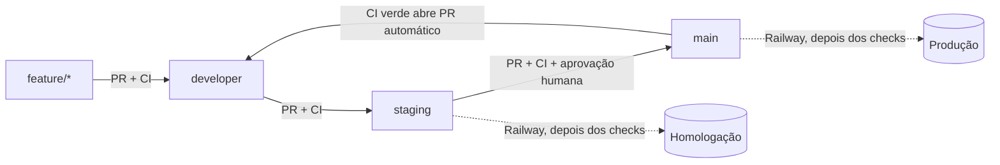

# Fluxo de CI/CD

Como uma alteração sai de uma branch de trabalho e chega à produção. A arquitetura de deploy está
em [ARQUITETURA.md §4](ARQUITETURA.md#4-infraestrutura-e-deploy) e a de CI em
[§7](ARQUITETURA.md#7-cicd-e-qualidade).

## Fluxo



| Etapa | Como acontece | O que protege |
|---|---|---|
| `feature/*` → `developer` | PR manual | Check `Build e testes` |
| `developer` → `staging` | PR manual | Check `Build e testes` e aprovação; o push publica em homologação |
| `staging` → `main` | PR manual, **merge commit** | Checks `Build e testes` e `Origem da promoção` e aprovação; o push publica em produção |
| `main` → `developer` | PR aberto pelo workflow, merge manual, **merge commit** | Check `Build e testes` |

Nenhum merge é automático. Produção só recebe código quando uma pessoa faz o merge do PR
`staging` → `main`.

**Use merge commit nas etapas entre branches longas.** Squash e rebase criam commits com outro
SHA, as branches divergem e toda promoção seguinte passa a ter conflito. Por isso também
`Require linear history` e `Require branches to be up to date` devem ficar desligados: depois de
cada promoção a `main` fica um merge commit à frente da `staging` até a sincronização chegar lá.

## Workflows

| Arquivo | Disparo | O que faz |
|---|---|---|
| [`ci.yml`](../.github/workflows/ci.yml) | PR e push em `developer`, `staging` e `main` | Job `Build e testes`, com Postgres (pgvector) e Redis reais; job `Origem da promoção` nos PRs para a `main` |
| [`sync-main-developer.yml`](../.github/workflows/sync-main-developer.yml) | CI verde em push na `main`, ou manual | Abre o PR `main` → `developer` se faltar algo e não houver PR aberto |

CodeQL segue em *default setup*, que o GitHub executa na branch padrão, nas protegidas e nos PRs
para elas. Não há workflow dele no repositório.

### Limitações do PR automático

- **Não dispara o CI do PR.** PRs abertos com `GITHUB_TOKEN` não geram eventos de workflow, e é
  isso que evita laços. O check exigido é atendido pelo push da `main`, porque a cabeça do PR é o
  mesmo commit. Esse resultado não testa a combinação com a `developer`, que é testada no push
  depois do merge. Para testar antes, feche e reabra o PR: a ação de uma pessoa dispara o CI.
- **O workflow só existe depois de chegar à `main`.** O `workflow_run` usa a versão da branch
  padrão, então a primeira execução é a do push seguinte à chegada do arquivo.

## Conflitos em `main` → `developer`

O workflow não resolve conflitos: comenta no PR e registra um aviso. Nada é alterado. Resolva em
uma branch própria, nunca na `main`:

```bash
git fetch origin
git switch -c sync/main-developer origin/developer
git merge origin/main
```

Resolva, faça o commit e abra um PR dessa branch para a `developer`. Quando ele entrar, a
`developer` passa a conter a `main` e o GitHub encerra o PR automático. Não use rebase nem force
push.

## Homologação e produção na Railway

Um serviço por branch, com gatilho de deploy próprio: a branch `staging` publica só no serviço de
homologação, e a `main` só no `tratoo`. Os dois esperam os checks do GitHub (*Wait for CI*). Os
deploys automáticos de PR estão desligados.

- **Configuração efetiva:** a Railway não lê o `railway.toml`. Build pelo `Dockerfile`, health
  check `/health/ready` e *draining* de 30 s estão nas configurações de cada serviço.
- **Migrations:** manuais nos dois serviços, sempre antes de a versão que precisa delas ser
  promovida. Aplique primeiro em homologação:

  ```bash
  railway ssh --service <servico-de-homologacao> --environment production -- sh -c "cd /app; dotnet Tratoo.API.dll --migrate-only"
  ```

  O serviço é informado de propósito: sem `--service`, a CLI usa o serviço vinculado à pasta.

### Isolamento exigido em homologação

Cada item abaixo deve ser exclusivo do serviço de homologação. Nenhum valor é registrado aqui.

| Grupo | Variáveis | Criado em |
|---|---|---|
| Banco | `ConnectionStrings__DefaultConnection`, `ConnectionStrings__VectorConnection` | Neon |
| Redis | `Redis__ConnectionString`, `Redis__ChaveProtecao` | Railway |
| Autenticação | `Jwt__SecretKey` | Gerado localmente |
| Dados cifrados | `DataProtector__Chave`; troque seguindo [ROTACAO-CHAVE-DADOS.md](ROTACAO-CHAVE-DADOS.md) se já houver dados | Gerado localmente |
| Arquivos | `CloudflareR2__*`, `CloudflareR2Private__*`: buckets e token próprios | Cloudflare |
| Pagamentos | `Asaas__ApiKey`, `Asaas__WebhookToken`: conta sandbox e webhook próprios | Asaas |
| E-mail | `Resend__ApiKey` e remetente | Resend |

## Configuração manual

Fora do repositório, portanto não versionada. Faça nesta ordem.

### GitHub

1. **Permitir que o Actions abra PRs:** Settings → Actions → General → Workflow permissions →
   *Allow GitHub Actions to create and approve pull requests*. Mantenha as permissões padrão em
   *Read repository contents*.
2. **Depois que este fluxo chegar à `main`:** em Settings → Branches → `main`, adicione
   `Origem da promoção` aos checks obrigatórios. Antes disso, nenhum PR teria esse check.
3. **Conferir as proteções:** `Build e testes` obrigatório nas três branches e force push e
   exclusão bloqueados.

### Railway e provedores

Crie as credenciais do quadro de isolamento que ainda forem compartilhadas e aplique-as somente no
serviço de homologação.

## Promover para produção

```bash
gh pr create --base main --head staging --title "release: staging → main" --body "Homologado em <data>."
```

1. Confirme a versão em homologação e aplique as migrations pendentes em produção, se houver.
2. Espere `Build e testes` e `Origem da promoção`.
3. Aprove e faça o merge com **merge commit**. A Railway publica depois dos checks da `main`.
4. Confira `/health/ready` em produção. O rollback é feito pelo histórico de deploys da Railway.
5. Faça o merge do PR `main` → `developer` que o workflow abrir.
