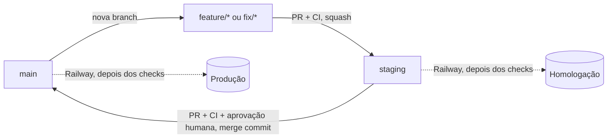

# Fluxo de CI/CD

Como uma alteração sai de uma branch de trabalho e chega à produção. A arquitetura de deploy está
em [ARQUITETURA.md §4](ARQUITETURA.md#4-infraestrutura-e-deploy) e a de CI em
[§7](ARQUITETURA.md#7-cicd-e-qualidade).

## Branches

| Branch | Tipo | Papel |
|---|---|---|
| `main` | Permanente | Produção |
| `staging` | Permanente | Homologação |
| `feature/*` | Temporária | Novas funcionalidades e melhorias |
| `fix/*` | Temporária | Correções de bugs |
| `hotfix/*` | Temporária | Correções urgentes em produção |
| `revert-*` | Temporária | Criada pelo botão **Revert** do GitHub para retirar algo da `staging` |

Toda branch de trabalho sai da `main`.

## Fluxo



1. Crie a branch a partir da `main` atualizada.
2. Abra o PR para a `staging` e espere o CI.
3. Faça o merge com **squash**. A Railway publica em homologação depois dos checks.
4. Homologue. Retire da `staging` o que for reprovado.
5. Abra o PR `staging` → `main` e espere o CI.
6. Faça o merge com **merge commit**. A Railway publica em produção depois dos checks.

Nenhum merge é automático. Produção só recebe código quando uma pessoa faz o merge de um PR.

### Por que cada método de merge

| PR | Método | Motivo |
|---|---|---|
| `feature/*`, `fix/*` e `revert-*` → `staging` | **Squash** | Cada entrega vira um commit, fácil de reverter. A branch preservada continua apta a um novo PR depois da retirada |
| `staging` → `main` | **Merge commit** | Registra o que já foi promovido. Com squash, a próxima promoção tentaria aplicar tudo de novo |
| `hotfix/*` → `main` e `staging` | **Squash** | O mesmo commit de correção entra nas duas, e a promoção seguinte não gera conflito |

O GitHub não permite escolher o método por branch, então isso é uma regra de processo. Por isso
também `Require linear history` e `Require branches to be up to date` devem ficar desligados.

## Retirar uma funcionalidade reprovada

A promoção leva tudo o que está na `staging`, então o que foi reprovado sai antes dela.

1. Abra o PR já mergeado da funcionalidade e clique em **Revert**. O GitHub cria a branch
   `revert-<número>-<nome>` e abre um PR para a `staging`.
2. Faça o merge com **squash**. Só essa funcionalidade sai, e a Railway publica a `staging` sem ela.
3. **Não apague a branch da funcionalidade.** Ajuste-a nela mesma e abra um novo PR para a
   `staging` quando estiver pronta. O PR traz a funcionalidade inteira de novo.

Se outra entrega tiver alterado as mesmas linhas depois, o botão Revert acusa conflito. Nesse caso,
faça a reversão em uma branch `fix/*`, a partir da `staging`, e resolva lá.

## Hotfix

Para uma correção que não pode esperar a homologação do que já está na `staging`:

```bash
git fetch origin
git switch -c hotfix/descricao origin/main
```

1. Faça o commit, envie a branch e abra o PR para a `main`. Espere o CI, faça o merge com
   **squash** e confira a produção.
2. Abra um segundo PR da **mesma branch** para a `staging`, também com squash. Sem isso, a correção
   não estará na homologação, e a próxima promoção pode gerar conflito.

## Conflitos

- **PR de `feature/*` ou `fix/*` para a `staging`:** faça `git merge origin/staging` na sua branch,
  resolva e envie. O conteúdo da `staging` passa a fazer parte da branch: se outra entrega for
  retirada depois, um novo PR dessa branch a trará de volta. Nesse caso, reverta-a na própria branch.
- **PR `staging` → `main`:** não use o editor de conflitos do GitHub, que tentaria gravar na
  `main` ou na `staging`. Crie `fix/*` a partir da `staging`, faça `git merge origin/main`, resolva
  e abra o PR para a `staging`.

Nunca use force push em `main` ou `staging`.

## Workflows

[`ci.yml`](../.github/workflows/ci.yml) roda em PRs e pushes de `staging` e `main`:

| Job | Quando | O que faz |
|---|---|---|
| `Build e testes` | Sempre | Build e testes, com Postgres (pgvector) e Redis reais |
| `Origem do PR` | Em PRs | Recusa origens fora das regras abaixo |

| Destino | Origens aceitas |
|---|---|
| `staging` | `feature/*`, `fix/*`, `hotfix/*`, `revert-*` |
| `main` | `staging`, `hotfix/*` |

CodeQL segue em *default setup*, que o GitHub executa na branch padrão, nas protegidas e nos PRs
para elas. Não há workflow dele no repositório.

## Homologação e produção na Railway

Um serviço por branch, com gatilho de deploy próprio: a branch `staging` publica só no serviço de
homologação, e a `main` só no `tratoo`. Os dois esperam os checks do GitHub (*Wait for CI*). Os
deploys automáticos de PR estão desligados.

- **Configuração efetiva:** a Railway não lê o `railway.toml`. Build pelo `Dockerfile`, health
  check `/health/ready` e *draining* de 30 s estão nas configurações de cada serviço.
- **Migrations:** manuais nos dois serviços, sempre antes de a versão que precisa delas ser
  promovida. Aplique primeiro em homologação:

  ```bash
  railway ssh --service <servico-de-homologacao> --environment production -- sh -c "cd /app; dotnet Tratoo.API.dll --migrate-only"
  ```

  O serviço é informado de propósito: sem `--service`, a CLI usa o serviço vinculado à pasta.

### Isolamento exigido em homologação

Cada item abaixo deve ser exclusivo do serviço de homologação. Nenhum valor é registrado aqui.

| Grupo | Variáveis | Criado em |
|---|---|---|
| Banco | `ConnectionStrings__DefaultConnection`, `ConnectionStrings__VectorConnection` | Neon |
| Redis | `Redis__ConnectionString`, `Redis__ChaveProtecao` | Railway |
| Autenticação | `Jwt__SecretKey` | Gerado localmente |
| Dados cifrados | `DataProtector__Chave`; troque seguindo [ROTACAO-CHAVE-DADOS.md](ROTACAO-CHAVE-DADOS.md) se já houver dados | Gerado localmente |
| Arquivos | `CloudflareR2__*`, `CloudflareR2Private__*`: buckets e token próprios | Cloudflare |
| Pagamentos | `Asaas__ApiKey`, `Asaas__WebhookToken`: conta sandbox e webhook próprios | Asaas |
| E-mail | `Resend__ApiKey` e remetente | Resend |

## Configuração manual

Fora do repositório, portanto não versionada. Faça depois que este fluxo chegar à `main`.

### GitHub

1. **Exigir a origem:** em Settings → Branches, adicione `Origem do PR` aos checks obrigatórios da
   `staging` e da `main`. Antes disso, o job só avisa.
2. **Conferir as proteções:** `Build e testes` obrigatório nas duas branches, com force push e
   exclusão bloqueados.
3. **Desativar rebase:** em Settings → General, desmarque *Allow rebase merging*.

### Railway e provedores

Crie as credenciais do quadro de isolamento que ainda forem compartilhadas e aplique-as somente no
serviço de homologação.

## Promover para produção

```bash
gh pr create --base main --head staging --title "release: staging → main" --body "Homologado em <data>."
```

1. Confirme a versão em homologação e aplique as migrations pendentes em produção, se houver.
2. Espere `Build e testes` e `Origem do PR`.
3. Aprove e faça o merge com **merge commit**. A Railway publica depois dos checks da `main`.
4. Confira `/health/ready` em produção. O rollback é feito pelo histórico de deploys da Railway.
