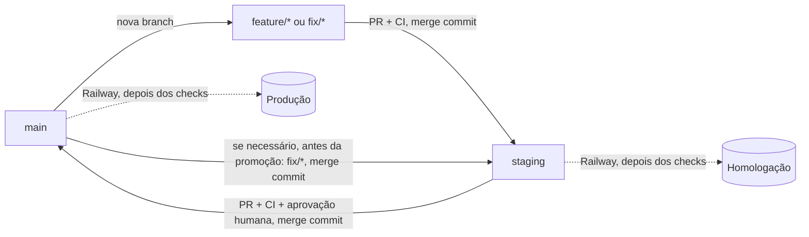

# Fluxo de CI/CD

Como uma alteração sai de uma branch de trabalho e chega à produção. A arquitetura de deploy está
em [ARQUITETURA.md §4](ARQUITETURA.md#4-infraestrutura-e-deploy) e a de CI em
[§7](ARQUITETURA.md#7-cicd-e-qualidade).

## Branches

| Branch | Tipo | Papel |
|---|---|---|
| `main` | Permanente | Produção |
| `staging` | Permanente | Homologação |
| `feature/*` | Temporária | Novas funcionalidades e melhorias |
| `fix/*` | Temporária | Correções de bugs |
| `hotfix/*` | Temporária | Correções urgentes em produção |
| `revert-*` | Temporária | Criada pelo botão **Revert** do GitHub para retirar algo da `staging` |
| `dependabot/*` | Temporária | Criada pelo Dependabot para atualizar uma dependência, sempre para a `staging` ([Dependências](#dependências)) |

Toda branch de trabalho sai da `main`.

## Fluxo



1. Crie a branch a partir da `main` atualizada.
2. Abra o PR para a `staging` e espere o CI. Se o GitHub indicar que a branch está desatualizada,
   use **Update branch**.
3. Faça o merge com **merge commit**. A Railway publica em homologação depois dos checks.
4. Homologue. Retire da `staging` o que for reprovado.
5. Se a `main` tiver algo que a `staging` não tem,
   [leve a `main` para a `staging`](#levar-a-main-para-a-staging).
6. Abra o PR `staging` → `main` e espere o CI.
7. Faça o merge com **merge commit**. A Railway publica em produção depois dos checks.

Nenhum merge é automático. Produção só recebe código quando uma pessoa faz o merge de um PR.

### Método de merge

**Todo PR entra com merge commit**: `feature/*`, `fix/*`, `hotfix/*`, `revert-*` e `dependabot/*`
na `staging`, e `staging` e `hotfix/*` na `main`. Com uma regra só, não há método a escolher em
cada PR.

- **Os commits mantêm a mesma identidade nas duas branches.** O que foi promovido não é aplicado de
  novo na promoção seguinte, e um `hotfix/*` mesclado na `main` e na `staging` é o mesmo commit nas
  duas, sem conflito depois.
- **A `main` chega à `staging` sem passo extra.** Toda branch de trabalho sai da `main`; quando ela
  entra na `staging` com merge commit, leva junto o merge da última promoção. Por isso
  [levar a `main` para a `staging`](#levar-a-main-para-a-staging) só é necessário quando nenhuma
  branch criada depois da promoção entrou na `staging`.
- **O custo é na retirada:** reverter um merge commit desfaz a entrega inteira, mas um novo PR da
  mesma branch não a traz de volta sozinho. Veja
  [Retirar uma funcionalidade reprovada](#retirar-uma-funcionalidade-reprovada).

O squash continua habilitado no repositório, mas não é usado. `Require linear history` precisa
ficar desligado, porque merge commit não é linear.

### Levar a `main` para a `staging`

`main` e `staging` exigem *Require branches to be up to date*: a origem de um PR precisa conter a
ponta do destino. Cada promoção cria um merge commit que só existe na `main`, e o botão **Update
branch** não resolve no PR `staging` → `main`, porque tentaria gravar direto na `staging`
protegida.

Normalmente esse merge chega à `staging` sozinho, junto com a próxima branch de trabalho (ver
[Método de merge](#método-de-merge)). Antes de promover, confira:

```bash
git fetch origin
git rev-list --count origin/staging..origin/main   # 0: nada a fazer
```

Se der mais que 0, depois da homologação:

```bash
git fetch origin
git switch -c fix/sincroniza-main origin/staging
git merge origin/main
git push -u origin fix/sincroniza-main
gh pr create --base staging --title "chore: leva a main para a staging" --body "Preparação da promoção."
```

Faça o merge com **merge commit**. Depois dele, a Railway publica a `staging` de novo, e o PR
`staging` → `main` pode seguir.

### Efeito do Update branch

**Update branch** faz o merge da `staging` na sua branch, então ela passa a conter as outras
entregas que estavam lá. Isso não atrapalha o merge para a `staging`, mas tem duas consequências:

- Se outra entrega for retirada depois, um novo PR da sua branch a trará de volta. Antes de abri-lo,
  reverta essa entrega na sua branch.
- Um merge na `staging` deixa os demais PRs abertos desatualizados, e cada um precisa de um novo
  Update branch.

## Retirar uma funcionalidade reprovada

A promoção leva tudo o que está na `staging`, então o que foi reprovado sai antes dela.

1. Abra o PR já mergeado da funcionalidade e clique em **Revert**. O GitHub cria a branch
   `revert-<número>-<nome>`, com um commit que desfaz o merge inteiro, e abre um PR para a
   `staging`.
2. Faça o merge com **merge commit**. Só essa funcionalidade sai, e a Railway publica a `staging`
   sem ela.
3. **Não apague a branch da funcionalidade.** Para trazê-la de volta, **não basta** ajustar a branch
   e abrir um novo PR: os commits dela já constam como mesclados, e só o ajuste entraria, sem a
   funcionalidade e sem nenhum aviso. Na branch da funcionalidade, nesta ordem:

   ```bash
   git fetch origin
   git switch <branch-da-funcionalidade>
   git merge origin/staging            # traz o revert: a funcionalidade some da branch
   git revert <sha-do-commit-de-revert> # devolve a funcionalidade
   # ajustes, commit, push e novo PR para a staging
   ```

   O `<sha-do-commit-de-revert>` é o commit da branch `revert-*` (não o merge do PR de revert).
   Confira o [efeito do Update branch](#efeito-do-update-branch): o merge da `staging` traz também as
   outras entregas.

Se outra entrega tiver alterado as mesmas linhas depois, o botão Revert acusa conflito. Nesse caso,
faça a reversão em uma branch `fix/*`, a partir da `staging`, e resolva lá.

## Hotfix

Para uma correção que não pode esperar a homologação do que já está na `staging`:

```bash
git fetch origin
git switch -c hotfix/descricao origin/main
```

1. Faça o commit, envie a branch e abra o PR para a `main`. Espere o CI, faça o merge com
   **merge commit** e confira a produção.
2. Abra um segundo PR da **mesma branch** para a `staging`, use **Update branch** e faça o merge
   também com merge commit. Sem isso, a correção não estará na homologação. Como o commit da
   correção é o mesmo nas duas branches, a próxima promoção não gera conflito.

Siga essa ordem: depois do Update branch, a branch contém o que está na `staging` e não pode mais
ir para a `main`.

## Conflitos

- **PR de `feature/*` ou `fix/*` para a `staging`:** faça `git merge origin/staging` na sua branch,
  resolva e envie. O resultado é o mesmo do [Update branch](#efeito-do-update-branch).
- **PR do Dependabot:** veja [Conflito em PR do Dependabot](#conflito-em-pr-do-dependabot).
- **PR `staging` → `main`:** não use o editor de conflitos do GitHub, que tentaria gravar na
  `main` ou na `staging`. Resolva no `git merge origin/main` de
  [levar a `main` para a `staging`](#levar-a-main-para-a-staging).

Nunca use force push em `main` ou `staging`.

## Workflows

[`ci.yml`](../.github/workflows/ci.yml) roda em PRs e pushes de `staging` e `main`:

| Job | Quando | O que faz |
|---|---|---|
| `Origem do PR` | Em PRs | Recusa origens fora das regras abaixo |
| `Build e testes` | Sempre | Restore travado nos lock files, verificação de pacotes vulneráveis, build, verificação de migrations e testes com Postgres (pgvector) e Redis reais |
| `Imagem Docker` | Sempre | Constrói a imagem pelo `Dockerfile` da raiz, a mesma que a Railway constrói, sem publicar, e faz a varredura com o Trivy |

| Destino | Origens aceitas |
|---|---|
| `staging` | `feature/*`, `fix/*`, `hotfix/*`, `revert-*`, `dependabot/*` |
| `main` | `staging`, `hotfix/*` |

Em todos os casos o PR precisa sair deste repositório; PR de fork é recusado.

### Passos do `Build e testes`

1. **Restore** com `--locked-mode` e `dotnet tool restore`. Falha se algum `.csproj` divergir do
   `packages.lock.json` dele ([Lock files](#lock-files)).
2. **Pacotes vulneráveis** ([`verificar-vulnerabilidades.sh`](../.github/scripts/verificar-vulnerabilidades.sh)):
   diretos e transitivos, pela base de avisos do nuget.org. **High** e **Critical** falham o job;
   **Moderate** e **Low** viram aviso. O `dotnet list package --vulnerable` sai com 0 mesmo achando
   algo, por isso a decisão é tomada no script, sobre a saída JSON.
3. **Build** em Release.
4. **Migrations em dia com o modelo**: `dotnet ef migrations has-pending-model-changes` falha se o
   modelo do `TratooContext` mudou sem migration correspondente. Não abre conexão: o
   `TratooContextFactory` fixa a versão do Postgres e nenhum banco é necessário. Isso **não** é o
   mesmo que migration pendente de aplicação: uma migration já criada e ainda não aplicada no Neon
   passa aqui e continua sendo aplicada à mão ([Migrations](#homologação-e-produção-na-railway)).
   O `VectorContext` não tem migrations (o schema vem do `VectorDbInitializer`) e fica de fora.
5. **Testes**, com `TRATOO_EXIGIR_DOCKER=1`: sem Docker, os testes de integração falham em vez de
   serem ignorados.

### Passos do `Imagem Docker`

1. **Build** com Buildx e cache do GitHub Actions (`type=gha`). A imagem vai só para o Docker local
   do runner (`load`), nunca para um registro.
2. **Trivy**, fixado por versão e digest na variável `TRIVY_IMAGEM` do job. Falha em **CRITICAL**
   e **HIGH** que tenham correção disponível (`--ignore-unfixed`). Vulnerabilidade sem correção
   some quando a Microsoft ou a distro corrigir e a imagem base for atualizada. A base de dados do
   Trivy fica em cache por um dia.

Exceções ficam no [`.trivyignore`](../.trivyignore), uma por linha, cada uma com o identificador
(CVE), o motivo de não se aplicar e uma validade (`exp:AAAA-MM-DD`). Vencida a validade, o Trivy
volta a reportar a vulnerabilidade e o job falha: a exceção é revista, nunca renovada no automático.
Para pacotes NuGet não há lista de exceções.

Exceções em vigor:

| CVE | Pacote | Motivo | Validade |
|---|---|---|---|
| CVE-2026-109518 | `apt`, `libapt-pkg6.0t64` (Ubuntu 24.04 da `aspnet:10.0`) | A falha está no apt ao baixar pacotes; o container nunca executa apt e roda como UID 1654. Corrigida no Ubuntu (2.8.4ubuntu0.1), ainda não na imagem da Microsoft | 23/11/2026 |

### Atalho de documentação

Se a mudança é **só documentação** (todos os arquivos em `Docs/` ou `.md` na raiz), `Build e
testes` e `Imagem Docker` passam em segundos, sem build nem testes. A decisão fica em
[`classificar-mudanca.sh`](../.github/scripts/classificar-mudanca.sh), chamado como primeiro
passo de cada job. Qualquer outro arquivo alterado, ou não conseguir calcular a diferença, roda a
CI completa.

O atalho não usa `paths-ignore` de propósito: os checks são obrigatórios e sem bypass, então um
workflow que não roda deixaria o PR preso em "Expected". Também não é um job separado ligado por
`needs`: se ele falhasse, os jobs dependentes seriam pulados, e um check obrigatório pulado conta
como aprovado. Como o check passa, o Railway (*Wait for CI*) ainda faz deploy num push só de docs;
para evitar, configure *Watch Paths* no serviço.

### Versões fixadas

| O quê | Como |
|---|---|
| Actions | Tag de major (`actions/checkout@v7`, `docker/build-push-action@v7`…), atualizadas pelo Dependabot |
| Trivy | Versão e digest (`aquasec/trivy:0.76.2@sha256:…`). Nunca `latest`. Atualização manual: troque os dois juntos |
| `dotnet-ef` | [`.config/dotnet-tools.json`](../.config/dotnet-tools.json), na mesma versão do EF Core dos `.csproj` |
| SDK .NET | `10.0.x` no `setup-dotnet` e `sdk:10.0` no `Dockerfile`, as duas na mesma major |

[`monitor-recifragem.yml`](../.github/workflows/monitor-recifragem.yml) é agendado a cada 2 h (o
GitHub atrasa e às vezes pula execuções agendadas) e lê o `/health/ready` público de produção e
homologação ([ROTACAO-CHAVES.md](ROTACAO-CHAVES.md#6-recifragem-automática-e-monitoramento)).

CodeQL segue em *default setup*, que o GitHub executa na branch padrão, nas protegidas e nos PRs
para elas. Não há workflow dele no repositório.

## Dependências

### Lock files

Cada projeto tem um `packages.lock.json` versionado com a árvore completa de pacotes, diretos e
transitivos, com hash. O [`Directory.Build.props`](../Directory.Build.props) liga isso para todos os
projetos, e a CI e o `Dockerfile` restauram com `--locked-mode`. O
[`Directory.Build.targets`](../Directory.Build.targets) tira o lock file do publish, para ele não ir
para a imagem.

Depois de adicionar, remover ou mudar a versão de um `PackageReference`:

```bash
dotnet restore Tratoo.sln
git add '**/packages.lock.json'
```

Sem isso, a CI falha no restore com `NU1004`.

### Dependabot

[`dependabot.yml`](../.github/dependabot.yml) abre PRs semanais (segunda de manhã) para a
`staging`, para NuGet (incluindo o `dotnet-ef`), actions e imagens do `Dockerfile`. Os PRs saem
de `dependabot/*`, por isso o check `Origem do PR` aceita essa origem só para a `staging`.

- A família Microsoft/System e o `dotnet-ef` vêm num PR só, com minor e patch, para ficarem na
  mesma versão.
- A major de EF Core, ASP.NET Core, Npgsql EF, `dotnet-ef` e das imagens `dotnet/*` é ignorada:
  ela exige outro runtime e sobe no PR de migração do .NET.
- O Dependabot atualiza o lock file **do projeto que ele mexeu**, mas não o dos projetos que
  dependem dele. Quando isso acontece, o PR falha; veja
  [Lock files em PR do Dependabot](#lock-files-em-pr-do-dependabot).
- Cada PR passa pela CI completa e só entra com merge manual, depois da homologação, como qualquer
  entrega. Leia as notas de versão antes do merge: o check de compatibilidade é o build e os
  testes, não a ausência de conflito.
- Os testes não exercitam as integrações externas (R2, Asaas, Resend, OpenAI). Atualização de
  pacote que fala com uma delas, ou que muda de major, precisa de teste manual em homologação antes
  da promoção. Exemplos: o AWSSDK 4 mudou o padrão de checksum dos uploads do R2, e o QuestPDF 2026.9
  passou a recusar fonte ausente (o PDF do contrato hoje tem teste próprio, o `ContratosPdfTests`).

#### Lock files em PR do Dependabot

**Quando:** o check `Build e testes` de um PR do Dependabot falha no passo **Restore** com
`NU1004` (*"The project references … whose dependencies has changed"*). Acontece quando o pacote
atualizado está no `Tratoo.Domain` ou no `Tratoo.API`: o `Tratoo.API` referencia o Domain, e o
`Tratoo.Tests` referencia os dois, então os lock files deles continuam com a versão antiga como
dependência transitiva. Se o lock file desatualizado for o do `Tratoo.API`, o `Imagem Docker` também
falha, no `dotnet restore --locked-mode` do build; o do `Tratoo.Tests` não afeta a imagem, porque o
`Dockerfile` não restaura os testes. Um PR que só mexe no `Tratoo.Tests` não tem dependentes e não
passa por isso.

**Como corrigir**, na própria branch do PR:

```bash
git fetch origin
git switch --track origin/dependabot/nuget/<caminho-da-branch-do-PR>
dotnet restore Tratoo.sln --force-evaluate
git status --short
git diff -- '*/packages.lock.json'
```

**O que revisar antes do commit:**

- `git status` mostra **só** arquivos `packages.lock.json`, normalmente dos projetos que dependem
  do projeto que o Dependabot alterou. Qualquer `.csproj` ou outro arquivo alterado é sinal de que
  algo saiu do esperado: pare e investigue.
- No diff, a única mudança de versão é a do pacote do PR (e as dependências que ele mesmo traz).
  Outro pacote mudando de versão também é motivo para parar.

```bash
git add '*/packages.lock.json'
git commit -m "chore(deps): atualiza os lock files dos projetos dependentes"
git push
```

**Como validar:**

- Localmente: `dotnet restore Tratoo.sln --locked-mode` passa, e `dotnet build Tratoo.sln -c Release`
  e `dotnet test Tratoo.sln` ficam verdes.
- No PR: os três checks (`Origem do PR`, `Build e testes`, `Imagem Docker`) ficam verdes.

Depois de um commit manual, o Dependabot deixa de rebasear a branch sozinho. Se ele precisar
recriar o PR (`@dependabot recreate`), o commit manual se perde e o procedimento é repetido. Não há
automação para isso de propósito: ela precisaria de um token com escrita nos PRs do Dependabot.

#### Conflito em PR do Dependabot

Acontece quando outro PR de dependência entra na `staging` antes e muda a mesma linha de um
`.csproj` (pacotes vizinhos, ou o mesmo pacote numa versão diferente) ou os mesmos lock files. Um
merge na `staging` deixa os demais PRs do Dependabot desatualizados.

```bash
git fetch origin
git switch --track origin/dependabot/nuget/<caminho-da-branch-do-PR>
git merge origin/staging
```

- **`.csproj`:** fique com as duas mudanças: a versão que veio da `staging` para os outros pacotes e
  a versão deste PR para o pacote dele. Quando é o mesmo pacote, fica a versão do PR.
- **Lock files:** não junte o JSON à mão. Pegue a versão da `staging` de todos eles (isso também
  resolve os que estão em conflito) e regenere a partir dos `.csproj` resolvidos:

  ```bash
  git checkout origin/staging -- '*/packages.lock.json'
  dotnet restore Tratoo.sln --force-evaluate
  git diff origin/staging --stat
  git add '*/*.csproj' '*/packages.lock.json'
  git commit --no-edit
  ```

  O `git diff origin/staging` deve mostrar só o pacote do PR, nos `.csproj` e nos lock files.
  Valide como em [Lock files em PR do Dependabot](#lock-files-em-pr-do-dependabot) e envie com
  `git push`, sem force.

## Homologação e produção na Railway

Um serviço por branch, com gatilho de deploy próprio: a branch `staging` publica só no serviço de
homologação, e a `main` só no `tratoo`. Os dois esperam os checks do GitHub (*Wait for CI*). Os
deploys automáticos de PR estão desligados.

- **Configuração efetiva:** a Railway não lê o `railway.toml`. Build pelo `Dockerfile`, health
  check `/health/ready` e *draining* de 30 s estão nas configurações de cada serviço.
- **Migrations:** manuais nos dois serviços, sempre antes de a versão que precisa delas ser
  promovida. A CI garante que a migration **existe** para cada mudança de modelo; aplicá-la no
  banco continua sendo este passo. Aplique primeiro em homologação:

  ```bash
  railway ssh --service <servico-de-homologacao> --environment production -- sh -c "cd /app; dotnet Tratoo.API.dll --migrate-only"
  ```

  O serviço é informado de propósito: sem `--service`, a CLI usa o serviço vinculado à pasta.
- **Réplicas:** produção com 2 e homologação com 1, a não ser durante um ensaio. Os dois serviços
  usam `restartPolicyType = ALWAYS`. Altere com `railway scale --service <servico> us-east4-eqdc4a=<n>`.
- **Repetir um deploy:** use `railway redeploy --from-source`. Sem a opção, a repetição falhou duas
  vezes na etapa de build em homologação.

### Validar as duas réplicas

Veja as respostas alternando:

```bash
for i in $(seq 1 12); do curl -s https://www.tratoo.app.br/health/live | grep -o '"instancia":"[^"]*"'; done
```

Para ensaiar a queda de uma réplica, descubra os identificadores no campo `deploymentInstanceId`:

```bash
railway logs --service tratoo --environment production --http --path /health/live --lines 20 --json
```

Encerre uma réplica, mantendo o tráfego no ar. O comando só funciona pelo PowerShell, no Windows:

```bash
railway ssh --service tratoo --environment production --deployment-instance <id> -- sh -c "kill -TERM 1"
```

O esperado é o log mostrar `SIGTERM recebido` e depois `Now listening` para a mesma réplica, em
poucos segundos, e o serviço voltar a 2/2 online. Confira requisições lentas ou com erro em
`railway logs --http`, no campo `upstreamErrors`.

### Isolamento exigido em homologação

Cada item abaixo deve ser exclusivo do serviço de homologação. Nenhum valor é registrado aqui.

| Grupo | Variáveis | Criado em |
|---|---|---|
| Banco | `ConnectionStrings__DefaultConnection`, `ConnectionStrings__VectorConnection` | Neon |
| Redis | `Redis__ConnectionString`, `Redis__ChaveProtecao` | Railway |
| Autenticação | `Jwt__SecretKey` | Gerado localmente |
| Dados cifrados | `DataProtector__Chave`; troque seguindo [ROTACAO-CHAVES.md](ROTACAO-CHAVES.md#1-chave-de-dados-dataprotector) se já houver dados | Gerado localmente |
| Arquivos | `CloudflareR2__*`, `CloudflareR2Private__*`: buckets e token próprios | Cloudflare |
| Pagamentos | `Asaas__ApiKey`, `Asaas__WebhookToken`: conta sandbox e webhook próprios | Asaas |
| E-mail | `Resend__ApiKey` e remetente | Resend |

## Configuração manual

Fica fora do repositório, portanto não é versionada. Se recriar algo, use estes valores.

### GitHub

Proteção de `main` e `staging`:

| Regra | Valor |
|---|---|
| Checks obrigatórios | `Build e testes`, `Origem do PR` e `Imagem Docker` |
| *Require branches to be up to date* | Ligado |
| PR obrigatório | Sim, com 0 aprovações: o merge manual é a aprovação humana |
| *Do not allow bypassing* (`enforce_admins`) | Ligado: vale também para administradores |
| Force push e exclusão | Bloqueados |

No repositório: merge commit ativo, *Allow rebase merging* desmarcado. O squash está ativo, mas
não é usado ([Método de merge](#método-de-merge)).

Os três checks respeitam o [atalho de documentação](#atalho-de-documentação): um PR só de docs não
fica preso esperando build.

Em *Settings → Code security*, mantenha ligados os alertas do Dependabot (*Dependabot alerts*). Eles
são independentes do `dependabot.yml`.

### Railway e provedores

Crie as credenciais do quadro de isolamento que ainda forem compartilhadas e aplique-as somente no
serviço de homologação.

#### Redis: persistência das sessões (pendente)

Com o controle de sessão, o Redis guarda as sessões de login. O snapshot RDB atual
(`--save 60 1`) pode perder até um minuto de escrita num reinício; com AOF, a perda cai para cerca
de um segundo. Perder sessões não perde dado (só obriga a novo login), mas um reinício do Redis
deslogaria todo mundo. Passo manual, nos serviços `Redis` de produção e de homologação, nas
configurações do serviço (comando de início), sem tirar a senha nem o RDB:

```
redis-server --requirepass <a mesma referência de senha de hoje> --save 60 1 --appendonly yes --appendfsync everysec
```

Depois de aplicar, confira pelo `redis-cli` dentro do serviço:

```
CONFIG GET appendonly            # esperado: yes
CONFIG GET appendfsync           # esperado: everysec
CONFIG GET maxmemory-policy      # NÃO pode ser allkeys-* (apagaria sessões vivas sob pressão de memória)
```

`noeviction` (padrão) ou `volatile-*` servem: toda chave de sessão tem TTL. Com `allkeys-lru` ou
`allkeys-random`, o Redis poderia descartar uma sessão ativa e deslogar alguém sem motivo.

#### Deploy do controle de sessão

- O primeiro deploy com sessão no servidor **desloga todos os usuários** uma vez: os tokens antigos
  não têm o claim `sid` e recebem 401.
- `Jwt__ExpirationHours` deixa de ser lido. Remova a variável dos dois serviços depois do deploy.
- Os tempos têm padrão no código; `Sessao__*` só é necessário para mudar algum
  ([ARQUITETURA.md §2.6](ARQUITETURA.md#26-autenticação-e-autorização)).
- Trocar `Redis__ChaveProtecao` desloga todos (as sessões ficam ilegíveis).

## Promover para produção

```bash
gh pr create --base main --head staging --title "release: staging → main" --body "Homologado em <data>."
```

1. Confira se a `main` tem algo que a `staging` não tem
   (`git rev-list --count origin/staging..origin/main`). Se tiver,
   [leve a `main` para a `staging`](#levar-a-main-para-a-staging) antes de abrir o PR.
2. Confirme a versão em homologação e aplique as migrations pendentes em produção, se houver.
3. Espere os três checks: `Origem do PR`, `Build e testes` e `Imagem Docker`.
4. Faça o merge com **merge commit**. A Railway publica depois dos checks da `main`.
5. Confira `/health/ready` em produção. O rollback é feito pelo histórico de deploys da Railway.
