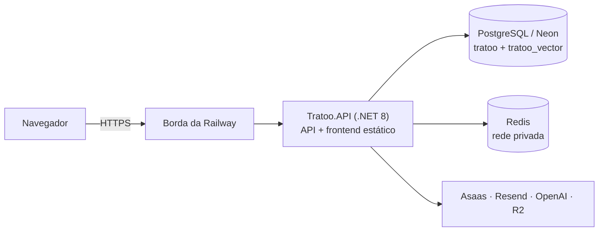

# Tratoo

[](https://github.com/Gustavo-C-almeida/tratoo/actions/workflows/ci.yml)

Marketplace de serviços que conecta **contratantes** a **prestadores freelancers**. Cobre o ciclo
completo de uma contratação: o projeto é publicado, os interessados mandam propostas, as partes
assinam um contrato digital, o pagamento fica retido em garantia (escrow) até a entrega ser
aprovada e, no fim, os dois lados se avaliam. Se houver desacordo, um administrador media a
disputa.

> **Status:** projeto de estudo e portfólio, publicado em
> [www.tratoo.app.br](https://www.tratoo.app.br). Os pagamentos usam o **ambiente de sandbox do
> Asaas**, então nenhuma transação é real.
>
> A documentação técnica completa, com decisões, evidências e limitações, fica em
> **[Docs/ARQUITETURA.md](Docs/ARQUITETURA.md)**.

---

## O problema que o Tratoo resolve

| Problema | Como o Tratoo trata |
|---|---|
| O prestador teme entregar e não receber | O valor é pago via PIX e fica retido antes de o trabalho começar |
| O contratante teme pagar e não receber | O pagamento só é liberado depois que a entrega é aprovada, ou quando o prazo de liberação automática vence |
| Falta de confiança entre desconhecidos | Identidade verificada (CPF/CNPJ), reputação pública e avaliação às cegas |
| Desacordos sem mediação | Disputa formal, decidida por um administrador |
| Falta de prova do que foi combinado | Contrato assinado pelas duas partes com código por e-mail, hash SHA-256, IP registrado e PDF arquivado |

A plataforma **não cobra taxa própria**. O valor vai inteiro para o prestador. A tela de pagamento
mostra apenas a taxa operacional do gateway (Asaas), a título informativo.

---

## Principais funcionalidades

1. **Cadastro e onboarding:** confirmação do e-mail por código, MFA opcional e perfil mínimo
   obrigatório antes de usar a plataforma. O CPF/CNPJ é cifrado em repouso e o CNPJ é validado na
   BrasilAPI.
2. **Perfis:** vitrine do prestador com portfólio, competências, experiências e certificações, e
   um percentual de completude do perfil.
3. **Projetos e propostas:** rascunho e publicação, busca com filtros, convites, proposta com até
   10 rodadas de negociação versionada e chat do projeto.
4. **Busca semântica:** embeddings da OpenAI guardados no PostgreSQL com pgvector, ranqueados por
   um score que combina similaridade, habilidades, comprovação, perfil, avaliação, histórico e
   verificação. Se a IA falhar, a busca cai para palavras-chave.
5. **Contrato digital:** gerado quando a proposta é aceita, assinado pelas duas partes com OTP (10
   minutos, 5 tentativas) e congelado em snapshot e PDF num bucket privado.
6. **Pagamento em escrow:** cobrança PIX no Asaas, webhook idempotente, ledger financeiro imutável,
   liberação manual ou automática (prazo de entrega + 7 dias) e limite diário por contratante.
7. **Entrega, cancelamento e disputa:** entrega formal com anexos, aprovação ou pedido de ajustes,
   cancelamento com regras por estágio e disputa com resolução administrativa.
8. **Avaliação às cegas:** nenhuma nota aparece antes de as duas partes avaliarem ou de a janela
   de 7 dias fechar. Assim ninguém avalia por retaliação.

---

## Tecnologias

| Camada | Tecnologia |
|---|---|
| Backend | .NET 8 · ASP.NET Core Minimal API · EF Core 9 · Npgsql |
| Banco | PostgreSQL (Neon) com pgvector (índice HNSW) |
| Cache e estado compartilhado | Redis (StackExchange.Redis) |
| Autenticação | JWT em cookie `HttpOnly` · BCrypt · MFA por e-mail |
| Integrações | Asaas (PIX) · Resend (e-mail) · OpenAI (embeddings) · Cloudflare R2 (arquivos) · BrasilAPI · ViaCEP |
| Frontend | HTML, CSS e JavaScript sem framework · Web Components · ES Modules · Bootstrap 5.3 |
| Infraestrutura | Docker · Railway · Docker Compose (Nginx, Postgres, Redis) para o ambiente local |
| Qualidade | xUnit · GitHub Actions · CodeQL |
| Outros | Serilog · QuestPDF |

---

## Arquitetura resumida



| Projeto | Responsabilidade |
|---|---|
| `Tratoo.API` | Host HTTP: `Program.cs`, endpoints Minimal API, middlewares, health checks, background services e infraestrutura (proxy, rate limiting, Redis, encerramento) |
| `Tratoo.Domain` | Regras de negócio organizadas por feature, entidades e `DbContext` do EF Core, além das implementações das integrações externas |
| `Tratoo.Web` | Frontend estático (`wwwroot`), servido pela própria API |
| `Tratoo.Tests` | 238 testes: unidade, host em memória e integração com Postgres e Redis reais via Docker |

O mesmo executável tem modos extras de linha de comando: `--healthcheck` (sonda do Docker),
`--migrate-only` (aplica migrations e sai) e `--recifrar-dados` (rotação da chave de criptografia).

---

## Infraestrutura e deploy

- **Produção na Railway:**
  - uma réplica da API, gerada a partir do `Dockerfile` da raiz, na região `sfo`;
  - um serviço Redis acessível só pela rede privada;
  - o banco no Neon, fora da Railway, na região `us-east-2`.
- **Deploy contínuo:** todo push na `main` gera um deploy, mas a Railway só faz o build depois que
  os checks do GitHub (CI e CodeQL) passam. A versão nova só recebe tráfego depois de passar no
  `/health/ready`. O rollback é manual, pelo histórico de deploys.
- **Container:**
  - imagem multi-stage (`sdk:8.0` → `aspnet:8.0`), processo rodando sem root (UID 1654);
  - a porta vem da variável `PORT` (8080 como reserva);
  - `ENTRYPOINT` em forma exec e encerramento gracioso de até 25 s.
- **Health checks:** `/health/live` verifica só o processo. `/health/ready` verifica PostgreSQL,
  pgvector, se a chave de criptografia decifra os dados existentes e, quando há Redis, o Redis. É
  ele que a Railway usa para decidir se promove uma versão.
- **Ambiente local:** o `compose.yaml` reproduz a topologia de produção com Nginx (TLS), duas
  réplicas da API, Postgres com pgvector, Redis e um serviço de migrations.

> A Railway não lê mais o `railway.toml` (o Config as Code foi depreciado). O health check e o
> *draining* de 30 s ficam nas configurações do serviço, e o arquivo continua no repositório como
> referência. A auditoria de 29/10 descobriu que eles nunca tinham sido aplicados, e a correção
> entrou em 30/10. Detalhes em [ARQUITETURA.md §4.3](Docs/ARQUITETURA.md#43-railwaytoml--configuração-efetiva).

---

## Segurança e confiabilidade

- **IP real do cliente atrás do proxy**, com um trust boundary explícito. Só a rede interna da
  Railway pode apresentar `X-Forwarded-For`, e o número de saltos (2) foi medido em produção. O IP
  correto alimenta a auditoria, o rate limiting e o HSTS.
- **Rate limiting por IP** em login, cadastro, reset de senha, dados bancários e OTP de contrato.
  O contador é distribuído no Redis e, se o Redis cair, o limite volta para a memória do processo.
- **OTP de uso único sob concorrência:** a tentativa é contada antes da comparação e o código é
  apagado de forma atômica. Se o armazenamento ficar indisponível, a operação é recusada com 503.
- **Dados sensíveis cifrados com AES-256** (conta bancária, chave PIX, CPF/CNPJ). A chave fica fora
  do código, a API não sobe sem ela e já existe um roteiro de rotação sem indisponibilidade.
- **Estado no Redis protegido:** valores cifrados com AES-256-GCM e nomes de chave em HMAC, para
  não expor e-mails nem IPs.
- **XSS:** CodeQL ativo no repositório e montagem de DOM segura (`utils/dom.js`). Ainda há alertas
  em aberto e uma migração em andamento, descritas na documentação técnica.
- **Idempotência financeira:** índices únicos para cobrança e webhook, e a liberação de pagamento
  reivindica o registro de forma atômica no banco. Duas instâncias não liberam o mesmo pagamento.
- **Segredos:** nenhum segredo versionado. Produção usa variáveis da Railway, e o CI roda sem
  segredos.

---

## CI e testes automatizados

O workflow [`.github/workflows/ci.yml`](.github/workflows/ci.yml) roda em todo PR e em todo push na
`main`. Ele faz restore, build em Release e roda os testes. A branch `main` exige que esse check
passe; a regra não se aplica a administradores.

- **238 testes** com xUnit: 206 de unidade e de host em memória (TestServer) e 32 de integração
  contra Postgres (pgvector) e Redis reais, iniciados via Docker.
- **No CI, a ausência de Docker é falha** (`TRATOO_EXIGIR_DOCKER=1`). Um pipeline verde garante
  que os testes de integração rodaram.
- **Cobertura:** proxy e IP, rate limiting, health checks, porta e encerramento, estado efêmero e
  OTP (inclusive concorrência), criptografia e rotação de chave, migrations e jobs com várias
  réplicas.
- **Lacuna conhecida:** não há testes de ponta a ponta das regras de negócio nem do frontend.

```bash
dotnet test Tratoo.sln
```

Sem Docker, os testes de integração são marcados como ignorados.

---

## Como executar localmente

### Com Docker (recomendado)

Pré-requisitos: Docker com Compose v2 e OpenSSL (já vem no Git Bash, no Windows).

```bash
cp .env.example .env
```

Preencha o `.env`. Se faltar uma variável obrigatória, o compose para e diz qual é.

```bash
bash infra/nginx/gerar-certificado.sh
```

```bash
docker compose up -d --build --wait
```

Acesse `https://localhost` (o certificado é autoassinado). A ordem de subida é: Postgres e Redis
saudáveis → `migrate` aplica o schema e sai → duas réplicas da API → Nginx.

- Para rodar as migrations de novo: `docker compose run --rm migrate`.
- `docker compose down` preserva os dados; `docker compose down -v` apaga tudo.
- Nada aponta para produção: o Asaas fica fixo no sandbox e o banco é local.

### Sem Docker

Pré-requisitos: .NET 8 SDK e PostgreSQL 16 com a extensão pgvector, com dois bancos (`tratoo` e
`tratoo_vector`).

1. Configure os segredos com `user-secrets`, sem editar arquivos versionados:

   ```bash
   dotnet user-secrets set "ConnectionStrings:DefaultConnection" "Host=localhost;Database=tratoo;Username=...;Password=..." --project Tratoo.API
   ```

   ```bash
   dotnet user-secrets set "ConnectionStrings:VectorConnection" "Host=localhost;Database=tratoo_vector;Username=...;Password=..." --project Tratoo.API
   ```

   ```bash
   dotnet user-secrets set "Jwt:SecretKey" "<32+ caracteres aleatórios>" --project Tratoo.API
   ```

   ```bash
   dotnet user-secrets set "DataProtector:Chave" "<chave local, nunca a de produção>" --project Tratoo.API
   ```

   Repita o comando para `Jwt:Issuer`, `Jwt:Audience` e `Resend:*`. Use
   [`Tratoo.API/appsettings.example.json`](Tratoo.API/appsettings.example.json) como referência.

2. Aplique as migrations. Isso exige a ferramenta `dotnet-ef` (`dotnet tool install --global dotnet-ef`).
   O comando de design-time (`TratooContextFactory`) **não** lê os user-secrets do `Tratoo.API`.
   Ele lê o `appsettings.json`, os user-secrets do `Tratoo.Domain` ou variáveis de ambiente. O
   caminho mais simples é passar a conexão na própria linha de comando:

   ```bash
   ConnectionStrings__DefaultConnection="Host=localhost;Database=tratoo;Username=...;Password=..." dotnet ef database update --project Tratoo.Domain --startup-project Tratoo.API --context TratooContext
   ```

3. Rode a API, que também serve o frontend. O schema vetorial (`CREATE EXTENSION IF NOT EXISTS
   vector`, tabelas e índices HNSW) é criado pela própria API na subida, então o usuário do banco
   precisa de permissão para criar a extensão:

   ```bash
   dotnet run --project Tratoo.API
   ```

> **Cuidado:** a API sobe com os BackgroundServices ativos, que expiram contratos e liberam
> pagamentos. Nunca rode localmente apontando para o banco de produção. Em `Development`, o
> Swagger fica em `/swagger` e as rotas de seed ficam habilitadas, incluindo `/api/dev/seed-admin`,
> que promove um usuário a Admin **sem autenticação**.

---

## Configurações necessárias

Em produção, toda a configuração vem de variáveis de ambiente: a convenção `Secao__Chave`
equivale a `Secao:Chave`. Os nomes abaixo são os que a aplicação lê. **Nenhum valor real é
versionado.**

| Configuração | Para quê | Obrigatória |
|---|---|---|
| `ConnectionStrings__DefaultConnection` | Banco de negócio (`TratooContext`) | Sim |
| `ConnectionStrings__VectorConnection` | Banco vetorial (`VectorContext`, pgvector) | Sim |
| `DataProtector__Chave` | Chave AES dos dados sensíveis. Sem ela a API **não sobe** | Sim |
| `DataProtector__ChaveAnterior` | Só durante uma rotação de chave | Não |
| `Jwt__SecretKey`, `Jwt__Issuer`, `Jwt__Audience`, `Jwt__ExpirationHours` | Emissão e validação do token | Sim (a expiração tem padrão de 8 h) |
| `Resend__ApiKey`, `Resend__FromEmail`, `Resend__FromName`, `Resend__BaseUrl`, `Resend__TimeoutSegundos` | E-mail transacional (o código também aceita `RESEND_API_KEY`/`RESEND_FROM_*`) | Sim, para cadastro, MFA e reset |
| `Redis__ConnectionString`, `Redis__ChaveProtecao` | Estado compartilhado e rate limiting distribuído. Sem Redis, usa a memória do processo | Não; se houver Redis, a chave de proteção é obrigatória |
| `Asaas__ApiKey`, `Asaas__BaseUrl`, `Asaas__WebhookToken`, `Asaas__ConfirmarTransferenciaImediatamente`, `Asaas__TaxaOperacionalEstimadaPercentual` | Pagamentos PIX e webhook | Para pagamentos |
| `OpenAI__ApiKey`, `OpenAI__BaseUrl` | Embeddings da busca semântica. Sem chave, a busca usa só palavras-chave | Não |
| `CloudflareR2__*`, `CloudflareR2Private__*` | Bucket público (fotos e portfólio) e privado (contratos e anexos) | Para uploads |
| `ConnectionStrings__MigrationConnection` | Conexão direta para `--migrate-only` (opcional; usa a `DefaultConnection` se ausente) | Não |
| `ForwardedHeaders__ForwardLimit`, `ForwardedHeaders__PeersConfiaveis__N` | Topologia de proxy. Os padrões já servem para a Railway; o compose usa 1 salto | Não |
| `LogArquivo__Habilitado` | Liga ou desliga o log em arquivo (padrão: ligado) | Não |

O ambiente local usa o [`.env.example`](.env.example), com placeholders e instruções.

---

## Estrutura do repositório

```
Tratoo/
├── Tratoo.API/          # Host HTTP: Program.cs, EndPoints/, Infrastructure/, BackgroundServices/
├── Tratoo.Domain/       # Features/<feature>/, Domain/Models, Data/ (DbContexts), Migrations/
├── Tratoo.Web/wwwroot/  # Frontend estático
├── Tratoo.Tests/        # Testes (Integracao/ = Docker)
├── Docs/                # Documentação técnica
├── infra/               # Nginx e Postgres do compose local
├── compose.yaml         # Stack local
├── Dockerfile           # Imagem de produção
└── railway.toml         # Referência da configuração de deploy (a Railway não lê; ver Infraestrutura)
```

---

## Documentação e links

- **[Docs/ARQUITETURA.md](Docs/ARQUITETURA.md):** arquitetura completa, decisões técnicas,
  segurança, concorrência, CI/CD, evolução do projeto e matriz de rastreabilidade.
- [Docs/REVERSE-PROXY-IP-CLIENTE.md](Docs/REVERSE-PROXY-IP-CLIENTE.md): diagnóstico e correção do
  IP do cliente atrás do proxy.
- [Docs/TRILHA2-DECISOES.md](Docs/TRILHA2-DECISOES.md): decisões sobre Docker, Redis, réplicas e
  migrations.
- [Docs/ROTACAO-CHAVE-DADOS.md](Docs/ROTACAO-CHAVE-DADOS.md): roteiro de rotação da chave de
  criptografia.
- [Tratoo.Web/wwwroot/CONTRIBUTING.md](Tratoo.Web/wwwroot/CONTRIBUTING.md): convenções do frontend.
- Aplicação: [www.tratoo.app.br](https://www.tratoo.app.br).
